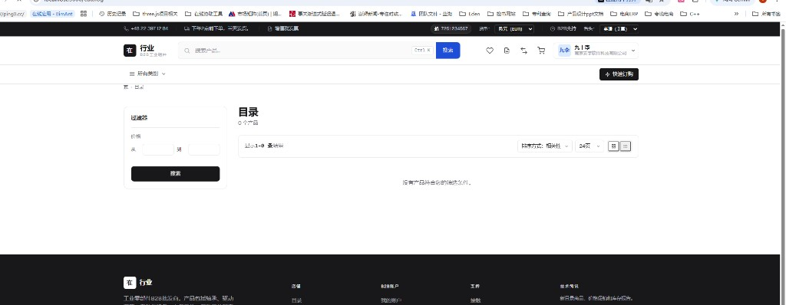

# 2026-10-30-chat2-计划白话五问澄清 会话沟通记录

用途：归档对 A～E 长期计划的白话澄清（是否对标一附、A/B/C/D/E 各做什么）。
范围：计划五问（原 chat2 首轮）+ 后续三轮澄清（A/B疑问与大B小b角色、销售渠道≠供货商、小b目录0产品）；不含 chat1。
本文件夹同时存放提问截图：fig1～figN。

---

## chat ask

时间：2026-10-30 00:01

OK 我已经把你本次沟通ask 和reps 手工记录到：[2026-10-30-chat1-Endora-架构改造任务.md](../2026-10-30-chat1-Endora-架构改造任务/2026-10-30-chat1-Endora-架构改造任务.md) 文件中，用于后面长期沟通，我们沟通定位依据。

你回答 中：
1：[2026-10-30-chat1-Endora-架构改造任务.md](../2026-10-30-chat1-Endora-架构改造任务/2026-10-30-chat1-Endora-架构改造任务.md):59-93  这是一个长期总体任务计划？
     是对标或基于这个： [PRO.md](../../pro_doc/PRO.md):102-162 内容来设计？

2： [2026-10-30-chat1-Endora-架构改造任务.md](../2026-10-30-chat1-Endora-架构改造任务/2026-10-30-chat1-Endora-架构改造任务.md):63-75 批次A B 是做说明内容，请说下目的，你现在描述的 太系统化，不是人能看懂普通说法。
  
3： [2026-10-30-chat1-Endora-架构改造任务.md](../2026-10-30-chat1-Endora-架构改造任务/2026-10-30-chat1-Endora-架构改造任务.md):76-80 这个是要做什么目的，起到什么作用，在改造代码前后 起到什么目的？

4： [2026-10-30-chat1-Endora-架构改造任务.md](../2026-10-30-chat1-Endora-架构改造任务/2026-10-30-chat1-Endora-架构改造任务.md):82-86 这个 D是不是才是实际代码改造，改造的内容是对标： [PRO.md](../../pro_doc/PRO.md):115-134 这个清单？

5： [2026-10-30-chat1-Endora-架构改造任务.md](../2026-10-30-chat1-Endora-架构改造任务/2026-10-30-chat1-Endora-架构改造任务.md):87-90 是测试演示意思？

---

## chat rep

时间：2026-10-30 00:07

按你的 5 个问题，用白话说明如下。

## 1）A～E 是不是长期总计划？是不是对标一附（PRO 102–162）？

**是，长期总路线图**（从「能跑的 Endora」做到「能试运营的 Mobii 竞价」）。

**主要依据就是「一附」+ §四门禁 + §六阶段**，不是另起一套：

- 一附：改哪些模块、MVP 做/不做  
- §四：状态机、门禁必须守住  
- §六：P0→P5 怎么排期  

A～E 只是把这些拆成「先干什么、后干什么」的顺序。

---

## 2）批次 A、B 是干什么的？（说人话）

### 批次 A — 开工前把「怎么开店」说死

目的：避免团队各干各的。

例如：店面用哪个销售渠道（`default` 还是演示用的 `pl_default`）、要不要单独叫 `mobii` 的部署壳、验收时对照哪张清单。

**几乎不写业务功能**，就是把环境/约定钉住，少踩你之前渠道配错那种坑。

### 批次 B — 先写成「施工说明书」，再动大工程

目的：把「竞价活动长什么样、单据怎么流转、谁能点通过、和订单怎么接」写成仓库认可的规格（spec / plan / tasks）。

**还不是改产品功能代码**，是防止一上来就改，改到一半和 RFQ/购物车缠在一起、和一附对不上。

人话：**A = 把规矩说清；B = 把图纸画清。**

---

## 3）批次 C（P1 底座）目的是什么？在写竞价代码前后起什么作用？

**在真正做「竞价活动」之前，先把舞台搭好。**

要做的大致是：

- 大B 里有运营 / 销售 / 售后角色（不然没人审单、没人发货）  
- 客户公司能挂对接人  
- 货品和说明文档能按高端货方式挂好；购物车主路径弱化一点，别抢戏  

**作用：**

| 时机 | 作用 |
| --- | --- |
| 写竞价代码**前** | 人、货、权限先就位，竞价单才有人审、有货可挂 |
| 写竞价代码**时** | 竞价模块直接用这些角色/组织/商品，不用边做竞价边补底座 |
| 写完之后 | 仍长期有用（不只为竞价），是运营日常底座 |

人话：**C = 先配好「谁登录、谁负责客户、货在哪」；D = 再做「发竞价、交意向单」。**

---

## 4）批次 D 是不是才开始真改代码？是不是对标模块清单 115–134？

**大体对：D 才是「竞价主功能」真正落地的阶段。**

但更准确是：

- **C** 也会改一点代码（角色、对接人、配置）——偏底座  
- **D** 才是清单里最重的那几项：  
  - **新建** `bidding`  
  - **新建 UI**（大B 竞价台、小b 活动/意向）  
  - 活动、回执、签核主链路  

对标一附 B 表时：

| 清单 | 主要落在 |
| --- | --- |
| 复用 org/catalog/… | 已有；C/D 接着用 |
| 扩展 roles / organizations | **偏 C** |
| **新建 bidding + 竞价 UI** | **正是 D** |
| 扩展 payments/orders/shipments 门禁 | **偏 E**（也可在 D 末尾薄接一点） |

人话：**D = 按清单把「竞价模块」做出来；不是整张表只在 D 一次做完。**

---

## 5）批次 E 是不是「测试演示」？

**不只是演示，更是「钱和货能对上、能追责」的收尾 + 验收。**

包括：预付确认、交易编号串起来、没付钱不能发货、落选/取消要释放库存，以及按 §6.2 跑通一整条（含异常）。

可以拿来给老板/客户看演示，但本质是 **履约门禁 + 验收**，不是可有可无的彩排。

人话：**D 让「能竞价」；E 让「竞完能安全交货、出事能查人」。**

---

## 一张总图（对应你的问题）

```text
A 说清规矩（渠道/部署）
B 写清图纸（规格，少返工）
C 搭好舞台（角色/客户/货）     ← 少量代码，改造「前半」
D 做竞价本体（bidding+两端 UI） ← 对标清单里的「新建」主战场
E 锁钱货门禁 + 整链验收       ← 对标扩展履约 + 可试运营
```

若这样理解没问题，下一步仍建议：**先做 A（很短）+ B（规格）**，再进 C/D。你回复「同意」后，我再按 do-task 把当前批次拆成可勾选的子任务编号。

---

## chat ask

时间：2026-10-30 00:20

OK，在进行A B任务之前，我需要在咨询下，A B任务中疑问点：
1：A 中提到：店面用哪个销售渠道（default 还是演示用的 pl_default）、要不要单独叫 mobii 的部署壳、验收时对照哪张清单。
  是不是要用一个小b 商户来发布H200 gpu 产品?  让其他小b 商户来采购 或 用竞价采购？
 我原本想：本Endora 项目架构，是B2B or B2C 模式，是由大B 运营方，发布产品，让所有注册小b 采购，或改造后 竞价采购？
    目前Endora 平台有默认销售渠道，是做什么的？是属于大B，还是小b层级。

 我目前在系统启动时，用了2个角色：
  大B：pnpm --filter backend run admin:create -- --email=463668442@qq.com --password='111111aaaaaa' --first-name=Ada --last-name=Lovelace
  也就是：463668442@qq.com  
  登录了：http://localhost:3002/  入口

  小b：我用jiushiecho@gmail.com 入住了，用的时：http://localhost:3000 登录入口。
  
  我的理解：3002 入口，大B账户登录后，此用户登录此平台，后可以做是管理小b，发布产品，管理订单能力。
 小b平台：3000入口，小b账户登录后，或不注册登录，小b是展示大B账户发布产品，小b商户可以注册，登录后，购买产品，或改造后竞价模式获取产品。

 我的理解对？ 以及你回答我上面提到几个问题？

2：你回答：@chatlog/2026-10-30-chat2-计划白话五问澄清/2026-10-30-chat2-计划白话五问澄清.md:59-67 
 是设计 我们改造目标架构中，最复杂的竞价流程，以文档的方式体现出来的意思？

---

## chat rep

时间：2026-10-30 00:25

先直接答你的角色理解，再说明销售渠道和批次 B 是干什么的。

## 1）你的理解：大体正确，补两点关键差别

### 谁卖、谁买（对标 Mobii）

| 端 | 地址 | 你的账号 | 正确理解 |
| --- | --- | --- | --- |
| **大B** | http://localhost:3002 | `463668442@qq.com`（admin） | **你们公司（运营方）**：管客户、上架/维护货品、订单履约；改造后还要 **发布竞价活动、审意向单、确认预付、放行发货** |
| **小b** | http://localhost:3000 | `jiushi…@gmail.com`（组织客户） | **采购方大客户**：看货、下单；改造后是 **参与竞价、交意向单、看结果**——**不是**「小b 商户互相卖货」 |

所以：

- **不是**「一个小b 发布 H200，其他小b 来买/竞价」。  
- **是**：**大B（你们）发布产品 / 发布竞价**；**多个小b（注册客户公司）** 来采购或竞价获取。  
- Endora 本身支持 B2B（组织）+ 也可 B2C 味的个人组织；你的 Mobii 场景按 **B2B：平台卖方 + 多客户买方** 来用即可。

未登录逛店面、登录后购买——和现在电商店面一致；竞价能力是改造后加在小b 上的。

---

### 「销售渠道」是什么？属于大B 还是小b？

**既不是「某一个小b 账号」，也不是「大B 管理员本人」。**

人话：销售渠道 = **这一套店面/价目/内容用哪条「生意线」**（例如官网店、某个区域店）。  

- 由 **平台（大B 侧）配置**，存在 `sales_channels` 里。  
- 小b 打开 3000 时，系统按配置（如 `NEXT_PUBLIC_SALES_CHANNEL_CODE=default`）走 **某一条渠道** 看商品和内容。  
- 你踩过的坑：`pl_default` 是演示/另一套渠道码；空库默认往往是 **`default`**。A 任务里「钉死用哪个」就是避免店面指错渠道。

**和「谁登录」无关**：不是「渠道=大B用户」或「渠道=小b用户」。

---

### 「mobii 部署壳」又是啥？

可选：给这次客户定制留一个叫 `mobii` 的 **overlay 文件夹**（按部署扩展，不改死核心）。  
**不是**再做一个小b，也不是销售渠道。A 里只是决定「现在建不建这个壳」，可以后期再建。

---

### 「验收对照哪张清单」

指改造做到某一阶段时，对照 PRO 里的门禁/MVP（§四、一附、§6.2），不是销售渠道本身。

---

## 2）批次 B 是不是「把最复杂的竞价流程写成文档」？

**对，就是这个意思。**

在大改代码前，用仓库认的规格（spec / plan / tasks）写清：

- 竞价活动、意向单怎么流转  
- 谁能点通过  
- 怎么接到订单/付款/发货  
- 明确 **不做** 实时拍卖、不做小程序等  

**还不是写功能代码**；是把改造目标里最绕的竞价流程先画成「施工图」，避免和购物车/RFQ 缠死。

---

**一句话对齐你的模型：**  
3002 = 你们运营（发货品、发竞价、审单）；3000 = 客户公司（买或竞价）；销售渠道 = 店面用哪条生意线（平台配置）；B = 先把竞价流程写成规格文档。

若以上无误，再说「同意」我们再开 A/B 任务拆解。

---

## chat ask

时间：2026-10-30 00:29

好的，你回答分析的非常细。

但是我复述我的理解：
销售渠道 是不是类似，大B中，管理了一个渠道，他是和产品有关联，大B平台管理了某个渠道，某些产品时这些渠道提供货源？
如：售卖H200 GPU卡，我可以在大B渠道中，创建一个Mobii 渠道供货商意思？还是说H200 实际生产，或供货商时英伟达，我应该在大B平台上建英伟达 为 销售渠道？
 还是用Mobii 公司（实际就是我自己公司，大B超级管理员，我自己部署系统）？

请在问答我这个问题。

---

## chat rep

时间：2026-10-30 00:32

你的复述里，把「销售渠道」理解成了「供货商 / 品牌厂商」——**这和 Endora 里的含义不一样。**

## 销售渠道 ≠ 供货商

| 概念 | 是什么 | 例子 |
| --- | --- | --- |
| **销售渠道（Sales Channel）** | 你们 **对外卖货的一条店面/生意线**（哪个网站、哪套价、哪套内容、哪种语言货币） | 「官网店」「华东站」「演示店 `pl_default`」 |
| **供货商 / 厂商** | 货从谁家来（生产或上游） | **英伟达**造 H200；你们 Mobii 从代理商进货 |
| **大B（你们公司）** | 部署并运营这套系统的卖方 | Mobii / 你自己的公司 |

所以：

- **不要**建「英伟达 = 销售渠道」——英伟达是厂商/上游，不是渠道。  
- **不要**把销售渠道理解成「某个小b 供货商入驻开店」。  
- **默认渠道 `default`**：就是本实例当前这条店面线；3000 店面挂在它上面看商品。

H200 在系统里通常是：**你们（大B）在目录里建商品「H200」**，并挂到某个/某些 **销售渠道** 上架；小b 在对应店面看到并购买或以后竞价。  
「货从英伟达来」若要管，是进销存/供应商/ERP 另一类信息，**不是**销售渠道这个字段。

---

## 直接回答你的三种建法

| 你的想法 | 对不对 |
| --- | --- |
| 建一个叫「Mobii」的渠道 = 供货商？ | **不对。** 渠道不是供货商；Mobii 是运营方本身。 |
| 建「英伟达」为销售渠道？ | **不对。** 英伟达不是渠道。 |
| 用 Mobii 公司（你自己部署、大B 超管）？ | **对。** 你就是卖方平台方；用现成 **`default`（或你们命名的一条店面渠道）** 卖/发竞价即可。 |

MVP 建议：**先继续用 `default` 一条渠道**，别为「供货商」去新建渠道。若以后有「官网 + 另一个独立站」两套店，再开第二条销售渠道。

---

**一句话：**  
销售渠道 = **你们开给客户看的那家「店」**；不是英伟达，也不是某个小b 供应商。H200 由 **你们大B** 上架到这条店（渠道）上，小b 来买或竞价。

---

## chat ask

时间：2026-10-30 00:34

OK ，理解了。
但是我小b 目前看，没有任何产品？见图1，是不是大B端未上架任何产品，或者说“默认渠道 default” 还未上架商品？

- **图1** 小b 目录页显示 0 个产品



---

## chat rep

时间：2026-10-30 00:35

**对，就是这个原因。**

你现在是干净库（`setup` 后没灌演示数据），大B **还没建/上架任何商品**，所以小b 目录显示 **「0 个产品」** 完全正常，一般不是登录坏了。

常见两种情况（你现在多半是第一种）：

1. **库里根本没有商品** → 要在大B（http://localhost:3002）里建商品并上架到当前店面用的渠道（你这边是 **`default`**）。  
2. 有商品但 **没挂到 `default` 渠道** / 未发布 → 小b 也看不到。

和「销售渠道是不是供货商」无关；只是 **这条店（default）上还没有可卖的货**。

---

**你可以：**

- 在 **3002** 用管理员建一个测试商品并发布到 default；或  
- 可选：`pnpm --filter backend run cli demo seed` 灌演示商品（会带演示数据/账号，按需再用）。

先在大B 随便上架一件测货，刷新 http://localhost:3000/catalog ，有货就说明链路通了。
