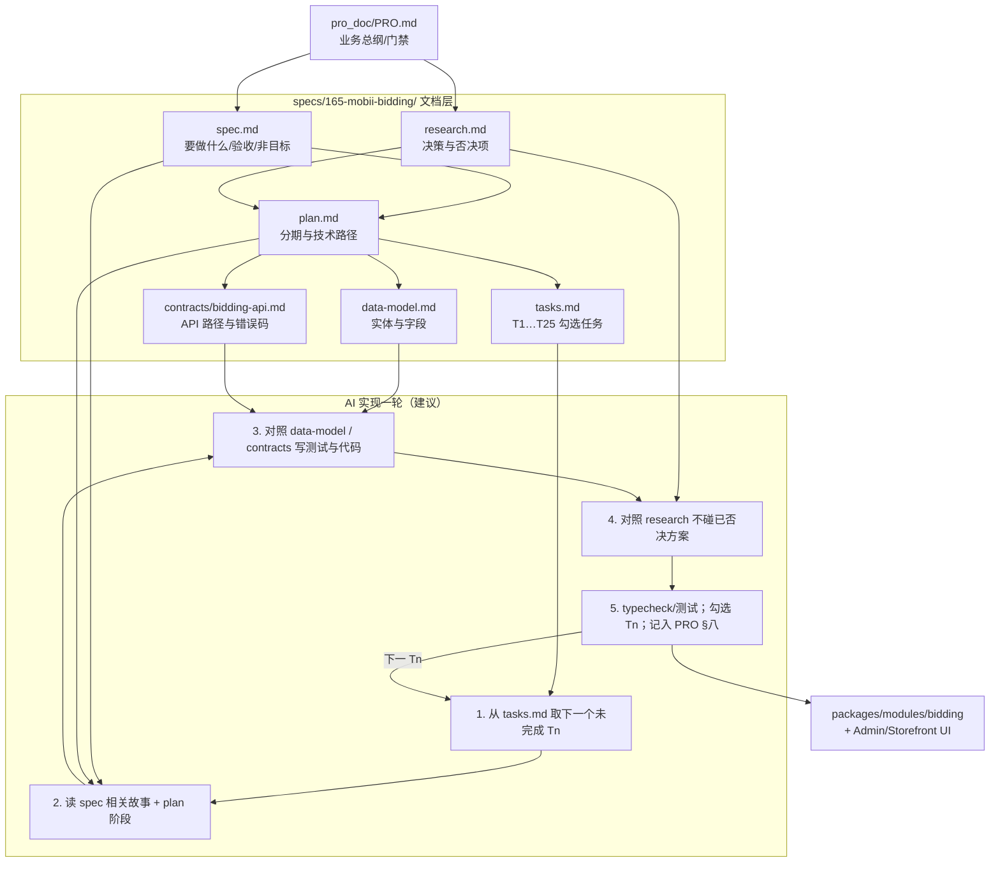

# 2026-10-30-chat3-165规格与AI协作流程 会话沟通记录

用途：归档「specs/165-mobii-bidding 各 md 在 AI 编程中的作用与流程」问答。
范围：最近一轮 ask + 对应 rep。
本文件夹同时存放提问截图：fig1～figN。

---

## chat ask

时间：2026-10-30 02:22

这里 [specs/165-mobii-bidding](../../specs/165-mobii-bidding) 文件夹中，这么多md文档，每个文档是说明功能，是ai编程时参考文档？如果是，这个几个文档 和ai配合时，参与ai编程实现功能时，他们在过程中，起到说明作用，分别是什么流程来参与。
你可以用一个流程图，来描述表达，目前这个文件夹下所有文件，在ai编程实现目标功能的流程。

---

## chat rep

时间：2026-10-30 02:23

是的：`specs/165-mobii-bidding/` 主要是 **给人 + AI 共用的施工说明书**，不是运行时代码。实现竞价功能时，AI 应按这些文档对齐范围、模型和任务，而不是凭空改。

## 各文件分别干什么

| 文件 | 作用（白话） | AI 编程时怎么用 |
| --- | --- | --- |
| `spec.md` | **要做什么 / 不做什么**（故事、门禁、验收） | 改代码前先对齐：用户故事、FR、非目标；防做成 RFQ/拍卖 |
| `research.md` | **为什么这么定**（否决了哪些方案） | 避免 AI 又提议「改 RFQ」「先建 overlay」等已否决项 |
| `plan.md` | **分几期、技术怎么落** | 决定先 C 还是 D、用 Command Bus、模块放哪 |
| `data-model.md` | **表/字段长什么样** | 写实体、迁移、状态字段时对照 |
| `contracts/bidding-api.md` | **HTTP 接口草稿** | 写路由/Zod 契约、前后端对齐路径与错误码 |
| `tasks.md` | **可勾选任务清单** | 一次只做 T1/T10…；做完勾选；TDD 顺序 |

配合仓库 **speckit 流程**：`specify → plan → tasks → implement`（你们批次 B 已做前三步的文档；C 起才是 implement）。

---

## 流程图：这些文档如何参与 AI 实现

---

## 人话版流程（和 AI 配合时）

1. **先定目标**：你/AI 打开 `spec.md` ——「这次允许做什么」。  
2. **查禁忌**：扫一眼 `research.md` ——「别再改 RFQ / 别强行 overlay」。  
3. **定本批落点**：看 `plan.md` —— 现在是 C 底座还是 D 竞价。  
4. **领任务**：从 `tasks.md` 拿一个 `Tn`（不要一次做完全部）。  
5. **写代码**：实体跟 `data-model.md`，接口跟 `contracts/…`；测试对准 `spec` 验收场景。  
6. **做完勾选**，在 `PRO.md` §八对应批次记一笔。

**一句话：**  
`spec` = 对不对；`research` = 别走歪；`plan` = 分几步；`data-model`+`contracts` = 长什么样；`tasks` = 今天干哪一件。AI 实现时按 **任务驱动 + 其它文档约束**，而不是只丢一句「做竞价」。
