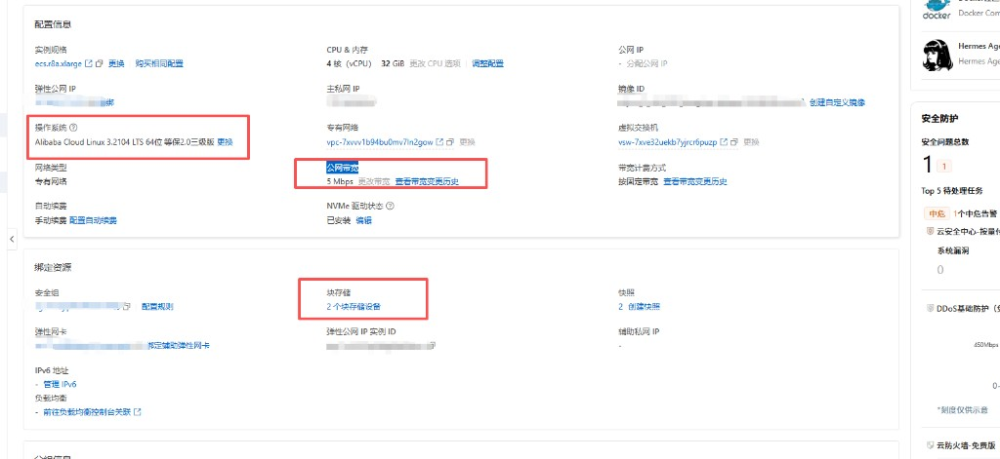
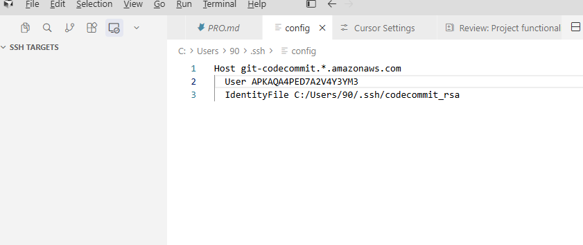
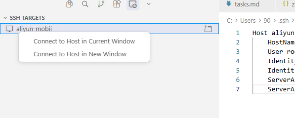
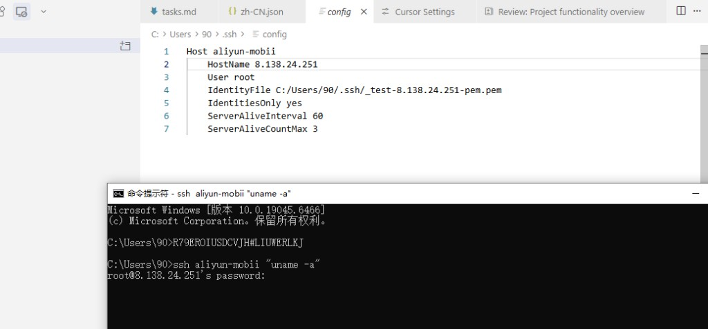
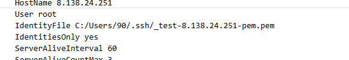
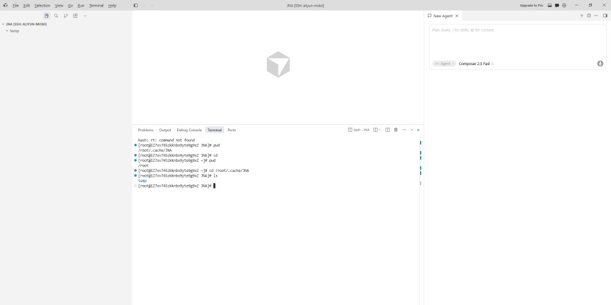
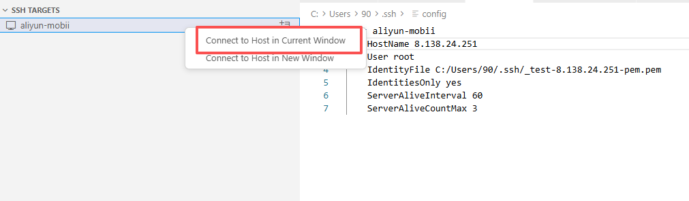

# 2026-11-05-chat2-阿里云ECS生产部署 会话沟通记录

用途：归档「Mobii-by-Endora 当前代码上阿里云 ECS 生产部署」相关 ask/rep（含 Docker 形态确认、资源评估、SSH/Remote-SSH、安装任务清单），便于按步骤操作对照。
范围：本窗口自「用现版本做项目生成部署、分配域名」起至「请给安装步骤任务清单」及本轮 chat-log 归档指令；不含同日更早的 git commit 日期改写。
本文件夹同时存放提问截图：fig1～fig7。

---

## chat ask

时间：2026-11-05 18:00

OK ，我想用现在版本 做项目生成部署，分配域名。
我有一台阿里云 服务配置如下：
* 操作系统：Alibaba Cloud Linux 3.2104 LTS 64位 
 * 硬件配置：4 核（vCPU）32 GiB
具体配置，见图1.红框是主要配置。

我现在需要怎么把目前项目 发布到这台阿里云服务，以生产的方式部署。

- **图1** 阿里云 ECS 实例配置（红框：OS、公网带宽 5Mbps、块存储 2）


---

## chat rep

时间：2026-11-05 18:05

可以。按仓库官方 **单机 VPS 生产部署**（`deploy/README.md`）来，你这台阿里云规格足够（文档建议 ≥4GB，你是 32GB）。先复述方案，确认后再写操作清单或协助逐步落地。

## 需求理解

把**当前仓库版本**以**生产形态**部署到这台阿里云 ECS，并完成域名接入（HTTPS）。机器要点：

| 项 | 你的配置 | 与官方要求对照 |
|---|---|---|
| CPU/内存 | 4 核 / 32 GiB | 充裕（运行态够用） |
| 系统 | Alibaba Cloud Linux 3 | 可用 Docker + nginx |
| 公网带宽 | **5 Mbps 固定** | 能跑业务；大流量图片/下载会偏紧 |
| 块存储 | 2 块盘 | 建议系统盘 + 数据盘挂 `/opt` 或 Docker 数据目录 |
| 拓扑 | 单机全家桶 | 与 `deploy/compose.prod.yml` 一致 |

## 官方生产拓扑（本仓库已定）

```
Internet → 主机 nginx(:80/:443, Let's Encrypt)
  ├─ 店面域名      → 127.0.0.1:3000  storefront
  ├─ admin.域名    → 127.0.0.1:8080  admin
  └─ api.域名      → 127.0.0.1:3001  backend(+workers)
         └─ postgres / redis / meilisearch（同机 Docker volume）
```

CI **不会**自动部署到你的机器（D-274）；需要：本机构建/推镜像 → ECS 上 `docker compose pull && up`。

## 建议分阶段（确认后按此执行）

1. **域名与 DNS** — 准备 3 个域名（或子域），A 记录指到 ECS 公网 IP  
   例：`www.xxx.com` / `admin.xxx.com` / `api.xxx.com`
2. **ECS 装机** — Docker Engine + Compose、nginx、certbot；数据盘挂载；安全组放行 80/443（22 仅你的 IP）
3. **镜像仓库** — 选一处推镜像（阿里云 ACR / GitHub GHCR / GitLab Registry），ECS `docker login`
4. **按域名构建三镜像** — storefront/admin 的公网域名在 **build 时写入**，改域名必须重建
5. **VPS 部署目录** — `/opt/b2b`：`.env`（由 `deploy/.env.prod.example` 填全密钥）+ `compose.prod.yml`
6. **nginx + HTTPS** — 按 `deploy/nginx.example.conf` 反代到本机端口，certbot 签证书
7. **首次启动** — `pull` → `up`（自动 migrate + `module:install --all`）→ 创建管理员
8. **生产清单** — 走完 `docs/docs/deployment/first-deployment-checklist.md`（SMTP、密钥、渠道码、备份等）

## 需要你先拍板的几件事

1. **三个域名**分别是什么？（已有域名？还是要新买？在阿里云 DNS 吗？）  
2. **镜像仓库**打算用哪家？（推荐阿里云 ACR，同区拉取更快）  
3. 本次是 **Mobii/竞价批采** 生产，还是先通用 Endora 空库上线？  
4. 你是否已有 **SSH 登录** 这台 ECS 的权限？公网 IP 能否发给我（可打码后三位）？  
5. 期望我这边下一步是：  
   - **A)** 只出一份中文逐步操作手册（放 `pro_doc/` 或 `doc/`），你自己在服务器执行；还是  
   - **B)** 你开着 SSH/屏幕共享，我按步骤远程指挥一条条执行？

请回复 **「正确」/「同意」**，并尽量补上上面 1～5 的答案；确认后我再按 do-task 拆子任务并开始产出/协助部署。

---

## chat ask

时间：2026-11-05 19:00

在回答你问题之前，我想咨询下：
1：目前本地开发 是使用docker +wsl 环境启动的。
  如果我在阿里云服务器Alibaba Cloud Linux 3 上，也可以用docker 方式实现生产部署？
这样我Alibaba Cloud Linux 3 服务器配置和 docker里面配置互相不冲突，不影响不是更好？

---

## chat rep

时间：2026-11-05 19:01

可以，而且这正是本仓库推荐的生产方式。

## 结论

在 **Alibaba Cloud Linux 3** 上用 **Docker Compose 做生产部署**完全可行，也是官方路径：`deploy/compose.prod.yml` + 主机上的 nginx（只做 HTTPS 反代）。

你的直觉对：**业务进程尽量进容器，主机只装“必要外层”**，互相不抢配置、互不影响。

## 本地 vs 生产（都是 Docker，角色不同）

| | 本地（WSL + Docker） | 生产（阿里云 Linux 3 + Docker） |
|---|---|---|
| 常用文件 | 根目录 `docker-compose.yml` | `deploy/compose.prod.yml` |
| 容器里通常有什么 | 多半是 Postgres / Redis / Meilisearch（应用常 `pnpm` 跑） | **全家桶**：backend + admin + storefront + 上述中间件 |
| 对外暴露 | 开发端口，方便调试 | 应用只绑 `127.0.0.1`，**外网只走主机 nginx :80/:443** |
| 配置隔离 | 开发 `.env` | `/opt/b2b/.env`（生产密钥，不进 git） |

两边都用 Docker，**不是把本地 compose 原样搬上云**，而是换生产那一套文件与密钥。

## “主机配置”和“容器配置”怎么分工才不冲突

建议这样切：

**主机（Alibaba Cloud Linux 3）只负责：**
- Docker Engine + Compose 插件  
- nginx + certbot（域名、证书、反代到本机端口）  
- 防火墙/安全组、磁盘挂载、备份 cron、SSH  

**Docker 容器负责：**
- Node 应用、Postgres、Redis、Meilisearch  
- 应用环境变量、数据 volume  

这样不会出现「主机装了一套 Node/Postgres，容器里又装一套」互相抢端口、抢版本的问题。

主机上**不必**再装 Node、pnpm、Postgres 来跑业务——那些都在镜像里。

## 和你机器的匹配度

- 4 核 / 32G：单机 Docker 全家桶很宽裕（文档建议运行态大约 ≥4G，8G 更舒服）。  
- 5 Mbps：带宽在主机出口，和“用不用 Docker”无关；大文件/多图时仍是瓶颈。  
- 2 块云盘：数据盘挂给 Docker 数据目录（或 `/opt/b2b` + volume），比全挤在系统盘更稳。

## 一句话

**可以、也应该用 Docker 做生产**；Alibaba Cloud Linux 3 只当“薄宿主机”，业务与中间件都在容器里，配置面分离，这比在主机上直接装一堆运行时更干净。

你确认这个方向后，再回答之前那几个问题（域名、镜像仓库、Mobii 还是通用、SSH、要手册还是逐步指挥）即可继续。

---

## chat ask

时间：2026-11-05 19:03

OK ，目前我生产服务器Alibaba Cloud Linux 3 ，cpu使用才0.3%，内存还剩12G，这样环境够？
如果够，我选哟怎么操作，按什么步骤，在阿里云Alibaba Cloud Linux 3服务器上进行部署 本项目（Mobii_Bidding_Platform_by_Endora 这样架构，也是就是目前最新代码，且把目前测试环境库中数据，也同步部署到生产环境）

---

## chat rep

时间：2026-11-05 19:04

## 1. 环境够不够？

**够用。** 按本仓库单机生产栈（backend + admin + storefront + Postgres + Redis + Meilisearch）：

| 资源 | 你的情况 | 判断 |
|---|---|---|
| CPU | 当前约 0.3% | 空闲充足；竞价峰值也够 4 核扛 |
| 内存 | 还剩约 **12G** | 运行态建议 ≥4G、舒适约 8G → **够** |
| 磁盘 | 2 块云盘 | 建议数据盘给 Docker volume / 备份 |
| 带宽 | **5 Mbps** | 能上线；大图/多并发下载会先顶满带宽，不是 CPU/内存 |

注意：若机器上还有别的服务已占约 20G，部署前在 ECS 上看一下 `free -h` / `docker stats`，给本项目至少再留 **8G 可用**更稳。

---

## 2. 生产怎么部署（Alibaba Cloud Linux 3 + Docker）

目标：主机只跑 Docker + nginx；业务全在容器里；代码 = 你现在的 Mobii-by-Endora 最新版。

### 阶段 A — 你先准备好（缺一不可）

1. **三个域名**（DNS A 记录指到 ECS 公网 IP）  
   - 小 b：`xxx.com`（或 `www`）  
   - 大 B：`admin.xxx.com`  
   - API：`api.xxx.com`
2. **镜像仓库**（建议阿里云 ACR 同地域）——用来推/拉三张镜像  
3. **SSH** 能登录 ECS；安全组放行 **80/443**（22 建议仅你的 IP）  
4. 明确「测试库」是哪一个：本地 Docker Postgres？还是另一台测试机？

### 阶段 B — ECS 装机（做一次）

```text
1. 安装 Docker Engine + Compose 插件
2. 安装 nginx + certbot（或阿里云等价证书方案）
3. 数据盘挂载（如 /data），Docker 数据根或 /opt/b2b 放数据盘
4. sudo mkdir -p /opt/b2b && 属主给你的部署用户
5. 复制 deploy/.env.prod.example → /opt/b2b/.env，填域名/仓库/全新密钥
6. 复制 deploy/compose.prod.yml、按模板改 nginx 反代到 127.0.0.1:3000/8080/3001
7. docker login <你的 ACR>
```

密钥用 `openssl rand …` **按生产新生成**（见 `.env.prod.example` 注释），不要照搬本地开发 `.env`。

### 阶段 C — 用当前代码构建并推镜像（在 CI 或你本机）

```text
1. 检出当前最新代码（含 Mobii 竞价等改动）
2. 用生产域名做 build-arg 构建三镜像：
   - backend、admin、storefront
   （店面/Admin 的公网域名是 build 时写死的，域名错了要重建）
3. 打 tag（建议用 git commit SHA）推到 ACR
```

仓库官方：CI 只负责证明能 build，**不会自动部署到你的阿里云**（要你在 ECS 上拉起来）。

### 阶段 D — ECS 首次启动

```bash
cd /opt/b2b
export IMAGE_TAG=<这次的sha>
docker compose --env-file .env -f compose.prod.yml pull
docker compose --env-file .env -f compose.prod.yml up -d
# 会先 migrate，再 module:install --all，然后起 API
```

然后 nginx + certbot 签证书，浏览器验证三个域名。

### 阶段 E — 业务侧（栈起来之后）

走 `docs/docs/deployment/first-deployment-checklist.md`：SMTP、渠道码、模块开关、管理员账号、备份 cron 等。  
Mobii：按需关掉购物车主路径无关模块（见 `pro_doc/mobii-foundation-conventions.md`）。

---

## 3. 「测试库数据同步到生产」——可以，但不要当默认一步

官方默认：**生产空库起步**（不跑 demo seed）。你要「测试数据一并上去」，改为 **dump/restore**，建议顺序：

```text
1. 生产栈先能空库正常启动（证明镜像/域名/密钥 OK）
2. 在测试库做 pg_dump（停写或短维护窗更稳）
3. 生产 compose 停 backend（避免写库）
4. 对生产 Postgres 做 restore（或新 volume 再 restore）
5. 再 up；必要时跑 migrate（若测试库版本 = 当前代码，通常已对齐）
6. Meilisearch：一般要重建索引（搜不到商品时优先查这个）
7. 上传的图片/附件：若在本地磁盘或对象存储，要一并拷到生产对应位置
```

**必须注意：**

| 点 | 说明 |
|---|---|
| 加密密钥 | 若测试库里有「已加密的密钥类设置」，生产 `SETTINGS_SECRET_ENCRYPTION_KEY` / `MFA_…` 必须与加密时一致，否则读不出来 |
| 支付/SMTP | 测试网关、假邮箱进生产会出事，restore 后要改回生产配置 |
| 域名/回调 | `API_DOMAIN`、支付回调 URL 必须是生产域名 |
| 不要用 `demo seed` | 那是演示灌数，带清表风险，**不适合当生产同步手段** |
| 合规 | 测试库若有真人/敏感数据，等同把测试数据当生产数据，需你确认可接受 |

更稳的做法往往是：**结构用 migrate；主数据用 Admin/导入；只把必要业务表选择性同步**，而不是整库一把梭。

---

## 4. 推荐你怎么选操作方式

| 方式 | 适合 |
|---|---|
| **先空库上线 → 再决定是否整库同步** | 第一次上阿里云，先验证 Docker/域名/证书 |
| **空库验证通过后再 pg_dump/restore** | 你明确要保留现有测试竞价/商品等数据 |

---

## 5. 你接下来只需回这几项（回完我可以按 do-task 拆成可勾选步骤清单，或写进 `pro_doc/`）

1. 三个域名分别是？  
2. 镜像用阿里云 ACR，还是别的？  
3. 「测试库」是本机 Docker 的库，还是已有测试服务器？大约多大？  
4. 同步策略选：**整库 restore** 还是 **先空库上线**？  
5. 要我产出：**中文逐步手册（你在 ECS 执行）**，还是 **你开 SSH 我逐步指挥**？

**简答你的两句：**  
- 资源：**够**（带宽比 CPU/内存更要盯）。  
- 操作：**Alibaba Cloud Linux 3 上 Docker 生产栈 + 主机 nginx**；最新代码打镜像推仓库；ECS `compose up`；测试数据用 **pg_dump/restore（慎用）**，不要用 demo seed。

---

## chat ask

时间：2026-11-05 19:09

[root@iZ7xv745zkknbx9yte9g9xZ ~]# free -h / docker stats
              total        used        free      shared  buff/cache   available
Mem:           15Gi       797Mi        11Gi        30Mi       2.3Gi        13Gi
Swap:          15Gi        61Mi        15Gi
[root@iZ7xv745zkknbx9yte9g9xZ ~]# 

这是目前的ecs 情况。

另外我看cursro开发工具，有一个ssh targets 组件，见图1，我是不是可以通过这个，连接到我的阿里云ecs，你是不是可以直接上去查看信息，这样协助部署，如果可以，这个config 怎么配置？

- **图1** Cursor SSH TARGETS 与 Windows `~\.ssh\config`（当时仅有 CodeCommit 段）


---

## chat rep

时间：2026-11-05 19:10

## ECS 内存

这台实际是 **15Gi**，可用约 **13Gi**，对单机 Docker 生产栈 **够用**（比文档建议的 8G 还宽裕）。之前控制台写的 32Gi 若对不上，以这台 `free -h` 为准即可。

---

## Cursor SSH Targets 能不能连阿里云？我能不能直接上去？

**可以连。** 在本机 `C:\Users\90\.ssh\config` 里加一段 ECS 的 `Host`，用 Remote-SSH 连上后，Cursor 会在 **ECS 上开远程窗口**。

**我能不能“直接上去”：**

| 方式 | 我能否在 ECS 上执行命令 |
|---|---|
| 你仍在本机这个仓库窗口聊天 | **不能**自动进 ECS；最多在你本机终端里 `ssh …`（需你已配好密钥且同意联网） |
| 你用 Remote-SSH **连上 ECS，并打开远程文件夹**（如 `/opt/b2b`），在那个窗口里跟我聊 | **可以**——那时工作区就是服务器，我能帮你装 Docker、改 nginx、起 compose |

所以：SSH Targets 是正确路径；要让我协助部署，请 **Remote-SSH 连上后再开对话**（或明确让我用本机 `ssh` 远程执行）。

---

## `config` 怎么写

在现有 CodeCommit 段 **下面追加**（不要删原来的），例如：

```sshconfig
Host aliyun-mobii
    HostName 你的ECS公网IP
    User root
    IdentityFile C:/Users/90/.ssh/aliyun_ecs.pem
    IdentitiesOnly yes
    ServerAliveInterval 60
    ServerAliveCountMax 3
```

说明：

1. **`HostName`**：阿里云控制台里的公网 IP（或已解析到该 IP 的域名）。  
2. **`User`**：常见是 `root`；若创建实例时选了普通用户则改成那个用户。  
3. **`IdentityFile`**：创建 ECS 时下载的 `.pem` / 私钥路径。若还没有：  
   - 控制台「绑定密钥对」或本机 `ssh-keygen`，把 **公钥** 写进 ECS 的 `~/.ssh/authorized_keys`。  
4. Windows 上私钥权限要严，否则 OpenSSH 可能拒用；`.pem` 建议只给当前用户读。  
5. 安全组放行 **22**（最好仅限你家/公司出口 IP）。

保存后：左侧 **SSH TARGETS** → 刷新 → 点 `aliyun-mobii` → Connect → 打开远程目录（建议先 `/root` 或之后的 `/opt/b2b`）。

连通自检（本机 PowerShell）：

```powershell
ssh aliyun-mobii "uname -a && free -h"
```

能回系统信息就说明配置对了。

---

## 建议你现在做的两步

1. 按上面补全 `HostName` + `IdentityFile`，用 `ssh aliyun-mobii` 先通。  
2. Cursor Remote-SSH 连上后告诉我（或在远程窗口继续问），我们再按步骤装 Docker / 部署 Mobii。

**不要把私钥内容或完整 `.pem` 贴到聊天里**；只需确认 Host 名、用户、是否已能登录。域名和镜像仓库仍可稍后定。

---

## chat ask

时间：2026-11-05 19:22

本机 WSL 终端摘录：

```text
eden@DESKTOP-NOVF1UH:~/github/endora-commerce$ ssh aliyun-mobii "uname -a && free -h"
Connection closed by 198.18.0.38 port 22
```

是不是配置ok了。
但是图1 ，没有看到：左侧 SSH TARGETS → 刷新 → 点 aliyun-mobii → Connect → 打开远程目录（建议先 /root 或之后的 /opt/b2b）。
的流程操作入口？

- **图1** 右键 `aliyun-mobii` 出现 Connect to Host in Current/New Window


---

## chat rep

时间：2026-11-05 19:23

## 1. 配置算不算 OK？

**Cursor 侧：Host 已识别。** 图里已有 `aliyun-mobii`，说明 `~/.ssh/config` 被读到了。

**连通性：还没 OK。** 终端里是：

```text
Connection closed by 198.18.0.38 port 22
```

这不是登录成功。`198.18.0.x` 多半是本机 **代理/Clash Fake-IP** 拦了 SSH，不是阿里云真实公网 IP。要先在本机（或关代理后）能：

```bash
ssh aliyun-mobii "uname -a"
```

看到 Linux 版本信息，才算通。

可先试：

1. `HostName` 填 ECS **真实公网 IP**（控制台复制），不要用会被代理污染的域名。  
2. 系统代理 / Clash 里对 SSH 或该 IP **直连（DIRECT）**，或先关代理再测。  
3. Windows PowerShell 再测一次（有时 WSL 走代理、Windows 不走）：  
   `ssh aliyun-mobii "uname -a"`

---

## 2. 「Connect」入口在哪？

Cursor **没有**单独写着 “Connect” 的大按钮。图1里你已经点到了：

- 右键 `aliyun-mobii` → **Connect to Host in New Window**（推荐）  
- 或 **Connect to Host in Current Window**  
- 或名称旁那个 **小文件夹 +** 图标（新窗口连接）

选其中一个即可。连上后左下角会变成类似 `SSH: aliyun-mobii`，再 **Open Folder** → `/root`。

注意：Remote-SSH 用的是 **Windows 上的** `C:\Users\90\.ssh\config`；你在 WSL 里测的是另一套环境。两边都要能通，或至少保证你点 Connect 的那一侧能通。

---

**小结：** UI 入口就是右键那两项；先把 `198.18.0.38` 这类假 IP/代理问题排除，SSH 真正通了再连远程协助部署。

---

## chat ask

时间：2026-11-05 19:27

这是我本地cmd 走指令，为什么提示密码，我不是通过图2 pem 方式登录？

- **图1** CMD 执行 `ssh aliyun-mobii` 后出现 `root@…'s password:`


- **图2** ssh config 中 `IdentityFile` 指向 `.pem`


---

## chat rep

时间：2026-11-05 19:28

出现 `password:` 说明：**已经连上这台 ECS，但密钥认证失败了**，OpenSSH 才退回问密码。`IdentityFile` 写了 PEM ≠ 一定用上了密钥。

## 常见原因（按概率）

1. **这台实例绑定的不是这把密钥**  
   控制台里实例的「密钥对」必须和 `_test-8.138.24.251-pem.pem` 是一对；换过机、换过密钥、或当时选的是密码登录，就会变成只认密码。

2. **本机读不到 / 拒绝使用该 PEM**  
   路径不对、文件名不一致，或 Windows 认为私钥权限太松，会跳过密钥再问密码。

3. **命令里的弯引号（次要）**  
   图里是 `“uname -a”`（中文弯引号），应改成直引号：
   ```bat
   ssh aliyun-mobii "uname -a"
   ```
   这通常不会单独导致要密码，但建议改掉。

`C:/Users/90/.ssh/...` 这种斜杠在 Windows OpenSSH 里一般没问题。

---

## 请先在本机 CMD 跑（看失败点）

```bat
ssh -v aliyun-mobii
```

在输出里找这几类行：

| 看到什么 | 含义 |
|---|---|
| `identity file ... type -1` / `No such file` | 路径错，没读到 PEM |
| `Permissions ... are too open` / `Ignoring ...` | 权限太松，密钥被忽略 |
| `Offering public key` → `Authentication refused` | 密钥读到了，但**服务器不认**（绑错钥或没写进 authorized_keys） |
| 直接 `password:` | 密钥阶段已失败 |

---

## 对应处理

**A. 修 Windows 私钥权限**

```bat
icacls C:\Users\90\.ssh\_test-8.138.24.251-pem.pem /inheritance:r
icacls C:\Users\90\.ssh\_test-8.138.24.251-pem.pem /grant:r "%USERNAME%:R"
```

再：

```bat
ssh -i C:\Users\90\.ssh\_test-8.138.24.251-pem.pem root@8.138.24.251
```

**B. 服务器侧不认这把钥**

- 阿里云控制台确认该实例绑定的密钥对 = 下载这把 PEM 时的那一对；或  
- 用控制台「重置实例密码」拿到 root 密码，先密码登录，再把公钥写入 `/root/.ssh/authorized_keys`；或  
- 用「发送远程命令 / 工作台 VNC」把公钥写进去。

**C. 临时用密码（仅应急）**

若你刚在控制台重置过 root 密码，提示 `password:` 时输入该密码可以进。Cursor Remote-SSH 更推荐修好密钥，少靠密码。

---

**结论：** 配置意图是对的（PEM 登录），但当前客户端**没用成这把钥**（或服务器不认）。把 `ssh -v` 里和 `Offering public key` / `Permissions` / `type -1` 相关的几行贴出来（可打码），我可以帮你对上是哪一种。不要粘贴 PEM 私钥内容。

---

## chat ask

时间：2026-11-05 19:33

OK  我已经用cursor 自己ssh targets 用密码的方式登录上阿里云ecs，但是他用新cursor窗口，如图1效果。
而不是目前cursor窗口。

为什么选中currencies窗口，他还是会弹出新cursro 窗口来连接ssh？

- **图1** Remote-SSH 新窗口（`SSH: aliyun-mobii`，打开远端目录）


- **图2** 右键菜单高亮 Connect to Host in Current Window


---

## chat rep

时间：2026-11-05 19:34

## 为什么还会弹出新窗口？

Remote-SSH 的本质是：**整个 Cursor 窗口变成“远端工作区”**，不能和本机 `endora-commerce` 文件夹在同一窗口里各占一半长期并存。

因此：

- **Connect to Host in New Window**：新开一个窗口专门连 ECS（你图1 就是这种）。
- **Connect to Host in Current Window**：应用**当前这个窗口**，把本机项目卸掉，改成只显示 ECS。

若你点了 Current Window 仍弹出新窗口，常见原因是：

1. 实际点到的是旁边的 **新窗口图标**，或菜单第二项 New Window。  
2. 当前窗口里有 **未保存文件 / Agent 会话 / 多根工作区**，Cursor 为保本机会话，改走新窗口。  
3. 本机窗口正在跑本地项目对话，产品更倾向 **另开远程窗**，避免冲掉本地聊天。

这不一定是 config 配错；SSH 已通（密码登录成功）说明连接没问题。

---

## 若坚持“当前窗口”连上

1. 先 **保存全部**，必要时 **File → Close Folder / Close Workspace**。  
2. `Ctrl+Shift+P` → 选 **`Remote-SSH: Connect to Host...`** → `aliyun-mobii`。  
3. 若仍问用哪个窗口，选 **当前窗口**。

连上后左下角应是 `SSH: aliyun-mobii`，资源管理器变成远端目录。

---

## 部署时更推荐怎么用

**就用新窗口连 ECS（图1）——这样更好：**

| 窗口 | 用途 |
|---|---|
| 原来的本机窗口 | 继续改 `endora-commerce` 代码 |
| `SSH: aliyun-mobii` 新窗口 | 在服务器上装 Docker、改 nginx、起 compose |

要我在 ECS 上协助部署，请到 **图1 那个远程窗口**里开 Agent 对话发指令；你现在这个本机聊天窗口里的我**看不到**那台 ECS。

**一句话：** 选 Current Window 仍弹新窗，多半是 Cursor 在保护本机工作区；对部署来说，新窗口是正常且推荐的用法。

---

## chat ask

时间：2026-11-05 19:38

OK 哪就用另外一个cursor终端 连接阿里云服务器。

当时目前项目 terminal 怎么用（WSL 里 `ssh aliyun-mobii` 出现 Connection closed by 198.18.0.38）连不上ssh？因为这是wsl 环境，
而本地cmd 目前是可以用密码连接上。虽然pem不行。

---

## chat rep

时间：2026-11-05 19:39

对，就是 **WSL 和 Windows CMD 不是同一套网络 / 同一套 SSH 配置**。

## 为什么 CMD 能连、WSL 连不上？

| | Windows CMD | 你现在的 WSL 终端 |
|---|---|---|
| 读的配置 | `C:\Users\90\.ssh\config` | 一般是 `/home/eden/.ssh/config`（经常没有或不同） |
| 实际连到的地址 | 真公网 `8.138.24.251` | 被代理劫持成 `198.18.0.38` |
| 结果 | 密码能登录 | `Connection closed by 198.18.0.38` |

`198.18.0.x` 典型是 **Clash / 同类代理的 Fake-IP**，WSL 流量进了代理隧道，SSH 被掐断；CMD 往往走系统直连，所以还能到阿里云。

`pem` 在 CMD 里不行、密码可以：只说明 **密钥认证失败、密码认证开着**；和 WSL 连不上是两件独立的事。

---

## WSL 里怎么修（任选一种）

### 办法 A（推荐）：WSL 直连真实 IP，并自备一份 config

在 **WSL** 里执行：

```bash
mkdir -p ~/.ssh && chmod 700 ~/.ssh

cat >> ~/.ssh/config << 'EOF'
Host aliyun-mobii
    HostName 8.138.24.251
    User root
    IdentitiesOnly yes
    ServerAliveInterval 60
    ServerAliveCountMax 3
EOF
chmod 600 ~/.ssh/config
```

临时关掉代理再测（按你本机代理变量名可能略有不同）：

```bash
unset http_proxy https_proxy HTTP_PROXY HTTPS_PROXY all_proxy ALL_PROXY
ssh -o ProxyCommand=none aliyun-mobii
```

若仍要密码，在 WSL 里输和 CMD 相同的 root 密码即可先通。

Clash 里也可把 `8.138.24.251` / `aliyun-mobii` 设为 **DIRECT**，并尽量对 WSL 关 Fake-IP。

### 办法 B：在 WSL 里直接调用 Windows 的 ssh.exe

这样用 Windows 那份 config（你已能密码登录的那套）：

```bash
ssh.exe aliyun-mobii
```

注意是 `ssh.exe`，不是 Linux 的 `ssh`。

### 办法 C（部署协助更省事）

继续用 **另一个 Cursor 窗口 Remote-SSH 连 ECS**；本机 WSL 终端只管写代码。不一定非要在这个项目终端里 SSH。

---

## 和「另一个 Cursor 连阿里云」的关系

- **远程 Cursor 窗口**：已经在 ECS 上，终端本身就是服务器，不需要再 `ssh aliyun-mobii`。  
- **本机项目 WSL 终端**：要 SSH 成功，必须先解决上面的 **代理 / 198.18** 问题。

**一句话：** CMD 通、WSL 不通，是因为 WSL 走了 Fake-IP 代理且未必读 Windows 的 ssh config；在 WSL 用真实 IP + 关代理，或改用 `ssh.exe` / Remote-SSH 窗口即可。

---

## chat ask

时间：2026-11-05 19:40

IdentityFile C:/Users/90/.ssh/_test-8.138.24.251-pem.pem
是不是 我要把这个pem 放到 wsl文件路径下，就可以？

---

## chat rep

时间：2026-11-05 19:41

**不完全是。** 把 PEM 放到 WSL 能访问的路径，只解决「Linux 的 `ssh` 能读到密钥」；**还解决不了**你之前的 `198.18.0.38` 代理问题，也解决不了「服务器不认这把钥、只认密码」。

## 路径怎么写

二选一即可：

**1. 复制进 WSL（更干净）**

```bash
cp /mnt/c/Users/90/.ssh/_test-8.138.24.251-pem.pem ~/.ssh/
chmod 600 ~/.ssh/_test-8.138.24.251-pem.pem
```

WSL 的 `~/.ssh/config` 里写：

```text
IdentityFile ~/.ssh/_test-8.138.24.251-pem.pem
```

**2. 不复制，直接指 Windows 盘**

```text
IdentityFile /mnt/c/Users/90/.ssh/_test-8.138.24.251-pem.pem
```

不要在 WSL 的 config 里写 `C:/Users/90/...`（那是给 Windows `ssh.exe` 用的）。

## 仍要注意

| 点 | 说明 |
|---|---|
| 代理 | WSL 仍要直连 `8.138.24.251`，否则还会被掐到 `198.18.x` |
| 密钥是否管用 | CMD 里这把 PEM 已经不行、只有密码能进 → 拷到 WSL **多半照样要密码**，除非先把公钥写进 ECS 的 `authorized_keys` |
| 权限 | WSL 里私钥必须是 `chmod 600` |

**结论：** 可以拷到 WSL 或用 `/mnt/c/...`；要 WSL 能连上，还要处理代理；要免密，还要让服务器真正接受这把钥（或继续用密码 / 用已连上的 Remote-SSH 窗口）。

---

## chat ask

时间：2026-11-05 19:42

办法 B：在 WSL 里直接调用 Windows 的 ssh.exe 我用这个方案进去了 

---

## chat rep

时间：2026-11-05 19:42

很好，说明 **网络和账号在 Windows 侧是通的**，WSL 里用 `ssh.exe` 是合理做法。

以后在这个项目终端里可以固定：

```bash
ssh.exe aliyun-mobii
```

需要免输入时可在 `~/.bashrc` 加一行：

```bash
alias ssh-aliyun='ssh.exe aliyun-mobii'
```

部署协助仍建议用 **另一个 Cursor 远程窗口**（已在 ECS 上）；本机 WSL 用 `ssh.exe` 做临时登录、传文件即可。接下来若要装 Docker / 起生产栈，在远程窗口里说一声就行。

---

## chat ask

时间：2026-11-05 19:43

本机已 SSH 进 ECS 后的终端摘录（top / free）：

```text
https://help.aliyun.com/document_detail/416274.html
Last failed login: Fri Nov  6 11:36:34 CST 2026 from 117.89.248.53 on ssh:notty
…
top - 11:43:27 up 601 days, 21:59,  3 users,  load average: 0.04, 0.06, 0.02
…
MiB Mem :  15453.4 total,  11295.3 free,   1290.1 used,   2868.0 buff/cache
MiB Swap:  16384.0 total,  16322.7 free,     61.2 used.  13804.1 avail Mem
…
```

你能看到 阿里云ecs的信息？

---

## chat rep

时间：2026-11-05 19:43

能看到——但仅限于你贴出来 / 终端里已经显示的那段内容。

从终端摘录可以读到例如：

- 主机已登录：`root@iZ7xv745zkknbx9yte9g9xZ`
- 内存约 **15Gi**，可用约 **13.8Gi**；CPU 几乎空闲（`99% id`）
- 负载很低：`0.04, 0.06, 0.02`
- 有进程：`AliYun+`、一个约占 **2.7%** 内存的 `node` 等

这是因为 **WSL 终端里已经用 `ssh.exe` 进了 ECS**，输出落在本机 Cursor 能读的终端文件里。

我**不能**在这台本机对话里自动在 ECS 上执行新命令；要持续在服务器上操作，仍需：

1. 你在已 SSH 的终端里自己敲命令，把结果发我；或  
2. 在 **Remote-SSH 那个 Cursor 窗口**里跟我聊（那边工作区就是 ECS）。

---

## chat ask

时间：2026-11-05 19:44

在 Remote-SSH 那个 Cursor 窗口里跟我聊（那边工作区就是 ECS）。
你目前的窗口 能知道 那边工作区就是 ECS 沟通的信息？

---

## chat rep

时间：2026-11-05 19:44

**不能。** 这是两个彼此独立的 Cursor 窗口：

| | 当前窗口（你现在跟我聊的） | Remote-SSH 窗口 |
|---|---|---|
| 工作区 | 本机 / WSL 的 `endora-commerce` | 阿里云 ECS 上的目录 |
| Agent 对话 | 只属于这边 | 只属于那边 |
| 我能否“看到那边” | **看不到** 那边的文件、终端、聊天 | 反之也看不到这边仓库（除非你拷过来） |

两边**不会自动同步**对话内容。要在 ECS 上让我协助部署，需要到 **Remote-SSH 那个窗口**新开（或继续）Agent，在那边发指令。

若只想在本窗口推进：你在 ECS 终端执行命令，把输出粘贴到这里，我可以根据文本帮你判断下一步——但这仍不是“我直接连着 ECS”。

---

## chat ask

时间：2026-11-05 19:44

OK 哪就这样先进行

---

## chat rep

时间：2026-11-05 19:45

好。就按这个分工先走：

1. **本窗口**：继续改 Mobii / `endora-commerce` 代码。  
2. **Remote-SSH 窗口**：在 ECS 上部署；在那边开 Agent，先发一句例如：「按 Endora `deploy/` 单机生产栈，准备装 Docker + nginx」。  

到远程窗口后，建议先让 Agent（或你自己）摸清机器现状：

```bash
cat /etc/os-release
free -h
df -h
which docker nginx 2>/dev/null; docker --version 2>/dev/null
ls /opt 2>/dev/null
```

把结果贴给**那边**的对话即可往下装。

域名、镜像仓库（ACR）、测试库是否整库同步这几项，定下来后告诉远程窗口那边的 Agent，就可以按正式步骤部署。

---

## chat ask

时间：2026-11-05 19:57

OK 我们回到本项目 在阿里云 ecs 安装事务。
请给我一个安装步骤 任务清单。我按步骤进行操作。

---

## chat rep

时间：2026-11-05 19:58

下面是一份可照着勾的 **阿里云 ECS 生产安装任务清单**（对应仓库 `deploy/` 单机 Docker 方案 + 当前 Mobii 最新代码）。先空库把栈跑通，数据同步单独放在最后。

---

## 0. 开始前先拍板（缺了后面会卡住）

- [x] **0.1** 三个域名已定，DNS A 记录指向 ECS 公网 IP  
  - 小 b：`b2b.justgoai.com`  
  - 大 B：`admin.justgoai.com`  
  - API：`api.justgoai.com`
- [x] **0.2** 镜像仓库：**阿里云 ACR 企业版 · 经济版**（已选）
  - 地域：华南3（广州）`cn-guangzhou`（须与 ECS 同地域）
  - 实例名：`mobii-b2b`；存储默认 OSS；仓库/命名空间配额不加购；VPC 访问控制=1；安全扫描可先关
  - 放弃：Docker Hub（ECS 超时）/ 个人版 ACR（不可用）/ 离线 save-load（改作备选）
  - `REGISTRY_IMAGE` 待实例就绪后从控制台「访问域名」填写，形如：  
    `<公网或VPC域名>/<命名空间>`（compose 会拼 `/backend` `/admin` `/storefront`）
- [x] **0.3** 本机能 `ssh.exe aliyun-mobii` 或 Cursor Remote-SSH 登录 ECS（root）
- [x] **0.4** 安全组：放行 **80 / 443**；**22** 尽量仅你的办公 IP
- [x] **0.5** 本次策略：先 **空库上线**；测试库同步放阶段 G（可选）

---

## 1. ECS 主机环境（做一次）

在 ECS 上执行 / 确认：

- [x] **1.1** 系统：`cat /etc/os-release`（Alibaba Cloud Linux 3）
- [x] **1.2** 资源：`free -h`、`df -h`（可用内存建议 ≥8G）
  - **1.2.1 验收（ECS，非本机 WSL）**：`Alibaba Cloud Linux 3 (Soaring Falcon)`；Mem 15Gi / available ~13Gi；`/`（nvme0n1p3）40G 剩 ~15G；`/data`（nvme1n1p1）98G 剩 ~48G 已挂载。
  - **1.2.2 建议（衔接 1.5 / 1.6）**：系统盘偏紧，部署目录与 Docker 数据尽量落数据盘：
    ```bash
    mkdir -p /data/b2b && chmod 700 /data/b2b
    ln -sfn /data/b2b /opt/b2b
    ```
  - **1.2.3 下一步（1.3 自检）**：在 ECS 上执行，确认是否已装 Docker / Compose：
    ```bash
    docker --version 2>/dev/null || echo "NO_DOCKER"
    docker compose version 2>/dev/null || echo "NO_COMPOSE"
    ```
- [x] **1.3** 安装 **Docker Engine + Compose 插件**
  - **1.3.1 自检结果**：曾为 `NO_DOCKER` / `NO_COMPOSE`；安装后已通过。
  - **1.3.2 安装（Alibaba Cloud Linux 3，阿里云 Docker CE 源）**：
    ```bash
    dnf install -y dnf-plugins-core
    dnf config-manager --add-repo https://mirrors.aliyun.com/docker-ce/linux/centos/docker-ce.repo
    dnf install -y docker-ce docker-ce-cli containerd.io docker-buildx-plugin docker-compose-plugin
    ```
  - **1.3.3 数据目录放到 `/data`（系统盘仅剩约 15G；须在首次 `systemctl start docker` 前配置）**：
    ```bash
    mkdir -p /data/docker
    mkdir -p /etc/docker
    cat > /etc/docker/daemon.json << 'EOF'
    {
      "data-root": "/data/docker",
      "registry-mirrors": ["https://docker.m.daocloud.io"]
    }
    EOF
    # registry-mirrors 可选，便于国内拉基础镜像；若无效可再改或删掉该行
    ```
  - **1.3.4 启动并验收（已通过）**：`Docker version 26.1.3`；`Docker Compose version v2.27.0`；`docker run --rm hello-world` 成功（含 Hello from Docker!）。
  - **1.3.5 可选复核 data-root**：`docker info | grep 'Docker Root Dir'`，期望 `/data/docker`（若仍是 `/var/lib/docker`，说明未按 1.3.3 配置，系统盘易满）。
- [x] **1.4** 安装 **nginx**、**certbot**（或阿里云证书方案）
  - **1.4.1 nginx**：已安装并在跑（`nginx: master process`，worker 多进程存在）。阶段 4 再改 `server_name` 反代到 3000/8080/3001。
  - **1.4.2 证书**：暂不装 certbot；稍后在**阿里云证书/SSL 控制台**申请并挂到现有 nginx（阶段 4 再做 HTTPS）。
- [x] **1.5**（建议）数据盘挂载到如 `/data`，后续 volume / `/opt/b2b` 放数据盘（见 1.2.2；`/data` 已存在）
- [x] **1.6** 创建部署目录（优先按 1.2.2，勿只挤在 40G 系统盘）：
  ```bash
  mkdir -p /data/b2b && chmod 700 /data/b2b
  ln -sfn /data/b2b /opt/b2b
  ls -ld /data/b2b /opt/b2b
  ```
  - **验收**：`drwx------ … /data/b2b`；`/opt/b2b -> /data/b2b`。
- [x] **1.7** ACR 开通后：本机 + ECS 均 `docker login` 到 **ACR 企业版**（不是 Docker Hub）
  - **1.7.0** 实例 `mobii-b2b`（经济版 / 广州）已运行；已设固定密码；已开通 PrivateZone 并添加专有网络。  
  - **1.7.1 域名**  
    - 公网：`mobii-b2b-registry.cn-guangzhou.cr.aliyuncs.com`（本机 push；公网页需加白名单）  
    - VPC：`mobii-b2b-registry-vpc.cn-guangzhou.cr.aliyuncs.com`（ECS pull）  
  - **1.7.2 ECS 登录（已通过）**：`Login Succeeded`；VPC 解析 `172.16.0.90`；用户名以访问凭证为准（当前为账号显示名）。  
  - [x] **1.7.3 本机**（Docker Desktop）公网登录（push 前必做）：
    ```bash
    docker login mobii-b2b-registry.cn-guangzhou.cr.aliyuncs.com
    ```
    公网「访问控制」须含你家出口 IP（或临时 `0.0.0.0/0`）。  
  - [x] **1.7.4** 控制台创建命名空间 `mobii`（已建）。

---

## 2. 部署配置与密钥（做一次）

从本机仓库拷到 ECS `/opt/b2b/`：

- [x] **2.1** 放入 `compose.prod.yml`（来自 `deploy/compose.prod.yml`）
- [x] **2.2** 复制 `deploy/.env.prod.example` → `/opt/b2b/.env`
- [x] **2.3** 填写 `.env`：  
  - `REGISTRY_IMAGE=mobii-b2b-registry-vpc.cn-guangzhou.cr.aliyuncs.com/mobii`（ECS pull 用 VPC）  
  - 域名：`b2b.justgoai.com` / `admin.justgoai.com` / `api.justgoai.com`  
  - 密钥已在 ECS 用 `openssl rand` 生成；无 `change-me` / `example.com` / `gitlab.com`  
  - `DEFAULT_SALES_CHANNEL_CODE=default`；`TRUSTED_PROXY_HOPS=1`
  - **注意**：`.env` 里 `REGISTRY_IMAGE=` / `IMAGE_TAG=` 各只保留**一行**有效赋值（重复行以最后一行为准，易踩坑）
- [x] **2.4** `chmod 600 /opt/b2b/.env`
- [x] **2.5** 确认 `.env` 里没有 `change-me`

---

## 3. 本机构建并推送到 ACR（ECS 用 VPC 域名 pull）✅ 已完成

- **说明**：本机 push 用 **公网** 域名；ECS `.env` 用 **VPC** 域名。命名空间/仓库名相同（`mobii/backend` 等），属同一 ACR 仓库。
- **本批结果**：`IMAGE_TAG=957c7678a`（本机 `git rev-parse --short HEAD`）；三仓已 push；ECS `.env` 已写成该 tag。

- [x] **3.0** 控制台在命名空间 `mobii` 下创建私有仓库：`backend`、`admin`、`storefront`
  - 因「自动创建仓库」关闭，须手动建三个私有仓；建完再 `docker push`。
- [x] **3.1** 记下 `IMAGE_TAG`（本机仓库根）：
  ```bash
  cd ~/github/endora-commerce   # 或你的本机克隆路径
  export IMAGE_TAG=$(git rev-parse --short HEAD)
  echo "IMAGE_TAG=$IMAGE_TAG"
  # 本批实际：IMAGE_TAG=957c7678a
  ```
- [x] **3.2** 本机 build（仓库**根目录**；Docker Desktop 已 `docker login` **公网**）：
  ```bash
  #  登录 ACR + 变量
  cd ~/github/endora-commerce
  docker login mobii-b2b-registry.cn-guangzhou.cr.aliyuncs.com
  
  # 本机 push 必须用公网域名（不要用 -vpc）
  export REGISTRY_IMAGE='mobii-b2b-registry.cn-guangzhou.cr.aliyuncs.com/mobii'
  export IMAGE_TAG=${IMAGE_TAG:-$(git rev-parse --short HEAD)}

  docker build -f backend/Dockerfile -t ${REGISTRY_IMAGE}/backend:${IMAGE_TAG} .

  docker build -f admin/Dockerfile \
    --build-arg VITE_API_BASE_URL=https://api.justgoai.com \
    -t ${REGISTRY_IMAGE}/admin:${IMAGE_TAG} .

  docker build -f storefront/Dockerfile \
    --build-arg NEXT_PUBLIC_API_BASE_URL=https://api.justgoai.com \
    --build-arg NEXT_PUBLIC_SITE_URL=https://b2b.justgoai.com \
    --build-arg NEXT_PUBLIC_SALES_CHANNEL_CODE=default \
    --build-arg NEXT_PUBLIC_DEFAULT_LOCALE=zh-CN \
    -t ${REGISTRY_IMAGE}/storefront:${IMAGE_TAG} .
  ```
  - admin / storefront 的 `NEXT_PUBLIC_*` / `VITE_*` 在 **build 时写入镜像**；域名错了要重建，不能只靠运行时 `.env`。
- [x] **3.3** 推送到 ACR（同一 `REGISTRY_IMAGE` 公网前缀）：
  ```bash
  docker push ${REGISTRY_IMAGE}/backend:${IMAGE_TAG}
  docker push ${REGISTRY_IMAGE}/admin:${IMAGE_TAG}
  docker push ${REGISTRY_IMAGE}/storefront:${IMAGE_TAG}
  ```
  - 验收：ACR 控制台 `mobii/backend`、`mobii/admin`、`mobii/storefront` 均可见 tag `957c7678a`。
- [x] **3.4** ECS 把 `.env` 的 `IMAGE_TAG` 改成该值（勿留 `latest`）：
  ```bash
  cd /opt/b2b
  # 若 .env 里有重复 IMAGE_TAG= 行，先 grep 清掉多余行，再写
  sed -i 's/^IMAGE_TAG=.*/IMAGE_TAG=957c7678a/' .env
  grep '^IMAGE_TAG=' .env
  grep '^REGISTRY_IMAGE=' .env
  ```
  - **本批验收**：
    - `IMAGE_TAG=957c7678a`
    - `REGISTRY_IMAGE=mobii-b2b-registry-vpc.cn-guangzhou.cr.aliyuncs.com/mobii`（ECS 侧必须是 **-vpc**）
  - 之后整栈发版：本机新 SHA → 三镜像 build/push → ECS 改 `IMAGE_TAG` → `compose pull && up`。
  - **仅改 storefront**：见下节 **3.6**（新 tag、禁止覆盖旧 tag、`--no-deps`）。
- [x] **3.5**（备选）离线 `docker save` / `load` —— **未使用**（ACR 正常，跳过）。

### 3.6 仅更新 storefront（热修 · 竞价 BFF 等同场景）

**适用：** 只改了前端（如 PDF 上传同源 BFF），**不**重建 admin / backend。

**背景（必读）：**

| 点 | 说明 |
| --- | --- |
| `IMAGE_TAG` 含义 | `export IMAGE_TAG=$(git rev-parse --short HEAD)` = 当前 **已提交** `HEAD` 短 SHA；工作区未 commit 时反复 export **不会变** |
| ACR 企业版 | **禁止覆盖已有 tag**。对已存在的 `957c7678a` 再 `push` 会失败：`tag already exists and cannot be overwritten` → ECS `pull` 仍是旧镜像 |
| `.env` 共用 | `compose.prod.yml` 里 backend / admin / storefront **共用** `IMAGE_TAG`。只 push 了 storefront 新 tag 时，整栈 `up -d` 会去拉 `backend:新tag` → `manifest unknown` |
| `up storefront` | 因 `depends_on: backend`，普通 `up -d storefront` **仍会解析依赖镜像**；必须加 **`--no-deps`** |
| 控制台验收 | ACR → `mobii` → **storefront** → **管理** → **镜像版本**：应出现**新 tag 一行**（仓库列表页看不到 tag） |

**本机（WSL / 有 Docker 的机器）：**

```bash
cd ~/github/endora-commerce
docker login mobii-b2b-registry.cn-guangzhou.cr.aliyuncs.com

export REGISTRY_IMAGE='mobii-b2b-registry.cn-guangzhou.cr.aliyuncs.com/mobii'
# 必须用「从未在 ACR 出现过」的 tag（不要复用首次发版的 957c7678a）
# 例：短 SHA + 后缀；或先 git commit 再用新的 short HEAD
export IMAGE_TAG="$(git rev-parse --short HEAD)-bff1"
echo "将推送: ${REGISTRY_IMAGE}/storefront:${IMAGE_TAG}"

docker build -f storefront/Dockerfile \
  --build-arg NEXT_PUBLIC_API_BASE_URL=https://api.justgoai.com \
  --build-arg NEXT_PUBLIC_SITE_URL=https://b2b.justgoai.com \
  --build-arg NEXT_PUBLIC_SALES_CHANNEL_CODE=default \
  --build-arg NEXT_PUBLIC_DEFAULT_LOCALE=zh-CN \
  -t ${REGISTRY_IMAGE}/storefront:${IMAGE_TAG} .

docker push ${REGISTRY_IMAGE}/storefront:${IMAGE_TAG}
# 成功后再到 ACR「镜像版本」确认新 tag 已出现；push 报 cannot be overwritten = 没推上去
echo "$IMAGE_TAG"   # 记下来，ECS 要用同一个字符串
```

**ECS：**

```bash
cd /opt/b2b
# 换成上一步 echo 出的完整 tag（示例）
sed -i 's/^IMAGE_TAG=.*/IMAGE_TAG=141da2746-bff1/' .env
grep '^IMAGE_TAG=' .env

docker compose --env-file .env -f compose.prod.yml pull storefront
# 关键：不要写成 up -d storefront（会因 depends_on 去找 backend:同一新 tag）
docker compose --env-file .env -f compose.prod.yml up -d --no-deps storefront

docker compose --env-file .env -f compose.prod.yml ps storefront
docker compose --env-file .env -f compose.prod.yml images storefront
```

**可选（避免以后整栈 up 踩坑）：** storefront 已确认跑在新镜像后，把 `.env` 的 `IMAGE_TAG` **改回** 三者都有的旧 tag（如 `957c7678a`）。正在跑的 storefront 容器仍保持刚拉的镜像，直到下次 recreate；此后整栈 `pull`/`up` 不会去找不存在的 `backend:xxx-bff1`。

**浏览器验收（无痕 / 小 B）：**

- 上传 PDF 时 Network：Host 应为 **`b2b.justgoai.com`**，路径 **`/api/bidding/campaigns/.../intent-attachments`**
- 若仍是 `POST https://api.justgoai.com/.../intent-attachments` 且无 Cookie → **仍是旧前端**（多半 push 失败或 ECS 未 `--no-deps` 起来）

---

## 4. 主机 nginx + 证书 ✅ 配置已 reload（DNS 待你确认）

**本机实际布局（已摸清，不是系统包 nginx）：**

| 项 | 值 |
| --- | --- |
| 安装前缀 | `/usr/local/nginx`（自编译；`PATH` 无 `nginx`） |
| 二进制 | `/usr/local/nginx/sbin/nginx` |
| 主配置 | `/usr/local/nginx/conf/nginx.conf` |
| 站点 include | `include vhost/*.conf;` → **`/usr/local/nginx/conf/vhost/*.conf`** |
| 证书目录 | `/usr/local/nginx/conf/ssl/`（阶段 4.3 用） |
| 测/重载 | `/usr/local/nginx/sbin/nginx -t`；`/usr/local/nginx/sbin/nginx -s reload` |

**不要**写 `/etc/nginx/conf.d/`（本机无此路径、主配置也未 include）。应用未 `up` 时反代会 502，先配好即可。

- [x] **4.0** 看现有布局（已完成）：
  ```bash
  ls -la /usr/local/nginx/conf/
  grep -nE 'include|http' /usr/local/nginx/conf/nginx.conf
  ls -la /usr/local/nginx/conf/vhost/
  grep -Rsn 'server_name' /usr/local/nginx/conf/vhost/ | head -50
  ```
  - **冲突结论**：大量既有 `*.justgoai.com` / `devmobii*` 等站，但 **没有** `b2b.justgoai.com` / `admin.justgoai.com` / `api.justgoai.com` 独立 vhost → 可新建。
  - 既有站证书统一：`/usr/local/nginx/conf/ssl/justgoai.com.pem` + `justgoai.com.key`（多半是通配/多域名；本批三子域直接复用）。
  - 日志习惯：`/usr/local/nginx/nginx_log/<host>_access.log` / `_error.log`。
- [x] **4.1** 写入 **`/usr/local/nginx/conf/vhost/mobii-b2b.conf`**（对齐本机既有风格：80→443 + SSL 反代；镜像 build 已写 `https://…`，不宜只开 HTTP）：
  ```bash
  # 再确认精确域名未被占用
  grep -RsnE 'server_name\s+(b2b|admin|api)\.justgoai\.com' /usr/local/nginx/conf/vhost/ || echo 'OK: three names free'

  # 可选：对照既有短配置写法
  # cat /usr/local/nginx/conf/vhost/justagent.justgoai.com.conf

  cat > /usr/local/nginx/conf/vhost/mobii-b2b.conf << 'EOF'
  # Mobii-by-Endora — b2b / admin / api.justgoai.com
  # Included via nginx.conf → include vhost/*.conf;

  map $http_upgrade $connection_upgrade {
      default upgrade;
      ''      close;
  }

  # --- Storefront ---
  server {
      listen 80;
      server_name b2b.justgoai.com;
      return 301 https://$host$request_uri;
  }
  server {
      listen 443 ssl;
      server_name b2b.justgoai.com;

      ssl_certificate     /usr/local/nginx/conf/ssl/justgoai.com.pem;
      ssl_certificate_key /usr/local/nginx/conf/ssl/justgoai.com.key;

      access_log /usr/local/nginx/nginx_log/b2b.justgoai.com_access.log;
      error_log  /usr/local/nginx/nginx_log/b2b.justgoai.com_error.log;

      location / {
          proxy_pass http://127.0.0.1:3000;
          proxy_http_version 1.1;
          proxy_set_header Host              $host;
          proxy_set_header X-Real-IP         $remote_addr;
          proxy_set_header X-Forwarded-For   $proxy_add_x_forwarded_for;
          proxy_set_header X-Forwarded-Proto $scheme;
          proxy_set_header X-Forwarded-Host  $host;
          proxy_set_header Upgrade           $http_upgrade;
          proxy_set_header Connection        $connection_upgrade;
          proxy_read_timeout 120s;
      }
  }

  # --- Admin ---
  server {
      listen 80;
      server_name admin.justgoai.com;
      return 301 https://$host$request_uri;
  }
  server {
      listen 443 ssl;
      server_name admin.justgoai.com;

      ssl_certificate     /usr/local/nginx/conf/ssl/justgoai.com.pem;
      ssl_certificate_key /usr/local/nginx/conf/ssl/justgoai.com.key;

      access_log /usr/local/nginx/nginx_log/admin.justgoai.com_access.log;
      error_log  /usr/local/nginx/nginx_log/admin.justgoai.com_error.log;

      location / {
          proxy_pass http://127.0.0.1:8080;
          proxy_http_version 1.1;
          proxy_set_header Host              $host;
          proxy_set_header X-Real-IP         $remote_addr;
          proxy_set_header X-Forwarded-For   $proxy_add_x_forwarded_for;
          proxy_set_header X-Forwarded-Proto $scheme;
          proxy_set_header X-Forwarded-Host  $host;
      }
  }

  # --- API ---
  server {
      listen 80;
      server_name api.justgoai.com;
      return 301 https://$host$request_uri;
  }
  server {
      listen 443 ssl;
      server_name api.justgoai.com;

      ssl_certificate     /usr/local/nginx/conf/ssl/justgoai.com.pem;
      ssl_certificate_key /usr/local/nginx/conf/ssl/justgoai.com.key;

      access_log /usr/local/nginx/nginx_log/api.justgoai.com_access.log;
      error_log  /usr/local/nginx/nginx_log/api.justgoai.com_error.log;

      location / {
          proxy_pass http://127.0.0.1:3001;
          proxy_http_version 1.1;
          proxy_set_header Host              $host;
          proxy_set_header X-Real-IP         $remote_addr;
          proxy_set_header X-Forwarded-For   $proxy_add_x_forwarded_for;
          proxy_set_header X-Forwarded-Proto $scheme;
          proxy_set_header X-Forwarded-Host  $host;
          proxy_set_header Upgrade           $http_upgrade;
          proxy_set_header Connection        $connection_upgrade;
          proxy_read_timeout 120s;
      }
  }
  EOF
  ```
  - 端口：`b2b`→3000、`admin`→8080、`api`→3001。
  - 与 `devmobii*` **不同主机名**，互不影响。
  - 若 `nginx -t` 报 `map` 重复：删本文件 `map` 块，改用已有变量或把 `map` 挪进 `nginx.conf` 的 `http {}` 一次。
  - 若证书不含这三个子域（浏览器报证书名不符）：再走 4.3 换通配/SAN；多数既有 `*.justgoai.com` 可直接用。
- [x] **4.2** 检查并重载（**不要** `systemctl reload nginx`）：
  ```bash
  ls -la /usr/local/nginx/conf/ssl/justgoai.com.pem /usr/local/nginx/conf/ssl/justgoai.com.key
  /usr/local/nginx/sbin/nginx -t
  /usr/local/nginx/sbin/nginx -s reload
  ```
  - **验收（已通过）**：证书文件存在；`syntax is ok` / `test is successful`；`-s reload` 无报错。
- [x] **4.3** HTTPS：已复用现有 `justgoai.com.pem` / `.key`；浏览器若报证书名不符再换通配/SAN。
- [x] **4.4** DNS：阿里云云解析已添加 `b2b` / `admin` / `api` → A → `8.138.24.251`（已启用）。
  ```bash
  # ECS 常无 dig；任选其一验收：
  getent ahostsv4 b2b.justgoai.com
  getent ahostsv4 admin.justgoai.com
  getent ahostsv4 api.justgoai.com
  # 或: nslookup b2b.justgoai.com
  # 或: ping -c 1 b2b.justgoai.com
  ```

---

## 5. 首次启动应用栈 ✅ 已完成

```bash
#进入部署目录（compose.prod.yml + .env）
cd /opt/b2b
#	确认要拉的镜像地址和 tag（应是 VPC 域名 + 957c7678a）
grep '^IMAGE_TAG=' .env   # 期望 IMAGE_TAG=957c7678a
#	按 .env 里的地址，从 ACR 把 backend / admin / storefront 镜像拉到 本机 ECS 的 Docker
docker compose --env-file .env -f compose.prod.yml pull
#用这些镜像在 ECS 上创建并后台启动容器（含 postgres/redis/meili 等）
docker compose --env-file .env -f compose.prod.yml up -d
#看各容器是否在跑
docker compose --env-file .env -f compose.prod.yml ps
```

- [x] **5.1** `pull` 成功：ACR 三应用镜像 + Hub 中间件（postgres/redis/meili）均 Pulled  
- [x] **5.2** migrate / install 成功：`backend-migrate` / `backend-install` 均为 **Exited**（一次性任务正常结束，不是挂掉）  
- [x] **5.3** 各服务 running（healthy）：
  - `storefront` → `127.0.0.1:3000`
  - `admin` → `127.0.0.1:8080`
  - `backend` → `127.0.0.1:3001`
  - postgres / redis / meilisearch healthy  
- [x] **5.4** 浏览器：Admin 可打开并登录（`https://admin.justgoai.com`）；API 根路径 `NOT_FOUND` 属正常；未登录 `/admin/me` 为 401  
- [x] **5.5** 创建管理员（生产用 compose 进 backend 容器跑 CLI；**不要**在 ECS 上用本机 `pnpm … admin:create`）：
  ```bash
  cd /opt/b2b
  # A) 交互式：不带邮箱/密码时，CLI 会提示你输入
  docker compose --env-file .env -f compose.prod.yml run --rm backend \
    node dist/cli.js admin_users create

  # B) 非交互：一次给齐参数（与 A 同一条命令，只是参数写全）
  docker compose --env-file .env -f compose.prod.yml run --rm backend \
    node dist/cli.js admin_users create \
    --email=you@example.com \
    --password='your-strong-password' \
    --first-name=Ada \
    --last-name=Lovelace
  ```
  - **本批**：已创建并登录成功。生产勿长期用弱口令；对话若外传请轮换密码。

---

## 6. 生产业务清单（栈起来之后）← **当前进行**

对照：`docs/docs/deployment/first-deployment-checklist.md`  
**性质**：栈已跑通后的**业务验收与加固**，不是再部署一遍。可按优先级做；6.1 建议尽快验完。

- [x] **6.1** SMTP 实测能收到邮件  
  - 已配 `/opt/b2b/.env` 的 `SMTP_URL` / `SMTP_FROM`（阿里企业邮 `smtp.qiye.aliyun.com:465`）并 `up -d backend`  
  - Admin → Settings → Organizations：`new_registration_recipients` = `["jiushi.li@justgoai.com"]`  
  - 曾因「三方客户端安全密码」自动开启导致登录密码不能 SMTP；已改为**安全密码/授权码**后收信正常  
  - **验收通过**：新注册商户后管理员邮箱能收到通知（Admin 铃铛亦有）  
- [x] **6.2** 销售渠道码与 locale 与构建一致  
  - 构建时用了：`NEXT_PUBLIC_SALES_CHANNEL_CODE=default`、`NEXT_PUBLIC_DEFAULT_LOCALE=zh-CN`、API `https://api.justgoai.com`  
  - **Admin 验收（已通过）**：`/sales-channels` 有 code=`default`（系统默认）、Active；默认语言 **zh-CN**；默认货币当前为 **EUR**（与构建无关，若国内结算要人民币可再改渠道货币为 CNY）  
- [x] **6.3** Mobii：按需关闭购物车主路径无关模块 — **本批跳过**（空库未上架、竞价主路径未定；保留 promotions / shopping_lists / quick_order / comparisons 全开；以后可在 `/platform/modules` 再关）
- [ ] **6.4** 配置 Postgres 定时 `pg_dump` 备份到盘外/OSS  
  - 生产库在 Docker volume；需 crontab/脚本定期 dump，拷到数据盘外或 OSS  
  - 未做备份前不要当「已可长期承载真实业务」  
- [ ] **6.5** 支付网关等用**生产**配置（勿留测试密钥）  
  - Admin 支付网关：回调 URL 须是 `https://api.justgoai.com/...`；密钥用生产凭证  
  - 暂不收款可后做，但上线收款前必查  

---

---

## 7.（可选）测试库数据同步 —— 空库验证通过后再做

- [ ] **7.1** 确认测试库来源、大小、是否含敏感/测试支付数据  
- [ ] **7.2** 测试库 `pg_dump`  
- [ ] **7.3** 生产停 backend → restore → 再 `up`  
- [ ] **7.4** 加密类密钥若库内已有密文，须与加密时一致，否则设置读不出  
- [ ] **7.5** 重建 Meilisearch 索引；同步上传文件/对象存储  
- [ ] **7.6** **不要用** `demo seed` 当生产灌数  

---

## 建议执行顺序（最短路径）

`0 → 1.7（开通 ACR + docker login）→ 2（compose/.env）→ 3（build/push ACR）→ 4（nginx）→ 5（pull/up）→ 6`，需要旧数据再做 `7`。

---

**当前进度：** 阶段 **0～5 + 6.1～6.2 已完成**；**6.3 跳过**。  
**缺陷修复（竞价 PDF 上传 401）：** 生产 `b2b.*` 与 `api.*` 分主机时，浏览器直连 API 带不上 `b2b_session`。已改 storefront：`SubmitBidForm` → 同源 `/api/bidding/…` BFF（转发 session）。  
**发版方式：** 只更新前端 → 按上文 **§3.6**（新 tag + `pull storefront` + `up -d --no-deps storefront`）。勿对已有 tag 覆盖 push；勿在缺 backend 同 tag 时跑无 `--no-deps` 的 `up`。  
**下一步：** 按 §3.6 发版后无痕回归上传 PDF；按需 **6.4～6.5**。

### H200 商品上架（方案 1 · API 脚本）

- 资料：`temp/H200 GPU _ NVIDIA/`（NVIDIA 公开页静态保存；脚本只用规格**摘要**，非整页照搬）
- 脚本：`temp/H200 GPU _ NVIDIA/seed-h200-on-ecs.sh`
- 约定：SKU `NVIDIA-H200`；**直接 active**；基价 **CNY 1,000,000**（不含税 / net）；渠道 `default` 已改 CNY
- ECS 执行：
  ```bash
  # 本机 scp 脚本到 ECS 后：
  export ADMIN_EMAIL='你的管理员邮箱'
  export ADMIN_PASSWORD='你的密码'
  bash seed-h200-on-ecs.sh
  ```
- **不要**用本地 Docker 整库 sync 到 ECS（风险高，等同阶段 7）

---

## chat ask

时间：2026-11-05 19:58

把本次安装ask  reps  以 @.cursor/rules/chat-log.md  ruile 写入到@chatlog 中，我在来一步步操作

---

## chat rep

时间：2026-11-05 20:02

已按 [chat-log.mdc](../../.cursor/rules/chat-log.mdc) 归档到：

`chatlog/2026-11-05-chat2-阿里云ECS生产部署/`

- 正文：`2026-11-05-chat2-阿里云ECS生产部署.md`（安装相关多轮 ask/rep 交替）
- 配图：`fig1`～`fig7`

同日已有 chat1（小b与大B性能），故本批为 **chat2**。未改业务代码、未做 git commit。

你可按上一轮任务清单从 **阶段 0/1** 逐步操作；每步结果贴回本窗口或 Remote-SSH 窗口即可。
