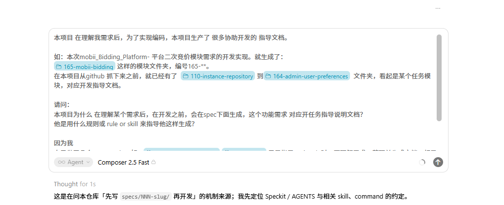
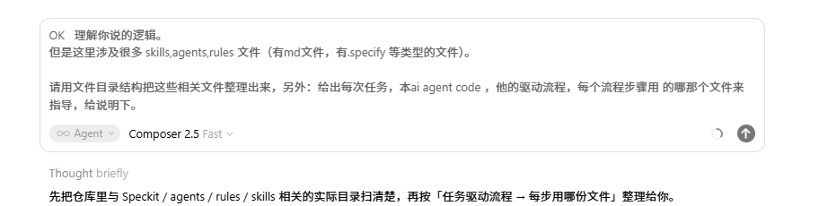

# 2026-11-09-chat1-Speckit与Agent驱动说明 会话沟通记录

用途：归档「为何先写 specs/NNN-slug」与「skills/agents/rules 目录及驱动流程」两轮问答。
范围：图中两轮 ask 及对应完整 rep（第二轮完整答复在用户说「继续」后给出）；不含 Request ID 讨论轮次。
本文件夹同时存放提问截图：fig1～figN。

---

## chat ask

时间：2026-11-09 01:36

- **图1** 用户提问截图（Speckit / specs 为何生成）


本项目 在理解我需求后，为了实现编码，本项目生产了 很多协助开发的 指导文档。

如：本次mobii_Bidding_Platform- 平台二次竞价模块需求的开发实现。就生成了：
[specs/165-mobii-bidding](../../specs/165-mobii-bidding) 这样的模块文件夹，编号165-**。
在本项目从github 抓下来之前，就已经有了  [specs/110-instance-repository](../../specs/110-instance-repository) 到[specs/164-admin-user-preferences](../../specs/164-admin-user-preferences)  文件夹，看起是某个任务模块，对应开发指导文档。

请问：
本项目为什么 在理解某个需求后，在开发之前，会在spec下面生成，这个功能需求 对应开任务指导说明文档？
他是用什么规则或 rule or skill 来指导他这样生成？

因为我
自己做了几个 cursor rule：如：[.cursor/rules/karpathy-guidelines.mdc](../../.cursor/rules/karpathy-guidelines.mdc) [.cursor/rules/do-task.mdc](../../.cursor/rules/do-task.mdc) 只是指导，ai code时，要理解需求，整理并生成文档，都是按我指定具体文档，如：放在PRO.md文档某个章节里面补充任务细节。
 没有像 endora-commerce这个项目原始保留的能力，生成spec下面这样的某个需求模块对应开发文档。
本endora-commerce项目中，有什么规范或rule ，让他能这样做。

---

## chat rep

时间：2026-11-09 01:40

结论先说：**不是**靠你这种「写进某个 PRO.md 章节」的 Cursor Rule 自动长出来的，而是仓库里一整套 **Speckit（规格驱动开发）工作流**：理解需求后，先走 `/speckit.specify → plan → tasks → implement`，在 `specs/NNN-slug/` 落下开发指导文档，再编码。

## 为什么要先生成 `specs/NNN-slug/`？

目的是：**需求 → 可验收规格 → 技术方案 → 可勾选任务 → 再写代码**，并和宪法（constitution）、模块约定、TDD 对齐。  
`AGENTS.md` 里写得很直白：

> New features follow the speckit flow: `/speckit.specify` → `/speckit.plan` → `/speckit.tasks` → `/speckit.implement`, producing `specs/NNN-slug/`.

像 `specs/165-mobii-bidding/` 就是一次功能的**规格包**（`spec.md`、`plan.md`、`tasks.md`、`contracts/` 等），不是 `do-task` 那种会话任务日志。

## 是靠什么规则 / skill / command？

| 层级 | 位置 | 作用 |
| --- | --- | --- |
| 总约定 | `AGENTS.md` § Feature workflow (speckit) | 规定新功能走 Speckit，产出 `specs/NNN-slug/` |
| Cursor 入口 | `.cursor/commands/speckit.*.md` | 斜杠命令：`/speckit.specify`、`plan`、`tasks`、`implement`… |
| Claude 侧 | `.claude/skills/speckit-*` | 同一套流程的 skill 端口 |
| 模板与脚本 | `.specify/templates/`、`.specify/scripts/bash/` | `spec-template.md`、`create-new-feature.sh` 等真正建目录、填骨架 |
| 原则 | `.specify/memory/constitution.md` | 模块化、TDD、API-first 等约束设计内容 |
| 角色 | `endora-commerce-architect` 等 subagent | 偏写规格/计划；dev 偏按 `tasks.md` 实现 |
| 路由提示 | `.cursor/rules/specify-rules.mdc` | **只指向读 `AGENTS.md`**，本身不生成 specs |

所以：**驱动「生成 specs」的是 Speckit Commands + `.specify` 工具链 + `AGENTS.md` 工作流约定**，不是 `karpathy-guidelines.mdc` / `do-task.mdc`。

## 和你自己的 rule 差在哪？

| | 你的 `do-task` / 写进 `PRO.md` | Endora 的 Speckit |
| --- | --- | --- |
| 触发 | 对话里确认需求后拆子任务 | 显式跑 `/speckit.specify` 等命令 |
| 产物 | `pro_doc/PRO.md` §99 任务清单 + commit 文案 | `specs/165-mobii-bidding/` 等独立功能规格目录 |
| 目的 | 本次执行可追溯、和 git 文案绑定 | 功能级需求/方案/任务/契约，给多人/多会话/MR 用 |
| 是否自动建 `specs/` | **不会**——rule 没要求那么做 | **会**——command + 脚本按模板创建 |

你的 rule 很适合「这一次怎么干、记到哪」；Speckit 适合「这个功能长期长什么样、怎么验收、怎么分任务实现」。两边可以并存：Mobii 业务总纲在 `PRO.md`，具体竞价实现落在 `specs/165-mobii-bidding/`。

## 想自己项目也有同样能力？

1. 引入 Speckit（或抄本仓 `.specify/` + `.cursor/commands/speckit.*`）  
2. 在 `AGENTS.md`（或等价总说明）写死：新功能必须走 specify → plan → tasks → implement  
3. 开发时主动用 `/speckit.specify …`，而不是只靠 always-on rule 往一个大 PRO 里追加  

**仅加 `do-task` 类 rule，不会 magically 长出 `specs/110`～`164` 那种目录**——那些是历史功能用 Speckit（或同类流程）一批批建出来并留在仓库里的。

---

## chat ask

时间：2026-11-09 18:06

- **图2** 用户提问截图（skills/agents/rules 目录与驱动流程）


OK   理解你说的逻辑。
但是这里涉及很多 skills,agents,rules 文件（有md文件，有.specify 等类型的文件）。

请用文件目录结构把这些相关文件整理出来，另外：给出每次任务，本ai agent code ，他的驱动流程，每个流程步骤用 的哪那个文件来指导，给说明下。

---

## chat rep

时间：2026-11-09 18:10

## 一、相关文件目录结构（按「管什么」分层）

```text
endora-commerce/
├── AGENTS.md                          # 总路由器：栈、约定、Speckit 流程、读哪份 conventions
├── CLAUDE.md                          # Claude 侧薄指针 → AGENTS.md + skills/agents 说明
│
├── .specify/                          # Speckit 引擎（模板 + 脚本 + 宪法 + 扩展）
│   ├── memory/
│   │   └── constitution.md            # 绑定原则（模块化/TDD/API-first…）
│   ├── templates/
│   │   ├── spec-template.md
│   │   ├── plan-template.md
│   │   ├── tasks-template.md
│   │   ├── checklist-template.md
│   │   ├── constitution-template.md
│   │   └── agent-file-template.md
│   ├── scripts/bash/
│   │   ├── create-new-feature.sh      # 建 specs/NNN-slug/、编号、分支相关
│   │   ├── setup-plan.sh
│   │   ├── check-prerequisites.sh
│   │   ├── update-agent-context.sh    # plan 后回写 AGENTS.md 附录
│   │   └── common.sh
│   ├── extensions.yml                 # hooks：specify/plan/tasks… 前后可跑 git 扩展
│   ├── feature.json / integration.json / init-options.json
│   ├── integrations/                  # 各 IDE 的 manifest + update-context 脚本
│   └── extensions/git/                # 可选：建分支、commit 等
│
├── .cursor/                           # Cursor 本机入口
│   ├── commands/                      # 斜杠命令 = Speckit 主驱动
│   │   ├── speckit.specify.md
│   │   ├── speckit.clarify.md
│   │   ├── speckit.plan.md
│   │   ├── speckit.tasks.md
│   │   ├── speckit.implement.md
│   │   ├── speckit.analyze.md
│   │   ├── speckit.checklist.md
│   │   ├── speckit.constitution.md
│   │   └── speckit.taskstoissues.md
│   ├── agents/                        # 角色子代理
│   │   ├── endora-commerce-architect.md
│   │   ├── endora-commerce-dev.md
│   │   ├── endora-commerce-designer.md
│   │   ├── endora-commerce-product-owner.md
│   │   └── task-completion-tracker.md # 你侧：写 PRO.md §99（非 Speckit）
│   ├── rules/                         # always-on / 场景规则（不自动建 specs）
│   │   ├── specify-rules.mdc          # 只指向 AGENTS.md
│   │   ├── karpathy-guidelines.mdc
│   │   ├── do-task.mdc                # 你侧：复述确认 → todos → §99
│   │   └── …（chat-log / markdown 等）
│   └── skills/
│       └── SKILL.md                   # 本仓 Cursor skill：karpathy 行为（非 Speckit）
│
├── .claude/                           # Claude Code 端口（同角色/同 Speckit）
│   ├── agents/                        # 与 .cursor/agents 角色对齐（无 task-completion）
│   └── skills/
│       ├── speckit-specify|plan|tasks|implement|…
│       └── ux-laws/SKILL.md
│
├── .agents/skills/                    # Codex 端口的 Speckit skills（镜像）
├── .codex/agents/                     # Codex 角色 toml
│
├── specs/
│   ├── NNN-slug/                      # 每次功能产物：spec/plan/tasks/contracts…
│   │   └── 例：165-mobii-bidding/
│   ├── conventions/                   # AGENTS 路由到的操作细则（composition/i18n…）
│   └── pre-migration-history/         # 编号地板说明（旧 specs 可能不在本仓）
│
└── pro_doc/                           # 你侧业务总纲 + do-task 日志（与 Speckit 并行）
    └── PRO.md  ## 99、do-task.log List
```

要点：**同一套 Speckit 逻辑，三套入口**——Cursor 用 `commands/`，Claude 用 `.claude/skills/speckit-*`，Codex 用 `.agents/skills/speckit-*`；模板与脚本只在 `.specify/` 一份。

---

## 二、两类「驱动」别混

| 轨道 | 触发 | 指导文件 | 产物 |
| --- | --- | --- | --- |
| **A. Speckit 功能开发**（仓库原生） | 你打 `/speckit.specify` 等 | commands + `.specify` + AGENTS + constitution | `specs/NNN-slug/` |
| **B. do-task 执行批次**（你加的） | 新需求复述 → 你回「正确」 | `do-task.mdc` + `PRO.md` §99 | 子任务勾选 + commit 文案 |

日常「先出 165 再写代码」走的是 **A**；你在对话里拆 27/28/29 批次走的是 **B**。可同时用，职责不同。

---

## 三、一次功能任务：AI 驱动流程 & 每步用哪个文件

以「新功能 / 像 165-mobii-bidding」为主路径（Cursor）：

```text
用户自然语言需求
        │
        ▼
┌─ 0. 会话常驻约束 ─────────────────────────────────────┐
│  .cursor/rules/specify-rules.mdc → 去读 AGENTS.md     │
│  .cursor/rules/karpathy-guidelines.mdc（编码时谨慎）   │
│  （若你开了 do-task：先复述确认，那是轨道 B）           │
└───────────────────────────────────────────────────────┘
        │
        ▼  用户执行 /speckit.specify …
┌─ 1. Specify（写需求规格）─────────────────────────────┐
│  驱动：.cursor/commands/speckit.specify.md             │
│  Hook：.specify/extensions.yml → before_specify        │
│        → 常跑 .specify/extensions/git/…feature         │
│  建目录/编号：.specify/scripts/bash/create-new-feature.sh │
│  填骨架：.specify/templates/spec-template.md           │
│  原则：.specify/memory/constitution.md                 │
│  总约定：AGENTS.md（栈、模块边界、陷阱）               │
│  角色（可选）：endora-commerce-architect.md            │
│  产物：specs/NNN-slug/spec.md                          │
└───────────────────────────────────────────────────────┘
        │
        ▼  /speckit.clarify（可选）
┌─ 2. Clarify ──────────────────────────────────────────┐
│  驱动：speckit.clarify.md                              │
│  改的还是同一份 specs/NNN-slug/spec.md                 │
└───────────────────────────────────────────────────────┘
        │
        ▼  /speckit.plan
┌─ 3. Plan（技术方案）──────────────────────────────────┐
│  驱动：speckit.plan.md                                 │
│  模板：plan-template.md（+ research/data-model 等）    │
│  脚本：setup-plan.sh；update-agent-context.sh → AGENTS │
│  路由读：specs/conventions/*（composition/migrations…）│
│  产物：plan.md、research.md、data-model.md、contracts/ │
└───────────────────────────────────────────────────────┘
        │
        ▼  /speckit.tasks
┌─ 4. Tasks（可勾选实现清单）───────────────────────────┐
│  驱动：speckit.tasks.md                                │
│  模板：tasks-template.md                               │
│  产物：specs/NNN-slug/tasks.md                         │
└───────────────────────────────────────────────────────┘
        │
        ▼  /speckit.implement 或交给 architect→dev
┌─ 5. Implement（写代码）───────────────────────────────┐
│  驱动：speckit.implement.md                            │
│  任务源：该功能的 tasks.md                             │
│  角色：endora-commerce-dev.md                          │
│  仍读：AGENTS.md + 相关 conventions + constitution        │
│  UI 时：.claude/skills/ux-laws/SKILL.md                │
│  行为：karpathy-guidelines（rule 或 .cursor/skills）   │
│  产物：packages/modules/…、admin、storefront、测试…    │
└───────────────────────────────────────────────────────┘
        │
        ▼  可选质量门
┌─ 6. Analyze / Checklist / PO 审计 ────────────────────┐
│  speckit.analyze.md / speckit.checklist.md             │
│  endora-commerce-product-owner.md                      │
└───────────────────────────────────────────────────────┘
```

Claude Code 把上表里的 **`.cursor/commands/speckit.X.md`** 换成 **`.claude/skills/speckit-X/SKILL.md`**，其余 `.specify` / `AGENTS.md` / 产物路径不变。

---

## 四、每步「谁真正下指令」一句话

| 步骤 | 谁驱动 AI | 谁规定长什么样 | 谁落盘 |
| --- | --- | --- | --- |
| Specify | `speckit.specify` command/skill | `spec-template` + constitution + AGENTS | `create-new-feature.sh` + 写 `spec.md` |
| Plan | `speckit.plan` | `plan-template` + conventions | `setup-plan.sh` + 写 plan 等；`update-agent-context.sh` |
| Tasks | `speckit.tasks` | `tasks-template` | 写 `tasks.md` |
| Implement | `speckit.implement` 或 dev agent | `tasks.md` + AGENTS + conventions | 改业务代码 |
| 你的批次日志 | `do-task.mdc` | 你定的编号与 §99 格式 | `pro_doc/PRO.md` |

---

## 五、和「普通每次改代码」的关系

- **新功能 / 大改**：应按 Speckit 主链走，**才会**出现 `specs/165-…`。  
- **小修小补**：常不跑完整 Speckit；仍被 `AGENTS.md` + `specify-rules` + karpathy（+ 你的 do-task）约束。  
- **`.cursor/rules` 不会单独创建 `specs/NNN`**；创建目录靠 **command/skill 调脚本 + 模板**。

若你希望，我可以再补一版「只画 Cursor 日常：用户一句话 → Agent 默认读哪些 always-on rule」的极简图（不含 Speckit）。
