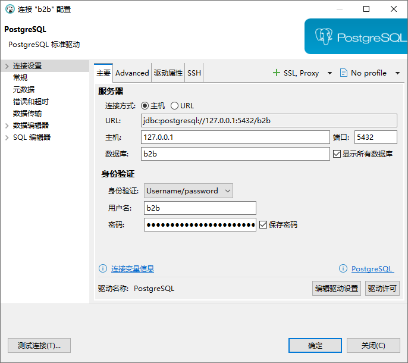
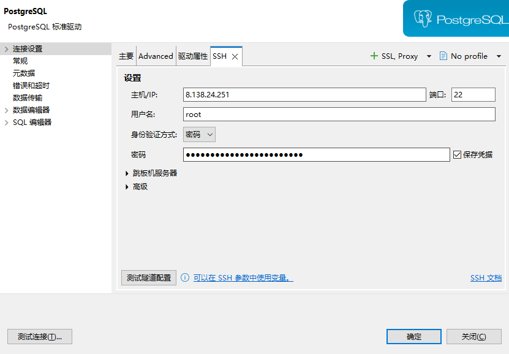

# 2026-11-10-chat1-生产Postgres-GUI连接 会话沟通记录

用途：归档「用数据库 GUI 连接阿里云 ECS Docker 中生产 PostgreSQL」的 ask/rep，并补充已验证的 DBeaver SSH 连法，便于后续改库对照。
范围：GUI 连接方案 ask/rep + 后续 DBeaver SSH（主要页 5432 / SSH 页）实测配置与配图；不含更早的 psql 进容器说明与 Megamenu 分析轮次。
本文件夹同时存放提问截图：fig1～fig2。

---

## chat ask

时间：2026-11-10 23:07

我像用 连接数据软件 来连接docker 中 PostgreSQL ，比较直观，用psql 太麻烦，后面管理太麻烦

---

## chat rep

时间：2026-11-10 23:10

可以。生产库**不要**把 `5432` 直接暴露到公网；用 **SSH 隧道 + 仅本机端口** 即可用 DBeaver / Navicat / DataGrip 连。

## 思路

```
你的电脑 GUI  →  localhost:15432  →(SSH 隧道)→  ECS:127.0.0.1:5432  →  postgres 容器
```

---

## 步骤 A：ECS 上让 Postgres 只监听本机

SSH 登录 ECS：

```bash
cd /opt/b2b
grep -E '^POSTGRES_(USER|PASSWORD|DB)=' .env
#只是查看 postgres 容器状态（是否 Up / healthy），不会改配置、不会重启、不会动数据。
docker compose --env-file .env -f compose.prod.yml ps postgres
```

生产 `compose.prod.yml` **默认没有** `ports`。临时加一个覆盖文件（不要改原文件也行）：

```bash
cat > /opt/b2b/compose.postgres-local.yml <<'EOF'
services:
  postgres:
    ports:
      - "127.0.0.1:5432:5432"
EOF

#按合并后的配置创建/更新并后台启动 postgres：把容器里的 5432 映射到 ECS 本机 127.0.0.1:5432（只本机可连，不是公网）。已有容器会按需 recreate 以带上新端口。
docker compose --env-file .env -f compose.prod.yml -f compose.postgres-local.yml up -d postgres
#查看 postgres 是否已 Up / healthy，确认上一步生效；只读，不改配置。
docker compose --env-file .env -f compose.prod.yml -f compose.postgres-local.yml ps postgres
#顺序：先 up，再 ps 核对状态。
```

确认只绑本机：

```bash
ss -lntp | grep 5432
# 应看到 127.0.0.1:5432，不要有 0.0.0.0:5432
```

---

## 步骤 B：本机开 SSH 隧道（Windows）

PowerShell / Git Bash：

```bash
ssh -N -L 15432:127.0.0.1:5432 root@你的ECS公网IP
ssh -N -L 15432:127.0.0.1:5432 root@8.138.24.251
```

窗口保持开着；断了 GUI 就连不上。

若已用 Cursor Remote-SSH / 密钥，把 `root@IP` 换成你平时登录用的即可。

验证是否开启成功：
```bash
Test-NetConnection 127.0.0.1 -Port 15432

netstat -an | findstr 15432
```
---

## 步骤 C：GUI 软件连接参数

| 项 | 值 |
|---|---|
| Host | `127.0.0.1` |
| Port | `15432` |
| Database | `.env` 里的 `POSTGRES_DB`（一般是 `b2b`） |
| User | `.env` 里的 `POSTGRES_USER`（一般是 `b2b`） |
| Password | `.env` 里的 `POSTGRES_PASSWORD` |
| SSL | 一般关（隧道内已加密） |

DBeaver：新建 PostgreSQL 连接，填上表即可测连。

---

## 步骤 C′：DBeaver 自带 SSH 隧道（已验证可用，推荐）

不必再开本机 PowerShell 的 `ssh -N -L 15432:...`。DBeaver 自己连 ECS SSH，再访问机内 Postgres。

**两种方式不要混用：**

| 方式 | DBeaver SSH 页 | 主要页 Host/Port | PowerShell `ssh -N -L 15432` |
|---|---|---|---|
| A. 仅 DBeaver SSH（本节约） | ✓ 开启 | `127.0.0.1` / **`5432`** | 可关闭 |
| B. 仅 PowerShell 隧道（步骤 B+C） | ✗ 关闭 | `127.0.0.1` / **`15432`** | 必须开着 |

### 主要（General）页

| 项 | 值 |
|---|---|
| Host | `127.0.0.1`（相对 **ECS 本机** 上的 Postgres） |
| Port | **`5432`**（不是 15432） |
| Database | `b2b` |
| Username | `b2b` |
| Password | `/opt/b2b/.env` 的 `POSTGRES_PASSWORD` |
| URL 示例 | `jdbc:postgresql://127.0.0.1:5432/b2b` |

- **图1** DBeaver 主要页：Host `127.0.0.1`、Port `5432`、库/用户 `b2b`


### SSH 页

| 项 | 值 |
|---|---|
| 使用 SSH 隧道 | ✓ 开启 |
| Host / IP | ECS 公网 IP（例：`8.138.24.251`） |
| Port | `22` |
| Username | `root`（或你平时 SSH 账号） |
| 身份验证 | 密码（或密钥） |
| Password | **ECS 登录密码**（不是数据库 `b2b` 密码） |

可先点「测试隧道配置」，成功后再点「测试连接」。

- **图2** DBeaver SSH 页：ECS IP、端口 22、用户 root、密码认证


### 前置（步骤 A 仍需要）

ECS 上仍须有 `compose.postgres-local.yml`，使 Postgres 监听 `127.0.0.1:5432`（仅本机），否则 SSH 进 ECS 后仍连不到库。

### 常见踩坑

- SSH 已通，但主要页仍填 `15432` → 会 `EOFException` / 超时（ECS 上没有 15432）。
- 旧版 Navicat 可能报 `authentication method 10 not supported`（不支持 PG16 SCRAM）；DBeaver 一般无此问题。
- **不要**在阿里云安全组对公网开放 `5432`。

---

## 用完建议收回端口

```bash
cd /opt/b2b
docker compose --env-file .env -f compose.prod.yml up -d postgres
# 需要时再删掉临时文件
rm -f /opt/b2b/compose.postgres-local.yml
```

并关掉本机 SSH 隧道窗口。

---

## 注意

- **不要**写成 `0.0.0.0:5432:5432` 或安全组放行 5432。  
- 生产直接改表有风险，改前在 ECS 做一次 `pg_dump` 备份。  
- 改 megamenu 等业务表后，小b 可能有约 1 分钟缓存，硬刷新即可。

如果你说用的是 **DBeaver / Navicat / DataGrip** 哪一个，我可以按那个软件把截图级字段对一下。
