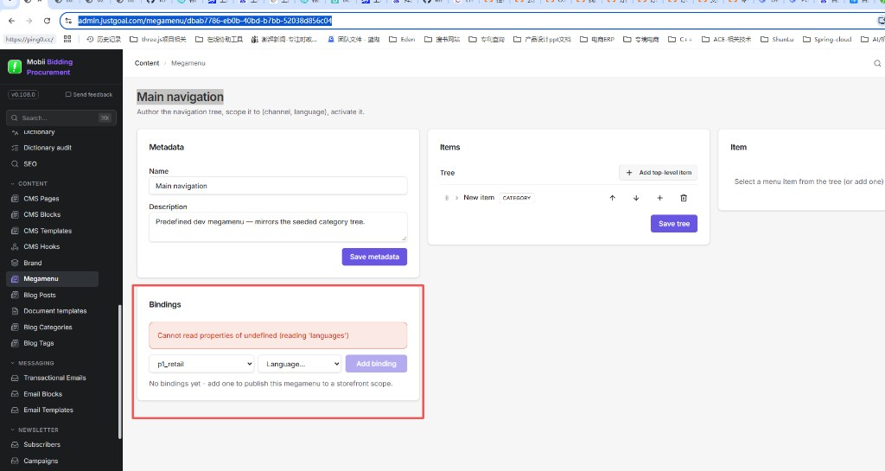
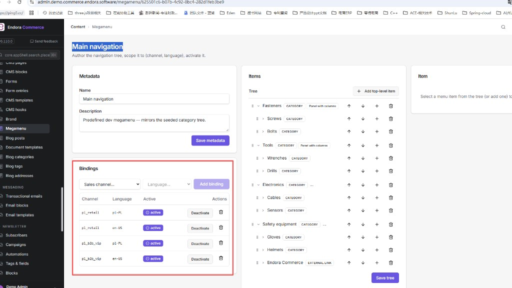
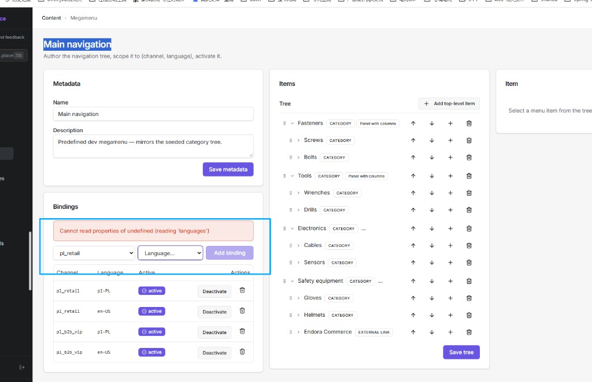
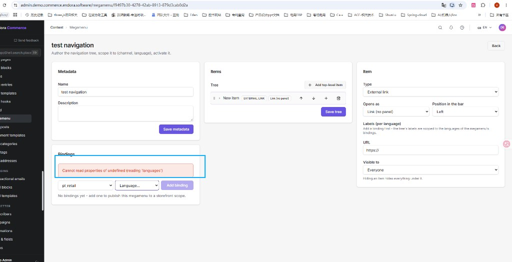
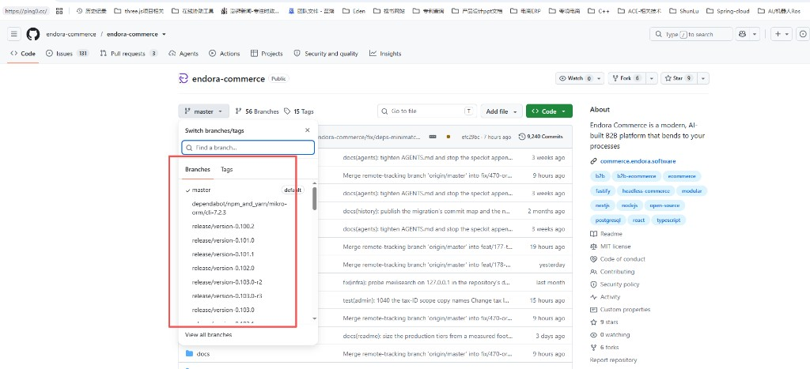
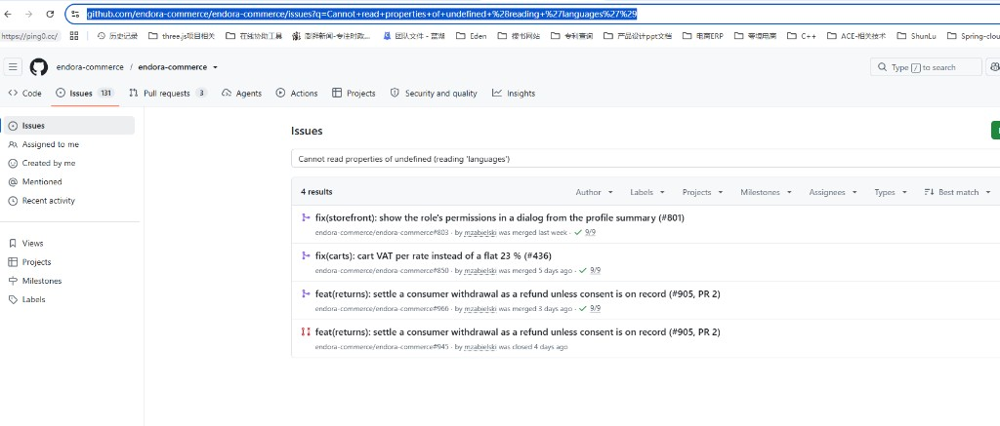

# 2026-11-11-chat1-Megamenu绑定语言报错分析 会话沟通记录

用途：归档「生产/开源 demo Megamenu Bindings 选渠道报 reading languages」的完整分析与方案确认，供后续修 UI 与本地验证参考。
范围：本窗口全部有价值 ask/rep（去掉系统 shell 完成通知类寒暄）；含 demo seed 是否可用于生产/测试、GitHub master/release 对照、方案选择。
本文件夹同时存放提问截图：fig1～fig6。

---

## chat ask

时间：2026-11-11 01:05

我们继续处理这个会话中（接续历史会话 [Megamenu 绑定语言报错](16762ae4-b859-477a-a499-eb8b47a369b5)），https://admin.justgoai.com/megamenu/dbab7786-eb0b-40bd-b7bb-52038d856c04  选中渠道，无法绑定语言的问题。
问题效果见图1.

请先理解下历史沟通情况，给我复述下问题

- **图1** 生产 Admin Megamenu Bindings：选中渠道后报 `reading 'languages'`

---

## chat rep

时间：2026-11-11 01:05

已读完历史会话 [Megamenu 绑定语言报错](16762ae4-b859-477a-a499-eb8b47a369b5)。按 do-task 第一步，先复述问题，请你确认。

---

## 问题复述

**现象（图1 / 生产 Admin）**  
在 [Main navigation 编辑页](https://admin.justgoai.com/megamenu/dbab7786-eb0b-40bd-b7bb-52038d856c04) 的 **Bindings** 中：选中销售渠道（如 `p1_retail` / 此前的 `default`）后，Language 下拉无法填充，并出现：

`Cannot read properties of undefined (reading 'languages')`

因此无法「Add binding」，菜单也就无法按「渠道 × 语言」发布到前台。

**业务背景（上一会话已对齐）**  
小 b 顶栏导航读的是 **Megamenu + 已激活绑定**，不是 Catalog 分类树本身。生产侧 `megamenu/by-channel` 曾返回 `MEGAMENU_NOT_FOUND`，正是因为还没有可用 binding；而加 binding 又被上述前端报错卡住。

**根因（上一会话已定位）**  
`BindingsPanel` 在选渠道后请求 `GET /api/v1/admin/sales-channels/:code`，却按 `res.data.languages` 取值；该接口实际直接返回渠道对象（含 `languages`），没有 `{ data: ... }` 包一层 → `res.data` 为 `undefined` → 读 `.languages` 崩溃。  
开源 demo 看起来「正常」，是因为种子数据里已有 binding，日常不必再走这条路径；在 demo 上再选渠道加绑定时，会复现同一报错（你已验证）。

**拟处理方向（待你确认后再分解执行）**  
1. 修 Admin：`BindingsPanel` 改为正确读取渠道的 `languages`（并做空值防护）。  
2. 修发版前如需应急：可用 API（或库）给该 megamenu 写入并激活所需「渠道 × 语言」绑定。

---

请确认：以上理解是否正确？回复「正确」或「同意」后，我再按 do-task 分解子任务并执行。

---

## chat ask

时间：2026-11-11 01:31

理解正确，但是细节上面看起来有问题：

你说的：
开源 demo 看起来「正常」，是因为种子数据里已有 binding，
下面是开源demo：同样页面：的url
https://admin.demo.commerce.endora.software/megamenu/625501c6-b07b-4c92-8bc4-282d1feb3be9 
因为他是已经有 数据，是：Main navigation ，点击这个 ”Main navigation“菜单进入后，见图1效果。
见图1，图1中红框 是默认值，但是我不知道他是哪里添加进去的。
但是：如果在开源demo这个页面，在binding 页，如果选某个销售渠道时，也会同样报和我们平台一样的错误，见图2.蓝框是我下拉 ”Sale channel ...“ 时报的错误。

请分析：先不看目前代码问题，可能是问题的基础上。

1：为什么开源demo 平台 目前已有”Main navigation“ 信息，编辑中，binding 是有某个渠道+language list 信息，见图1 红框的位置。他是怎么添加进去的。
 因为：看图2，开源demo 在选中 sales channel 时也会报错。

- **图1** 开源 demo Main navigation：Bindings 已有 4 行 active（红框）

- **图2** 同一页选 Sales channel 后同样报错（蓝框）

---

## chat rep

时间：2026-11-11 01:33

你的观察是对的：**图1 红框里的 4 行，不是靠 Admin「选渠道 → Add binding」加进去的**；图2 也说明那条 UI 路径在开源 demo 上同样坏了。

## 图1 红框数据从哪来？

来自 **demo 组合种子脚本**，不是人手点页面。

实例初始化/执行 `demo seed` 时，`packages/demo-composition` 里有一步 **`megamenu over the category tree`**，会直接写库：

1. 创建名为 **`Main navigation`** 的菜单（描述正是你看到的 *Predefined dev megamenu — mirrors the seeded category tree.*）
2. 按种子分类树写入 Items（Fasteners / Tools…）
3. **遍历当时所有销售渠道**，对每种语言 `pl-PL`、`en-US` **直接 `create(MegamenuBinding, { active: true })` 插入 `megamenu_bindings`**

所以图1 红框里常见的是：

| 渠道 | 语言 | 状态 |
|------|------|------|
| `pl_retail` | `pl-PL` / `en-US` | active |
| `pl_b2b_vip` | `pl-PL` / `en-US` | active |

这是 **ORM 写库 / 种子数据**，完全不经过 Bindings 面板那次「拉渠道详情 → 读 `languages`」的前端逻辑。

## 为何图1「看起来正常」，图2 又会报错？

这是两条不同路径：

| 路径 | 做什么 | 结果 |
|------|--------|------|
| **列表展示** | 打开编辑页 → `GET .../menus/:id/bindings` 读已有行 | 正常 → 图1 红框 |
| **新增绑定** | 选 Sales channel → 再请求渠道详情取 `languages` | 前端取值写错 → 图2 蓝框 |

demo 顶栏能出导航，靠的是种子已写入且 `active` 的 binding；**并不证明「Add binding」UI 可用**。你在 demo 再选渠道，就会踩到和你们生产一样的 bug——这正好说明：**已有行 ≠ UI 加进去的**。

## 和你们生产的对照

你们生产的 `Main navigation` 多半是后来手工建的（或别的路径），**没有跑过 demo-composition 那一步**，所以 Bindings 是空的；要补绑定又只能走坏掉的 UI，于是卡死。demo「有红框」只是种子绕过了 UI，不是另一套正确前端。

---

若对「数据来自 demo seed、不是 UI」这一点也认可，回复「同意」后我再按 do-task 分解：修 `BindingsPanel` +（如需要）生产侧用 API/库补绑定。

---

## chat ask

时间：2026-11-11 01:35

图1，时开源demo ，我用create 一个新 Megamenu，“test navigation”效果，确实在binding list中没有默认信息，但是选中 “Sale channel”也是报错的。

- **图1** 开源 demo 新建 test navigation：Bindings 为空，选渠道仍报错

---

## chat rep

时间：2026-11-11 01:35

对，图1把因果钉死了：

1. **种子只喂「Main navigation」**  
   新建的 `test navigation` Bindings 为空（文案 *No bindings yet…*）是预期行为，不会自动带红框那 4 行。

2. **报错与「有没有种子数据」无关**  
   在空菜单上选 `pl_retail` 同样 `reading 'languages'` → 坏的是 **「选渠道 → 拉语言列表」** 这条前端路径；demo / 生产、旧菜单 / 新菜单都一样。

3. **连带效果**  
   右侧 Labels 写 *Add a binding first…*，是因为还没有 binding，不是另一个独立 bug。

结论不变：要能在 Admin 里正常绑定，必须修 `BindingsPanel` 对渠道 `languages` 的读取；开源 demo 现有红框只是 seed 写库绕过了这条 UI。

若确认按此修，请回复「同意」，我再按 do-task 分解并改代码。

---

## chat ask

时间：2026-11-11 17:51

你给我的回复：看起来 这个：Content > Megamenu,demo 平台看起来也是脚本导入写入，不是前端页面UI手工操作新增的。
哪我们目前生产阿里云ecs 系统，有可以用目前脚本导入：
实例初始化/执行 demo seed 时，packages/demo-composition 里有一步 megamenu over the category tree，会直接写库？

---

## chat rep

时间：2026-11-11 17:52

**不建议、也不该在生产 ECS 上跑 `demo seed` / demo-composition 来补 Megamenu。**

## 为什么不行

1. **平台会拦**  
   `NODE_ENV=production` 时默认拒绝 demo seed；只有显式设 `ALLOW_DEV_SEED_IN_PRODUCTION=true` 才能绕过，注释写明这会 **WIPES business data**。另有数据库是否可丢弃的检查。生产库不是 demo 目标。

2. **不是「只写一条 megamenu」**  
   `demo seed` 会先跑各模块 demo 数据，再跑整包 composition：渠道改名/语言、演示商品、角色、库存、买家、CRM 管道等。没有「只执行 megamenu over the category tree」的官方开关。

3. **即便只看那一步，内容也不对你们**  
   它按 **demo 分类树**（Fasteners / Tools…）建菜单，语言写死 **`pl-PL` / `en-US`**，再绑当时所有渠道。你们要的是自己的类目（如 Memory）和 **`zh-CN` 等**，以及 `p1_retail` / `default`——种子对不上。

4. **和现有数据还可能撞车**  
   若已有名为 `Main navigation` 的菜单，该步按名字幂等 **直接跳过**，不会给你们补 binding。

部署会话里也写过：生产用 dump/restore 等手段，**不要用 demo seed 当灌数**。

## 生产上该怎么做

| 目标 | 做法 |
|------|------|
| 长期能在 Admin 里绑定 | 修 `BindingsPanel`（选渠道读 `languages`） |
| 发版前先让顶栏可用 | 用 **Admin API** 或（你们已能连库时）**直接插/激活 `megamenu_bindings`**：真实渠道 × 真实语言，挂到现有菜单 |

**结论：** demo 红框来自 demo seed 写库；生产不要套用同一脚本。要补绑定用 API/SQL 对症写入，或修好 UI 后再在页面上加。

若要继续，可以说「同意修 UI」或「先给生产 API/SQL 绕过步骤」，我再按 do-task 分解执行。

---

## chat ask

时间：2026-11-11 18:25

我理解下 你刚回答的问题：

1：平台会拦
   是不是生产环境ECS 上，有环境变量，需要改后，才能执行 demo seed？

 2：不是「只写一条 megamenu」
  是不是里面还有其他demo 数据，也回导入进去？不仅仅时 megamenu 这个composition？

  4：即便只看那一步，内容也不对你们
        是不是理解为：目前我生产ECS 环境 和 目前deom seed 中环境数据已经有差异？所以不能直接用demo seed 来插入了。
 
   请分析我的理解对吗？
  
    另外：如是对的，请把这个demo-里面做的所有事情，请列出来。
   
  
   如果对的话，下面有2个方案：
1： 可以对 demo compistion seed 进行改造，改造符合目前ecs环境data的，仅仅插入：megamenu  seed data。
 2：根据  demo compistion 代码模块，如果1 不合适，是可以用一个sql 代码或sh 脚本，插入到ecs环境中？
3： 调整目前代码，用ui 手工可以操作插入，目前在binding 窗口中，选择“Sale channel”时，提示报错，是代码错误，需要优化，还是说 系统中其他数据没有完善导致勾选不处理。

---

## chat rep

时间：2026-11-11 18:30

你的三点理解**基本正确**；方案结论也一并说清。

---

## 对你理解的核对

**1. 平台会拦 → 要改环境变量才能跑？**  
**对，但不止改一个变量，而且即使绕过也不该在生产跑。**

生产默认 `NODE_ENV=production` 会直接拒绝。要硬跑至少涉及：

| 变量 | 作用 |
|------|------|
| `ALLOW_DEV_SEED_IN_PRODUCTION=true` | 允许在 production 跑 demo seed（注释写明会清业务数据） |
| `ALLOW_DEV_SEED_ON_NON_LOCAL_DATABASE=true` | 允许对非本机/非 test 库动手 |

改变量 ≠ 安全；这是**故意开闸**，不是正常生产操作。

**2. 不是只写一条 megamenu → 还会灌别的 demo 数据？**  
**对。**  
一次 `demo seed` ≈：

1. **各已安装模块自己的 demo seed**（目录、角色、组织、仓库等各自表）  
2. **再跑** `@endora-commerce/demo-composition` 整包接线（渠道、megamenu、价格、库存、买家、CRM…）

没有「只执行 megamenu 那一步」的官方入口。

**4. 生产与 demo seed 数据已有差异，不能直接套？**  
**对。**  
demo 按 **Fasteners/Tools… + `pl-PL`/`en-US` + `pl_retail`/`pl_b2b_vip`** 写；你们是 **自己的类目 + 渠道（如 `p1_retail`）+ 语言（如 `zh-CN`）**。即便只抽 megamenu 那一步，写进去的也不是你们要的导航。

---

## demo seed / demo-composition 实际做了什么

### A. 各模块自带的 demo seed（composition 之前）

每个已安装且开启的模块，若声明了 demo seed，会先各自灌本模块演示行（商品、分类、角色、组织、仓库等——随实例模块集变化）。

### B. Foundation（composition 最早）

| 步骤 | 做什么 |
|------|--------|
| **the demo's two sales channels** | 接管/配置零售渠道（可能把 `default` 改成 `pl_retail`），设语言 `pl-PL`/`en-US`、货币 PLN/EUR；并确保 VIP 渠道 `pl_b2b_vip` |

### C. Composition 主步骤

| 步骤 | 做什么 |
|------|--------|
| **demo administrators take their roles** | 演示管理员挂上角色 |
| **megamenu over the category tree** | 建 `Main navigation` + 按 demo 分类树写 items + 全渠道×`pl-PL`/`en-US` 写 **active bindings** |
| **product↔category and channel↔product bridges** | 演示商品挂分类、挂销售渠道 |
| **demo organisation joins the VIP customer group** | 演示组织进 VIP 客户组 |
| **base prices and price books over the demo catalogue** | 演示价目/价格册 |
| **the VIP channel hides prices until sign-in** | VIP 渠道未登录藏价 |
| **stock spread across the demo warehouses** | 演示库存铺到仓库 |
| **demo buyer joins the demo organisation** | 演示买家进演示组织 |
| **product attributes over the demo catalogue** | 演示商品属性 |
| **placeholder images for the demo catalogue** | 占位图 |
| **sample attachments for the demo catalogue** | 示例附件 PDF |
| **credit limit granted to the demo organisation** | 演示组织授信 |
| **sales pipeline（CRM）** | 一堆演示商机/历史/备注等 |
| **demo projects / project tasks** | 演示项目与任务 |

所以：**megamenu 只是其中一小步**，且强依赖 demo 分类与 demo 语言设定。

---

## 对你三个方案的判断

| 方案 | 是否合适 | 说明 |
|------|----------|------|
| **1. 改 demo-composition，只按 ECS 数据插 megamenu** | **不推荐作主方案** | 等于给生产另写一套「伪 demo」；污染 demo 包语义，且要跟你们类目/渠道/语言永久分叉维护。应急可以本地写一次性脚本，但不要改官方 composition 当生产灌数器。 |
| **2. 用 SQL / sh 往 ECS 插 binding** | **可作为发版前临时绕过** | 在现有 `megamenus` 上插入/激活真实的「渠道 × 语言」行即可；**不**跑 demo seed。你们已有 GUI/SSH 连库条件。 |
| **3. 修 Admin UI，Binding 里选渠道不再报错** | **这是正解，应做** | |

### 方案 3 是「代码 bug」还是「数据没完善」？

**是前端代码错误，不是生产数据没配齐。**

证据：

- 接口 `GET /api/v1/admin/sales-channels/:code` **直接返回渠道对象**（含 `languages`），没有 `{ data: ... }`。
- `BindingsPanel` 却写了 `res.data.languages` → `res.data` 为 `undefined` → 正是报错文案。
- 开源 demo 新建空菜单、选 `pl_retail` 同样炸 → 数据再完整也会炸。

渠道列表能出来，说明渠道数据在；Language 下拉挂掉是**读错响应结构**，不是「语言没配所以勾不了」。

---

## 建议路径

1. **主路径**：修 `BindingsPanel`（读 `res.languages` + 空值防护）→ 发版 Admin → 在 UI 正常 Add binding。  
2. **可选临时**：在修发版前，用 SQL/API 给现有菜单写入 `渠道 × zh-CN`（等）并 `active`，先让前台导航可用。  
3. **不要**：在生产开 `ALLOW_DEV_SEED_*` 跑整包 demo seed，也不要为 ECS 去改官方 demo-composition 当灌数工具。

若以上理解你也认可，回复「同意」后我按 do-task 分解（优先修 UI；需要的话附带生产 SQL/API 绕过步骤）。

---

## chat ask

时间：2026-11-11 18:50

你分析的很细，而且蛮好。
当时还是有疑问：
为什么 demo 项目，还有这个代码bug，这个是github上开源项目：
https://github.com/endora-commerce/endora-commerce 我git clone 是master版本，难道是我git 版本不对，这个master版本有错误，其他分支 发布分支正常？见图1 是目前git项目的分支情况。
或者：在次github 羡慕 issue 中：查询这样类似错误：
https://github.com/endora-commerce/endora-commerce/issues?q=Cannot+read+properties+of+undefined+%28reading+%27languages%27%29 
发现如下：图2 查询结果。
你可以根据这个github url 和 issue url https://github.com/endora-commerce/endora-commerce/issues 

在分析下，这个是目前开源项目总体bug，还是master有bug。某些发布分支是ok？

- **图1** GitHub 仓库分支列表（master 与 release/version-*）

- **图2** Issues 搜索该报错文案的 4 条结果

---

## chat rep

时间：2026-11-11 19:08

先核对：`BindingsPanel` 在 master 与各 release 分支上是否同一处取值，以及你在 Issues 里搜到的 4 条是否真相关。（分析未完，下轮续。）

---

## chat ask

时间：2026-11-11 19:08

继续任务

---

## chat rep

时间：2026-11-11 19:09

结论先说：**不是你 clone 错分支。这是开源项目里一直存在的前端 bug；切到图1 那些 `release/version-*` 也修不好。**

---

## 1. 和 master / 发布分支的关系

已对照 GitHub 上的源码：

| 引用 | `BindingsPanel` 里选渠道后的写法 |
|------|----------------------------------|
| [`master`](https://raw.githubusercontent.com/endora-commerce/endora-commerce/master/packages/modules/megamenu/src/admin/components/BindingsPanel.tsx) | `res.data.languages`（有 bug） |
| [`release/version-0.103.0`](https://raw.githubusercontent.com/endora-commerce/endora-commerce/release/version-0.103.0/packages/modules/megamenu/src/admin/components/BindingsPanel.tsx) | 同样 |
| [`release/version-0.100.2`](https://raw.githubusercontent.com/endora-commerce/endora-commerce/release/version-0.100.2/packages/modules/megamenu/src/admin/components/BindingsPanel.tsx) | 同样 |

接口实际返回的是渠道对象本身（带 `languages`），没有 `{ data: ... }`。  
因此：**master 有 bug，已抽查的发布分支也有；不是「只有 master 坏、release 正常」。**

公开 demo（[admin.demo…](https://admin.demo.commerce.endora.software/megamenu/625501c6-b07b-4c92-8bc4-282d1feb3be9)）新建菜单选渠道也会炸，进一步说明是**线上同源代码问题**，不是你本地 checkout 错了。

有趣细节：文件里注释已修过「列表接口要用 `items` 不能用 `data`」，但**详情接口仍写成 `res.data.languages`**——同类错误修了一半。

---

## 2. 图2 Issues 搜索说明不了什么

你搜的是整句：

[`Cannot read properties of undefined (reading 'languages')`](https://github.com/endora-commerce/endora-commerce/issues?q=Cannot+read+properties+of+undefined+%28reading+%27languages%27%29)

图2 那 4 条（returns / carts VAT / storefront permissions）**标题和主题都不是 Megamenu Bindings**。GitHub 会在正文/diff/评论里做词匹配（如 `languages`、`undefined`），容易出**误匹配**。

另用更贴题的检索（`megamenu` + `binding`）也**没有**「选 Sales channel 报 reading languages」这类正式 issue；碰到的相关提及是别的 PR 里顺带写到 megamenu 测试夹具，不是这个 UI bug。

所以：**开源 Issues 里目前看不到「已登记并修好」这条缺陷；不等于 release 分支已经 OK。**

---

## 3. 怎么理解

| 疑问 | 结论 |
|------|------|
| 是不是 git 版本不对？ | **不是**；master 就是有这段错代码 |
| 是不是只有 master 有、release 正常？ | **不是**；抽查的 `0.100.2` / `0.103.0` 同源错误 |
| 切发布分支能治好？ | **不能** |
| 是开源总体 bug 还是你环境独有？ | **开源 Admin 代码缺陷**；生产/demo 都会踩；demo 有 binding 只靠 seed 写库绕过 UI |

---

**可行做法仍是：** 修 `BindingsPanel`（读 `res.languages`）并发版；发版前可用 SQL/API 临时写 binding。  
不要指望换 `release/version-*` 解决。

若要开始改代码，回复「同意」即可按 do-task 分解执行。

---

## chat ask

时间：2026-11-11 19:13

OK，我同意目前调整代码bug的方案，但是在之前，是不是先在目前本地 wsl+docker 开发环境先实现后，在进行发布到生产阿里云ecs docker？

另外：我测试环境是不是可以把目前 demo seed @packages/demo-composition/src/composition.ts  导入？

---

## chat rep

时间：2026-11-11 19:14

## 对你两个问题的回答

**1. 是否先在本地 WSL + Docker 修通，再发生产 ECS？**  
**对，就应按这个顺序。**

1. 本地改 `BindingsPanel` → `dev:infra` / 本地 Admin 验证「选渠道 → 出语言 → Add binding」  
2. 再打镜像 / 部署到阿里云 ECS  
3. 生产验证；若发版前就要顶栏可用，再用 API/SQL 临时补 binding（可选）

不要先在生产改代码或硬跑 demo seed。

**2. 测试环境能不能导入 `demo-composition`？**  
**可以，前提是「可丢弃的开发/测试库」，不是生产库。**

| 环境 | 建议 |
|------|------|
| 本地 WSL + Docker（`dev:infra`，库本机/可清空） | 可以 `pnpm run cli demo seed`（或文档等价命令） |
| 单独测试机，且 `NODE_ENV≠production`、库可重建 | 可以 |
| 阿里云 **生产** ECS | **不要** |

注意：demo seed 会灌整套演示数据（渠道、商品、菜单、CRM…），不只 megamenu；测 Binding 修复其实**不必**先 seed——建一个空菜单选渠道就能复现/验证修复。seed 更适合「本地要对齐开源 demo 整店效果」。

---

## 需求复述（待你确认后分解执行）

1. **修代码**：`BindingsPanel` 选 Sales channel 后正确读取渠道 `languages`，消除 `reading 'languages'`，使 Language 下拉与 Add binding 可用。  
2. **验证顺序**：先在 **本地 WSL + Docker** 验证通过，再发布到 **生产阿里云 ECS Docker**。  
3. **测试数据**：本地/可丢弃测试库可按需跑 demo seed；**生产不跑**；生产若需应急绑顶栏，用 API/SQL，不改 demo-composition 当生产灌数器。

请回复「正确」或「同意」，我再按 do-task 分解子任务并开始改代码。

---

## chat ask

时间：2026-11-11 19:16

请把本次chat对话，都用 @.cursor/rules/chat-log.md rule 规则，插入到 chatlog文件夹下先。
用于我们后面做任务 参考记录。

然后我们在开始做do-task任务。

---

## chat rep

时间：2026-11-11 19:20

已按 chat-log 规则归档到：

`chatlog/2026-11-11-chat1-Megamenu绑定语言报错分析/`

- md：`2026-11-11-chat1-Megamenu绑定语言报错分析.md`
- 配图：fig1～fig6

随后按已确认方案启动 do-task：本地修 `BindingsPanel`（`res.data.languages` → 正确读渠道 `languages`），本地 WSL+Docker 验证后再发生产 ECS；生产不跑 demo seed。
