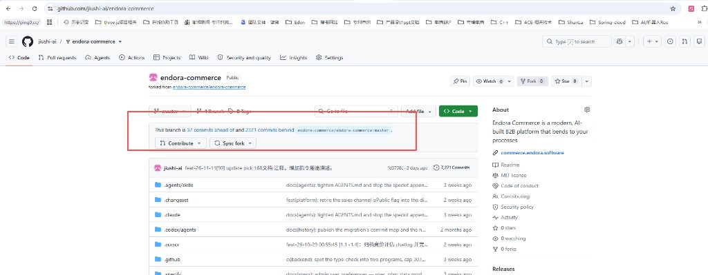

# 2026-11-13-chat4-上游合并策略与远程分支 会话沟通记录

用途：讨论「测到洞再 cherry-pick feature」的风险，以及能否与开源 master 总体融合；并澄清 origin/upstream 远程分支含义，作为后续合并事务依据。
范围：最近 2 轮 ask + 对应 rep。
本文件夹同时存放提问截图：fig1。

---

## chat ask

时间：2026-11-13 23:38

OK ，目前发布成功。
但是下面有一个讨论话题：

我本地项目进展步骤：
1：前面某个一天26-10-29号 从 forked from endora-commerce/endora-commerce：https://github.com/endora-commerce/endora-commerce.git  git clone 下来的本地，放在wsl+docker 开发环境，而且git 是开源master版本。假设此为init-0 版本。

2：为了满足本地mobii-bidding 模块，竞价模块，就基于init-0 版本，做了改造：实现bidding业务+多语系改造（大B主要是添加il8 json，小b 我改了首页页面格局，凸显bidding能力，同时也新增il18 json）
   这步版本：可以定义  本地：master 版本。

3：但是我 在测试过程中，发现mobii-bidding-1 的某些功能 有缺陷，如：https://admin.justgoai.com/megamenu 
功能有缺陷（这个时候已经过来很多填， 开源项目已经修复或升级功能，吧这个问题优化了），对比：开源目前代码和demo 演示，发现他们在 feature 168 上已经优化了此功能。
  包括：小b  产品目录分类，用tab 方式展示，都一通优化了。
  所以：就 mobii-bidding-1 为base，做了一个 feat/megamenu-168-from-upstream 版本，把开源feat 168的部分代码和本地融合。解决了 发现 Megamenu 和小b 产品分类tab 展示问题。
    这步版本：feat/megamenu-168-from-upstream

  4：但是继续测试feat/megamenu-168-from-upstream，我们，发现 我们feat/megamenu-168-from-upstream版本，在设置 渠道 多语系逻辑，和 demo开源页面有差异，经过分析：开源项目，在feature 167 时候也做了优化。
   所以：我就以feat/megamenu-168-from-upstream 为base，checkout出一个新分支： feat/storefront-167-from-upstream 
  用这个分支 和 开源项目 167 进行融合。实际代码融合。
测试后，发现解决 大B 在配置 sale channel ，配置渠道可以用多语系配置问题，且：小b端，url 也可以随切换调整，包括 tab展示多语系模式。等问题。

经过上面4步操作，目前git 的状态：

本地分支含 feat/megamenu-168-from-upstream、feat/storefront-167-from-upstream（当前）、master；远程含 origin/master、upstream/master。

所以：我有个一个担心，我是目前1-4的流程，实际都是发现一个问题后，在和开源git 代码比对，看对方在那个feature id 时候修复了，在来融合，这样风险非常大。
  你会发现：我先融合168，在后面融合167.   168 比 167 大。但是还先融合了。
正常不合理，和开源git的顺序是反的。
如果：168 和 167 调整内容不重合，或没有连续性，是可以。如果有先后连续性，会不会导致问题，
如：168 把167的部分bug优化了，但是又有我们后面有融合167，是不是会把久代码融合进入，这样bug还在。

所以：我想后面如果这样做，一直用测试，发现某个功能和 开源demo有差异，在分析开源哪里feature调整了，在来融合，非常巨大任务，而且错误了高。每次pick时，都会判断很多问题是否可以合并 或del。

所以：我有个想法，
1：拿目前最新本地：feat/storefront-167-from-upstream 为base， 和 开源git 最新master代码进行，比较。
看目前我们代码  和 开源最新master 代码，有那些差异。
差异类型可能分2种：
1： 我们目前代码 ，比开源master 少，因为开源master 最近一直在执行优化迭代，估计很多很多：基于我的：init-0 版本，做了很多功能优化。
   可能这块我们后续用 feat/storefront-167-from-upstream  测试会发现。
  2：我们自己新增功能，如 bindding 业务（大b 小b都涉及到的），新增il18的语言文件。这些应该都不会在开源git master源码种有。

 基于上面2类情况，你可以类列出来：
1：开源git master 比我们多模块，他做上面功能优化目的， 适合合并到我们目前项目？
2：我们项目多的模块，和git master 目前最新代码不冲突，要保留的？分：业务我们多的，如：bidding，
还有：目前最新git master 已有bug，我们优化了，建议保留：如 在Megamenu 编辑中：Bindings 模块：选渠道+语言，add时，我们ui可以手工操作，但是目前git 开源最新代码，还是有bug。类似这种：我们应该保留。

可以这样理出来？目的：让我们本地最新代码，和 开源git code master代码 做一次总体融合。
这样做的目的：开源代码最新代码，肯定优化了很多不是bidding业务的逻辑或bug，我目前用最开源最新代码合并我本地，肯定能解决很多我还未测试出来的bug。总体一次性融合解决。

如果可行，实际我本地项目，间隔一段时间，都可以按这个逻辑 和 开源git master进行一次合并。

另外补充：一点：我的git hub账户，也就是我本地项目 提交到：我自己git hub账户 页面。
见图1。因为我们本地项目 开始代码，时fork forked from endora-commerce/endora-commerce模式。
- **图1** GitHub fork 提示：This branch is 37 commits ahead of and 2371 commits behind endora-commerce/endora-commerce:master


图1 中，会提示 我们目前https://github.com/jiushi-ai/endora-commerce 和 This branch is 37 commits ahead of and 2371 commits behind endora-commerce/endora-commerce:master.
有多少差异。
当然：我本地 feat/storefront-167-from-upstream 最新代码，还未提交到 https://github.com/jiushi-ai/endora-commerce  在线账户下。
如果提交了：是不是可以：
https://github.com/jiushi-ai/endora-commerce  下，用最新feat/storefront-167-from-upstream  和 endora-commerce/endora-commerce:master. 比较，看互相差异在哪里。
可以在github上做合并？

回答上面2个问题

---

## chat rep

时间：2026-11-13 23:42

## 先对一下现状数字

| 对比 | ahead（你们多） | behind（开源多） |
|---|---|---|
| `feat/storefront-167-from-upstream` vs `upstream/master` | **57** | **2371** |
| 图1 的 `origin/master` vs 开源 `master` | **37** | **2371** |

分叉点约在 2026-10-28（你们 clone 前后）。后面 2371 条是开源整段演进，不是「差几个 feature 文件」。

---

## 问题 1：能否「理清单 → 跟开源 master 总体一次融合」？

**分类思路可行，而且应该做；但「一次性 merge 进 2371 commits」不推荐当常规手段。**

### 你们对风险的担心（先合 168 再合 167）

合理担心，但要分清：

- Feature 编号 **不是严格时间线**，也不是「必须按号序合」的依赖图；168 megamenu 与 167 locale-path 主题不同。
- 真正风险是：**有依赖/同一文件被两边改过**时，后合的旧片会盖掉先合的修。
- 你们已经在 168 之上合了 167，且生产测通 → 说明这次组合大体可用；**不能由此推出「以后任意颠倒都安全」**。

「测到一个洞 → 猜 feature → cherry-pick」确实贵、易漏、冲突多——这是战术问题，不是否定 cherry-pick 本身。

### 「列两类差异」——可以，建议这样列

| 类型 | 含义 | 处置 |
|---|---|---|
| A. 开源有、你们无 | 新模块/修 bug/平台能力（167/168 之后还有一堆） | **按价值排队 cherry-pick / 合发布标签**，不要整包盲合 |
| B1. 你们有、开源无 | bidding、Mobii 首页、zh i18n… | **永久保留**（overlay / 自有提交） |
| B2. 你们修了、开源仍烂或未合 | 如 Bindings 选渠道+语言 | **保留你们的修**；合上游时冲突选你们或手工并 |

这份清单的目的是 **同步路线图**，不是证明「可以一次 `git merge upstream/master`」。

### 为什么不建议「跟最新 master 总体一锤子融合」

- **体量**：约 **2371** 提交，冲突面是整仓（platform、contracts、admin、storefront、迁移、检查脚本…）。
- **行为**：一次 merge 会把你们 57 条（bidding/i18n/生产修）和开源半年演进缠在同一图里，回滚/归因极难。
- **结果**：短期内「可能修掉未测到的洞」，但更可能引入 **新洞 + 迁移顺序问题 + 检查失败**，比按 feature 挑合更不可控。

更稳的节奏（间隔同步可以，但换方式）：

1. **基线**：以 `feat/storefront-167-from-upstream`（或合回自有 `master`）为生产线。  
2. **对照**：定期 `git log / diff` 或按 `specs/NNN-*`、upstream tag（你们已有 `v0.106`…`v0.110`）看 changelog。  
3. **摄入**：只合「测到的洞 / 明确要的能力」对应提交或小范围 MR；保留 B1/B2。  
4. **可选升级**：隔几个月评估「跳到某一 upstream tag 再 rebase 自有补丁」——仍是项目级工程，不是点 Sync。

**结论：**  
「理出差异、决定保留/合入」——**要做**。  
「用这份清单驱动定期、有选择地跟开源对齐」——**对**。  
「一次性把开源最新 master 整仓融进来当主策略」——**不可行当默认**；风险远大于「先 168 后 167」那种单 feature 颠倒。

---

## 问题 2：推到 GitHub 后，能否在网页上和开源 master 比差异并合并？

**可以比较；不建议在网页上 Sync/Merge 那 2371。**

图1 状态是 **fork 的 `master`** vs 开源 `master`，**还不是**你本地的 `feat/storefront-167-from-upstream`（该分支尚未推到 [jiushi-ai/endora-commerce](https://github.com/jiushi-ai/endora-commerce)）。

推上去之后可以：

1. `git push -u origin feat/storefront-167-from-upstream`  
2. GitHub：**Compare** `endora-commerce/endora-commerce:master`…`jiushi-ai:feat/storefront-167-from-upstream`（或反过来）→ 看文件/提交差  
3. 开 **PR**：`upstream/master` → 你们分支，或你们分支 → 自有 `master`

**不要点 Sync fork 一键同步**，除非你们做好「整仓合 2371 + 解决全部冲突 + 全量回归」的项目预算。Sync 本质接近「把 behind 那一大段拉进来」，和本地 `merge upstream/master` 同级危险。

GitHub 适合：**看差异、做 code review、合你们自己的小 PR**。  
真正跟开源对齐：仍在本地按 feature/tag **挑选合入**，测完再推 origin。

---

## 直接回答你的两个问题

1. **「分类列出 → 总体融合开源最新」**  
   - 分类列出：**可行且应该**。  
   - 总体一次融合 master：**不推荐**；应用「按清单、按 tag/feature 分批合 + 永久保留 bidding/自有修」。

2. **「推到自己 GitHub 后能否网页比较/合并」**  
   - **比较：可以**（推分支后 Compare）。  
   - **网页一键跟开源 master 合并/Sync：技术上能点，战略上不要**；和本地盲 merge 2371 是同一件事。

若下一步要落地「差异清单」，可以在确认后做一版：**仅报告**（模块/specs 级 ahead-behind 摘要），**不执行 merge**。需要的话回复「同意」我再按 do-task 拆任务出报告。

---

## chat ask

时间：2026-11-13 23:50

先问几个git问题：

本地代码分支目前最新是 feat/storefront-167-from-upstream。

但是远程分支这 3 行是什么意思：

```text
origin/HEAD -> origin/master
origin/master
upstream/master
```

origin/HEAD -> origin/master 这个是不是指目前 git 执行那个远程分支，如果提交就会提交到这个远程分支，这个分支是不是：
https://github.com/jiushi-ai/endora-commerce  的 master branches。目前我的 github 账户，branches 下仅一个 master 分支。

origin/master 这个是不是就是我 github 账户，branches 下仅一个 master 分支。
而：
upstream/master 是指 开源项目 endora-commerce/endora-commerce 的 master 分支？

所以：你上面说：
feat/storefront-167-from-upstream vs upstream/master
实际就是本地分支 和  开源项目 endora-commerce/endora-commerce 的 master 分支  比较？

---

## chat rep

时间：2026-11-13 23:52

对，你的理解大体正确；有一点要改一下：**`origin/HEAD -> origin/master` 不是「当前提交会推到哪」**。

## 本地三行

| 分支 | 含义 |
|---|---|
| `feat/megamenu-168-from-upstream` | 本地合过 168 的分支 |
| `* feat/storefront-167-from-upstream` | **当前检出**（最新工作线） |
| `master` | 本地 master（一般对应你 fork 上较早的线） |

## 远程三行分别是什么

```text
origin/HEAD -> origin/master
origin/master
upstream/master
```

| 名字 | 含义 |
|---|---|
| **`origin`** | 远程名 = 你的仓库 [jiushi-ai/endora-commerce](https://github.com/jiushi-ai/endora-commerce) |
| **`upstream`** | 远程名 = 开源 [endora-commerce/endora-commerce](https://github.com/endora-commerce/endora-commerce) |
| **`origin/master`** | 你 GitHub 上目前那一个 **master**（网页 Branches 里看到的那个） |
| **`upstream/master`** | 开源仓库的 **master** |
| **`origin/HEAD -> origin/master`** | 只表示：clone/默认看 `origin` 时，**默认分支是 master**。不是「正在推送的目标」 |

### 和「提交/推送」的关系

- **`git commit`**：只写**本地当前分支**（现在是 `feat/storefront-167-from-upstream`），**不会**自动上 GitHub。
- **`git push`**：推到哪，看当前分支有没有设 upstream。  
  你还没推过 `feat/storefront-167-…` 时，GitHub 上就还只有 master；需要例如：

  ```bash
  git push -u origin feat/storefront-167-from-upstream
  ```

  之后网页上才会多这个分支。  
  **不会**因为有 `origin/HEAD -> origin/master` 就自动推到 master。

所以：

- `origin/master` → **是**，你账户下那个唯一的 master。  
- `upstream/master` → **是**，开源项目的 master。  
- `origin/HEAD -> origin/master` → **不是**「当前执行/提交目标」，只是 origin 的默认分支指针。

## 关于之前的比较

是的：

```text
feat/storefront-167-from-upstream  vs  upstream/master
```

= **本地当前功能分支** 和 **开源 endora-commerce/endora-commerce 的 master**（你本机 `git fetch upstream` 之后的快照）比 ahead/behind。

图1 的「37 ahead / 2371 behind」则是 **`origin/master`（你网页上的 master）** vs 开源 master，数字会略不同，因为 167 分支还没推上去、比 fork 的 master 更新。
