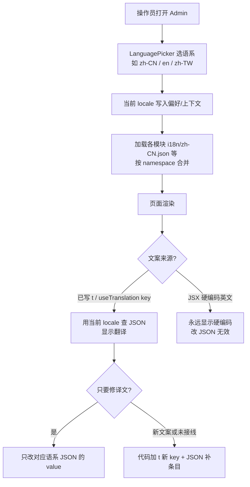
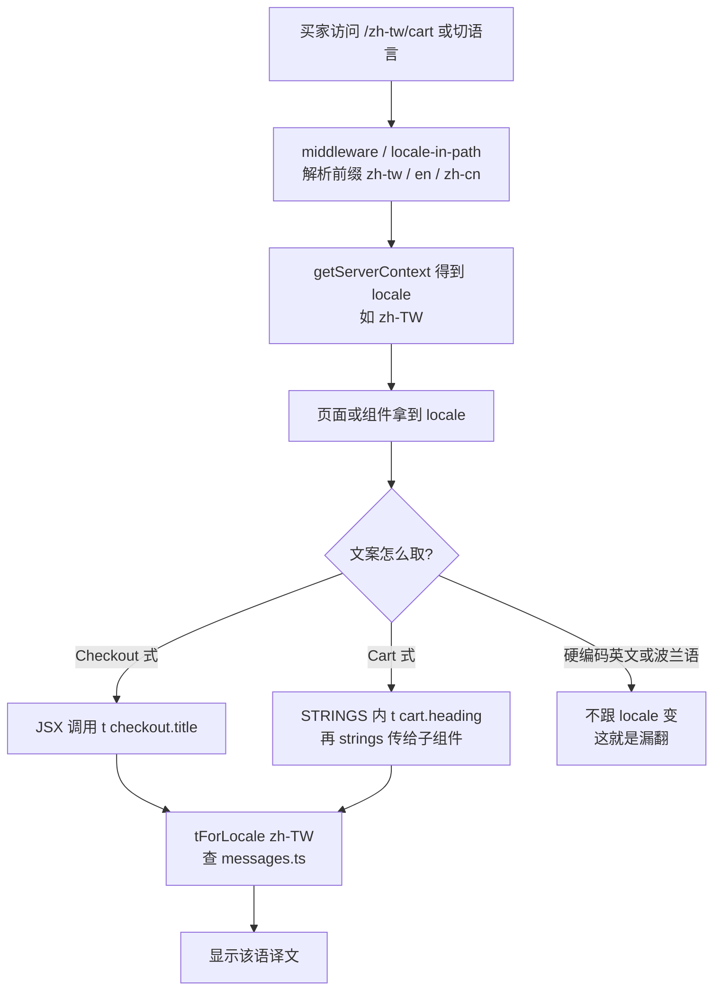

# 2026-11-16-chat1-大B与小b多语系对照 会话沟通记录

用途：对比 cart 与 checkout（eaa80a8）两次 i18n 改法差异，并对照大 B Admin 与小 b 多语系流程（是否必须 t()、能否只维护词条）。
范围：最近 3 轮 ask + 对应 rep。
本文件夹同时存放提问截图：本轮无附图。

---

## chat ask

时间：2026-11-16 18:02

你这次改动 为了支持 购物车页面，能支持i18n ，在切换多语言时，页面能正常跟随切换对应页面语言。

但是我看本次调整的几个文件，我有点奇怪。
所以我想咨询：
本次优化 购物车cart 页面 i8n 和 git 历史上 commitid：eaa80a8e1a19c906e075c083730e56fe12634e56
这次优化i18n，在优化方式上有什么不同？

因为我看 git eaa80a8e1a19c906e075c083730e56fe12634e56 这次优化i18n，修改的文件 和本次优化cart i18n 优化的文件不一样。

请分析2次都为了让小b端某个页面，能支持i18n的问题。
他们分别调整了什么文件，他们调试方式一样？

---

## chat rep

时间：2026-11-16 18:02

你的直觉对：**两次都是给小 b 某个页面补 i18n，目标一样，但动刀位置不同**，所以看到的文件列表不一样。

---

## 对比一览

| | **eaa80a8（批次 38）结算页** | **本次（批次 40）购物车** |
|--|--|--|
| 页面 | `/checkout` | `/cart` |
| 原问题 | JSX / 组件里**直接写死英文**（另有 CheckoutHeader 品牌） | 已有集中 `STRINGS(locale)`，但**只分 pl / 英文**，zh 落英文 |
| 主要改法 | 在调用处改成 `t('checkout.xxx')` + 补 `messages.ts` | **重写 `STRINGS` 内部** 走 `tForLocale` + 补 `messages.ts` |
| 是否大改子组件 | 要改：字符串散在各组件 | **基本不用改** CartLine / CartTotals 等 |

---

## eaa80a8 改了什么文件、为什么

动到的业务文件大致是：

- `storefront/app/(commerce)/checkout/page.tsx` — 页内硬编码英文 → `t(...)`
- `storefront/components/checkout/PaymentMethods.tsx` — `"Payment method"` → `t(...)`
- `storefront/components/checkout/CheckoutHeader.tsx` + `layout.tsx` — Industria → Mobii + locale
- `storefront/lib/i18n/messages.ts` — 新增 `checkout.*` 等键
- 若干 checkout 测试

**原因：** 结算页文案**本来就散在 page 和子组件 JSX 里**，没有像购物车那样的统一 `STRINGS` 出口，所以要一个个替换调用点。

---

## 本次 cart 改了什么文件、为什么

目前工作区大致是：

- `storefront/app/(commerce)/cart/page.tsx` — 删掉 `if (pl) … else 英文` 大段，改成 `STRINGS` 里用 `t('cart.*')`
- `storefront/lib/i18n/messages.ts` — 新增一整套 `cart.*`
- `storefront/test/i18n/cart-locale.test.ts`（新）
- `pro_doc/PRO.md`

**没改** `CartLine.tsx` / `CartTotals.tsx` / `CartCouponInput.tsx` 等。

**原因：** 这些组件早就吃 page 传入的 `strings`，自己不写「Your cart」。问题只在 **`STRINGS` 没给中文**。改源头即可，组件跟着对。

---

## 调试 / 优化方式一样吗？

**目录与原则一样，落地手术不一样：**

相同：

- 都用小 b 的 `storefront/lib/i18n/messages.ts`
- 都补 **en / zh-CN / zh-TW / pl**
- 都让页面跟当前 locale 走 `tForLocale(locale)`

不同：

| | 结算页 eaa80a8 | 购物车本次 |
|--|--|--|
| 原结构 | 分散硬编码 | 已有 `STRINGS` + `strings` props |
| 优化点 | 多个文件把字面量换成 `t('key')` | 一个函数从「双语 if」改成「messages」 |
| 文件多少 | page + 若干 checkout 组件 | 主要 page + messages |

一句话：**不是两套 i18n 体系，是两个页面原来组织文案的方式不同，所以 diff 落点不同。**  
结算页要「拔钉子」；购物车是「换供稿源」。

---

## chat ask

时间：2026-11-16 18:06

是不是，cart 和 Checkout 2个页面模块，在底层代码实现逻辑上有差异。才导致你 在都要实现i18n目的时，选择了不同方式？

---

## chat rep

时间：2026-11-16 18:06

对，就是这个意思。

**目的一样**（跟 locale 显示对的语言），**页面原来怎么管文案不一样**，所以改法不同：

- **Checkout**：文案散落在 page / 子组件 JSX 里 → 要在多处换成 `t('…')`，并改相关组件文件。  
- **Cart**：文案已集中在 `STRINGS(locale)`，再以 `strings` 传给子组件 → 只要改 `STRINGS` 接上 `messages.ts`，子组件不用动。

不是两套 i18n 框架，是**两个模块既有实现结构不同**，才选了不同落地方式。

---

## chat ask

时间：2026-11-16 18:20

可以用同一种方式实现i18n吗？
因为我看目前demo开源，他是支持PL , EN  2 种语言，在大B端 提供 PL EN 2中json 文件。
前端admin 切换某个语系时，大Badmin 就会自动变改语系。如果新增某个语系，需要在工程中，新增匹配：PL  或 EN.json 同样改语言json，类似我在目前大B平台上 新增 cn-tw，cn-zh 中文2 种json文件。所以在大b切换时，会自动切换语系。
所以：在大Badmin端，如果页面上发现某个组件 或 文字，在切换语言时，发现未被切换到，我就修改或新增 改语言 json文件即可。
不用在代码中 用 t('..') 去调整对应title.key .

这样对大B admin 多语系切换，逻辑分析理解对吗？

但是大B 和小b 语系逻辑估计有差异。

小b 所有语言是不是放在同一个文件中，是：[messages.ts](../../storefront/lib/i18n/messages.ts)  这里包含：en-US zh-CN  zh-TW，所有key:value 放在一个文件中，和大 B admin ，分不同语言 对应一个 json文件的方式。
另外：小b页面 ，在首页切换语系时，url会自动带上en cn 等标签字符串，这些url 会动态加载某个语系，这个逻辑，我还不清楚，请用流程图的方式，提供给我，看看他是怎么走的流程，页面难道都一定要用  t('..') 来替换？因为我刚刚咨询，感觉不是每个页面多语系实现方式都一样，导致有的页面用 t('..') ，有的不用。
 如果是这样，就有问题，小b的多语言维护太困难，不能想大B admin，只要页面上写某个语言key，对应语系json 新增对应key的翻译语言，页面代码上不用都要 t('..') 来控制转化。这样是非常好的模式，语言配置和页面代码 是互相匹配的，而不是通过 t('..') 来固定翻译转化。

请理解我的疑问，给我回答问题：
1：目前大B admin，多语系的流程，我分析的对吗？他的便捷性是不是可以按我的理解处理，页面某个未被翻译的语系，直接找到对应语系json文件，在里面维护，就可以让页面自动更新，只要json文件有改tile.key 对应翻译即可。不用修改页面代码，用 t('..') 来固定转化。
   不管我理解对错，请用流程图的方式，展示大B admin 语系流程处理过程。

2：结合上次我的疑问：checkout页和cart页，调试方式不一样，同时结合我上面对小b分析和理解，请分析我对目前小b语系代码疑问是否对？同时提供目前小b 多语系切换 代码上逻辑，用流程图的方式展示。
  并且：对我提到对小b，有没有更好的方式来实现多余细，而不用每次在代码上用 t('..') 固定来转换，而是类似用大b admin模式，只要维护好 [messages.ts](../../storefront/lib/i18n/messages.ts) 语言key和value值，只有对应语系key：value，页面就会自动更新语系，不用每次改动代码来实现。

---

## chat rep

时间：2026-11-16 19:10

你的疑问核心是：**「只改 JSON / messages，页面会不会自己变？」**  
结论先说清楚：

- **大 B：不完全是你理解的那种「不用 t」**——页面里本来就要写 key（`t('…')` / `useTranslation`），JSON 只负责「这个 key 在各语言下是什么字」。
- **小 b：也一样要 key 查找**；cart / checkout 差异只是「查找写在哪」，不是两套体系。
- **没有**「页面写死中文/英文、只靠 JSON 自动替换」这种魔法；Admin 也没有。

---

## 1. 大 B Admin：你的理解对不对？

### 对的部分
- 语系按文件分：`en.json` / `pl.json` / `zh-CN.json` / `zh-TW.json`（各模块 `i18n/` + `_i18n`）。
- 切语言后，**已经接好 key 的文案**会跟着变。
- **漏翻 / 错译**（例如 `Save`→「节省」）→ 多数情况**只改对应语系 JSON 的 value** 即可，不用改页面结构。

### 需要纠正的部分
Admin **并不是**「页面随便写一段字，JSON 有同名 key 就自动替换」。

页面代码里仍然要有类似：

```ts
const t = useTranslation('core'); // 或某模块 namespace
<button>{t('common.save')}</button>
```

流程是：**代码声明 key → 运行时按当前语言从 JSON 取 value**。

| 场景 | 要不要改代码 | 要不要改 JSON |
|------|----------------|----------------|
| key 已存在，只是中文错了 / 缺 zh-TW | 否 | 是 |
| 页面写死英文 `"Save"`，从未 `t('…')` | **是**（改成 `t('…')`） | 是（补 key） |
| 新按钮、新文案 | **是**（加 `t('新key')`） | 是 |

所以：「发现某段字切语言不变 → 只改 JSON」——**仅当这段字已经在用某个 key**；若是硬编码，仍要先改代码接上 key。

### 大 B Admin 语系流程（示意）



便捷性：**已接线的 key → 维护 JSON 即可**；**未接线 → 仍要改代码**。这点和你想象的「完全不用 t」不同。

---

## 2. 小 b：你的分析、流程图、能否像大 B 那样「只维护词条」

### 你对小 b 的理解：哪里对、哪里偏

| 说法 | 判断 |
|------|------|
| 小 b 主要词条在一个 `messages.ts`（en-US / zh-CN / zh-TW / pl-PL） | **对**（和 Admin「一语言一 JSON」文件形态不同） |
| URL 带 `/en` `/zh-cn` `/zh-tw` 决定页面语言 | **对**（feature 167：path 定语言） |
| cart / checkout 是两套 i18n 体系 | **不对**——都是 `tForLocale` + `messages.ts` |
| cart 不用 `t()`、checkout 才用 | **不对**——cart 的 `STRINGS()` 内部就是一堆 `t('cart.xxx')`，只是集中在一个函数里 |
| 小 b 可以像「只改 messages、页面从不写 key」 | **不行**——和 Admin 一样，渲染时必须有「查 key」这一步 |

### 小 b 多语系流程（示意）



### cart vs checkout：只是「接线姿势」不同

```text
Checkout:  页面多处直接 t('checkout.xxx')
Cart:      一处 STRINGS() 里统一 t('cart.xxx') → 传给 CartLine/CartTotals…
两者最终：同一个 messages.ts + 同一个 tForLocale
```

### 「有没有更好的方式，不用每次改代码写 t()？」

- **不能**做成：页面写死中文/英文，只靠 `messages.ts` 自动替换——React/Next 不会扫 DOM 做这件事；Admin 也不会。
- **可以**做成（也是现在正确方向）的「大 B 同款体验」：
  1. **代码里只写 key**（`t('…')` 或 `STRINGS` 里的 `t`）——通常**第一次**接上；
  2. **以后修译文 / 补 zh-TW** → **只改 `messages.ts`（或拆成多 JSON）**，不再改页面逻辑。

你真正想要的便捷性是第 2 点；第 1 点（声明 key）Admin、小 b 都免不了。  
若某页已经全是 `t('…')` / `STRINGS`，之后漏翻就和改 Admin JSON 一样：**只维护词条**。

可选改进（工程形态，不是免掉 t）：

- 把 `messages.ts` **拆成** `en-US.json` / `zh-CN.json`…（更像大 B），但渲染仍要 `t(key)`；
- 新页面统一约定：禁止硬编码，一律 key（cart 的 `STRINGS` 或直接 `t` 二选一即可）。

---

## 直接回答你的两个问题

**1. 大 B**  
- 流程理解：**「切语言 → 加载该语 JSON → 已 `t(key)` 的地方换文案」** 对。  
- **「完全不用 t，只维护 JSON」** 不对；**「key 已接好时只改 JSON」** 对。  
- 流程图见上文 Admin 图。

**2. 小 b**  
- 「一个 `messages.ts` + URL 前缀定语言」对；「cart/checkout 两套逻辑、有的不用 t」不对。  
- 流程图见上文 Storefront 图。  
- **更好方式**：不是消灭 `t()`，而是 **页面一律用 key（一次接线）+ 长期只维护 messages**——这才和大 B 的便捷性对齐。
