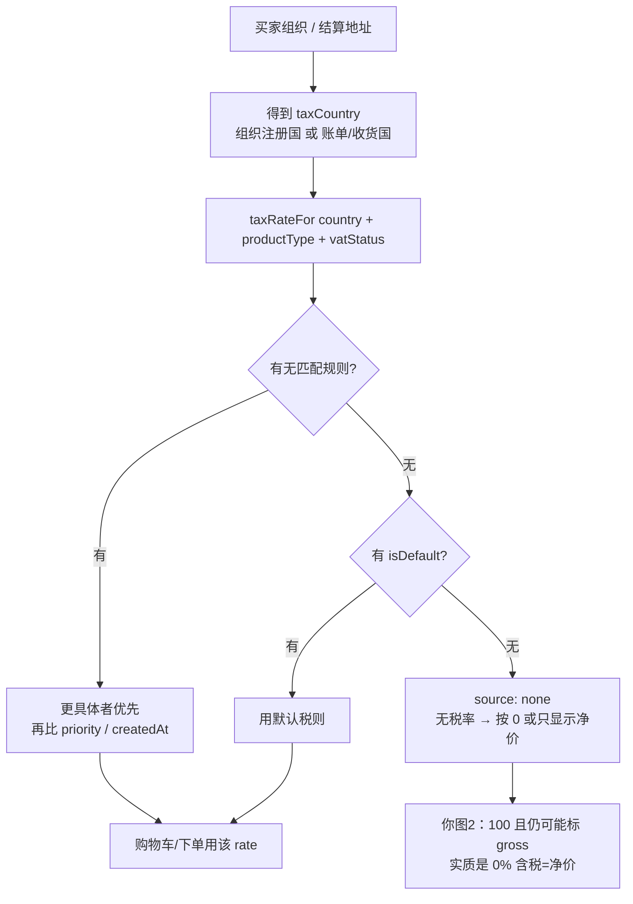

# 2026-11-16-chat1-大B与小b多语系对照 会话沟通记录

用途：对比 cart 与 checkout（eaa80a8）两次 i18n 改法差异，并对照大 B Admin 与小 b 多语系流程（是否必须 t()、能否只维护词条）。
范围：最近 3 轮 ask + 对应 rep。
本文件夹同时存放提问截图：本轮无附图。

---

## chat ask

时间：2026-11-16 18:20

经过对你任务测试：
任务1，我发布ecs 效果ok，i18n 在not-found 页显示正确》

任务2：你分析的信息看起非常对，但是我有回到 demo开源url 测试，在https://admin.demo.commerce.endora.software/taxes 税率配置页：
把上次测试，20%税率，不限制任何国家信息删除，新增2个税率，一个是国家是US，一个是：EN，如图1所示
这时候：在小ｂ上发现，购物车商品　还是上次100 PL　EU 商品，在购物车车中价格，没有加入税部分，显示还是100 单位，如图2所示。
 这样测试目的：就是看小b 取大B 去取那个税率信息来结算本购物车产品税，这个目前需要你在进入分析，给出逻辑。
  正常：不同国家税率不一样，小b 按什么逻辑去取对应税，上次测试，配置20%是不限制任何国家时，小b就默认取这个来计算税。
看起来合理，但是如果我新增了某些国家税，按理小b怎么分别出：本产品应该用那个税率来计算自己税价格。
这个逻辑，目前git 开源项目上有这样逻辑设计？如果有，给我在目前 任务2 分析基础上，在补充描述此逻辑。
  

任务3：
  1：Manage stock（管理库存） 是否开启？ 
   见我目前admin https://admin.justgoai.com/catalog/products/1ebcdccc-f1d5-4208-a669-e48a02c5d038   如图3 ，图4  蓝框配置，看起没有勾选上。且设置最小起订量=1.
  2：另外目前 我们ecs 配置参考如：
  https://admin.justgoai.com/warehouses 
如图 6所示：，看起默认参考没有关联任何物品？是不是这个原因？

   2: 你给我sql 
  查询结果如如图5 所示，且：SELECT id, sku, manage_stock, backorder_enabled, min_order_quantity
FROM catalog_product WHERE sku = 'NVIDIA-H200';
后只有：products 表，没有catalog_product  表结构。查询数据如：
1ebcdccc-f1d5-4208-a669-e48a02c5d038	NVIDIA-H200	true	false	1

 但是我测试发现一个问题，可以能让小b 能正常 下单，到大B admin orders 中查看到下单信息：
是:在：这个产品：https://admin.justgoai.com/catalog/products/1ebcdccc-f1d5-4208-a669-e48a02c5d038 
打开 H200 产品 → Inventory
发现：按仓库库存 下面我配置2个仓库：如图 7所示，其中第一仓库是默认仓库，目前图中看起来是100，但是上次报错时，这个地方设置是0，但是第二参试是200 .
为什么第一个参考 手头有：0时，小b端 下单，会提示上次看到错误。
请分析这个原因？

---

## chat rep

时间：2026-11-16 19:10

## 任务1
已确认生产 OK，本段不展开。

---

## 任务2 补充：多国税则时，小 b「按什么」选税率

开源**有这套设计**，核心不在前端猜国家，而在后端 `TaxService.taxRateFor({ country, productType, vatStatus })`（[taxes 文档](https://docs.commerce.endora.software/modules/taxes/)）。

### 选中规则（与产品无关的「国家」从哪来）



匹配定义（开源与本地 `tax-service.ts` 一致）：

1. 规则某字段为 **null（不限）** → 对该维度一律匹配；有值则必须等于入参。  
2. 多条都匹配 → **收窄字段更多的优先**。  
3. 再按 `priority` 降序、`createdAt` 升序。  
4. 仍无匹配 → 用 **`isDefault=true`**。  
5. 再没有 → **`none`（没有税率）**，不是随便挑 US/UK。

**`country` 入参从哪来（不是商品上的国家）：**

| 场景 | 来源 |
|------|------|
| 购物车读（上游 #436） | 组织税档：`OrganizationTaxProfilePort` → `registeredAddress.country` + `vatStatus` |
| 下单 `placeOrder` | 优先账单国，否则收货国，否则组织注册国 |
| RFQ 等 | 组织国；没有时有的路径会 fallback（如 `'PL'`） |

商品本身**不**决定「用美国税还是英国税」；**买家税籍/地址国家**才进解析器。

### 对照你两次 demo 测试

| 配置 | Demo Buyer（多半 PL 组织）结果 |
|------|--------------------------------|
| 一条「不限国家」20% | 规则对任意 country 都匹配 → 购物车 100→**120** |
| 删掉不限国，只留 **US 15%**、**英国 10%** | 入参 country≈**PL**，对不上 US/GB → **none** → 等效 **0%** → 图2 **100**（标 gross 时 = 净价×1.0） |

所以：不是「小 b 不会取税」，而是 **当前买家国家对不上你配的国别税，又没有默认/不限国规则**。

注意：图里「EN」若指英语，税则国家应是 ISO-2（英国多为 **GB**，不是语言码 EN）。预览可用大 B：`Taxes` → preview（`country` + `productType` + `vatStatus`）。

### 和上次分析的关系

- 上游：后端按上表解析真实税率，再给 cart API。  
- 你们 fork：购物车仍常乘 **`DEFAULT_VAT_RATE=0.23`**，**不会**按国别税表走。  
- 要对齐 demo：合入 cart 的真实 `taxRate` + 去掉前端假 23%；国别行为仍靠上面算法，不靠前端选国。

---

## 任务3 补充：为什么 default 仓=0 就下不了单

### 先澄清「管理库存」勾选（图3/4 vs SQL 图5）

UI 文案是 **「Disable stock management / 禁用库存管理」**：

- **未勾选** = 仍在管库存 → DB `manage_stock = true`（与你 SQL 一致）。  
- **勾选** = 不管库存，才不会因库存拒单。

`min_order_quantity=1`、`backorder_enabled=false` 也与现象一致：无足够可售、又不允许超卖 → `STOCK_UNAVAILABLE`（文案像「不适用于订购数量」）。

### 仓库列表「产品数=0」（图6）不是根因

`Warehouses` 上的「产品/手头」是**该仓有库存记录的商品数/总量**，不是「渠道有没有绑这个仓」。  
`default` 显示 0 产品，只说明当时几乎没货记在这个仓，**不等于**渠道没绑它。

### 为何 default=0、南京=200 仍会拒单（图4/7）

下单锁货流程是：

1. 取**当前销售渠道**绑定的候选仓（`warehouse_channel_assignments`）。  
2. 策略默认多为 **`default_first`**：先扣渠道「默认仓」，不够再从**同属该渠道的其他候选仓**拆分（`resolveAllocations`）。  
3. 仅当**所有候选仓合计可用 &lt; 数量**且不允许 backorder → `STOCK_UNAVAILABLE`。

因此：若 **南京仓未绑到小 b 所用渠道**（常见只有 `default` 在渠道上），候选列表里只有 default：

- default **手头 0** → 合计 0 → 拒单（你上次错误）。  
- 你把 default 改成 **100** → 候选仓有货 → 能下单。  
- 南京 200 **不会参与**，除非它也在该渠道的候选仓里。

若两边都已绑定且策略是 `default_first`，按代码 default=0、南京=200、买 1 件**应能**从南京扣；你当时失败，更符合 **「渠道候选里当时只有 default」**，而不是「看不见南京库存总数」。

### 建议你在大 B 再确认的两点

1. **销售渠道**（如 `default`）→ 仓库绑定：是否同时有 `default` 与 `cn-nanjing`，谁是 **渠道默认仓**。  
2. 产品 Inventory「履行策略」为继承时，实际用的是渠道策略；不必先改起订量。

可选 SQL：

```sql
-- 渠道绑了哪些仓（表名以库为准）
SELECT sc.code AS channel, w.code AS warehouse, a.is_default
FROM warehouse_channel_assignments a
JOIN warehouses w ON w.id = a.warehouse_id
JOIN sales_channels sc ON sc.id = a.sales_channel_id
ORDER BY sc.code, a.is_default DESC;

-- H200 各仓可用
SELECT w.code, sl.on_hand, sl.reserved, (sl.on_hand - sl.reserved) AS available
FROM stock_levels sl
JOIN warehouses w ON w.id = sl.warehouse_id
JOIN products p ON p.id = sl.product_id
WHERE p.sku = 'NVIDIA-H200';
```

---

**一句话**：税按**买家国家/组织税档**匹配税则，不是按商品；库存按下单时**渠道候选仓**扣货，不是按「全平台所有仓合计」。你两次现象都符合这套开源逻辑。

## chat ask

时间：2026-11-16 18:20

---

## chat rep

时间：2026-11-16 19:10
