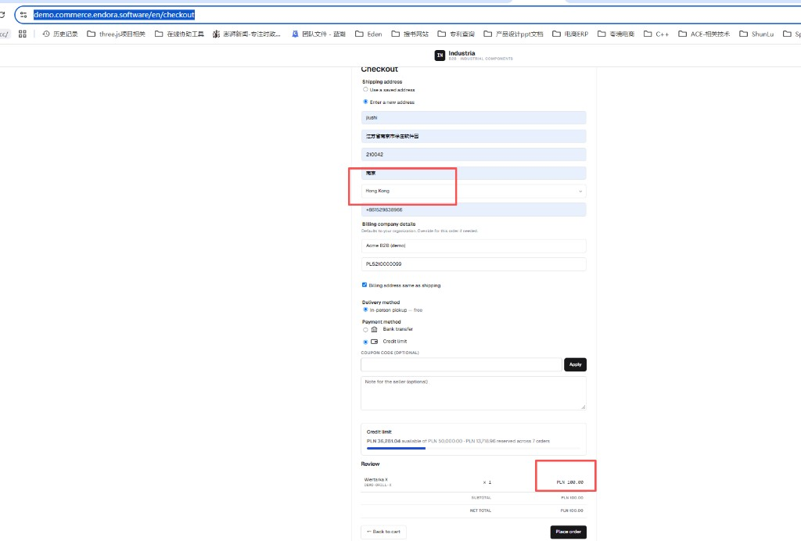
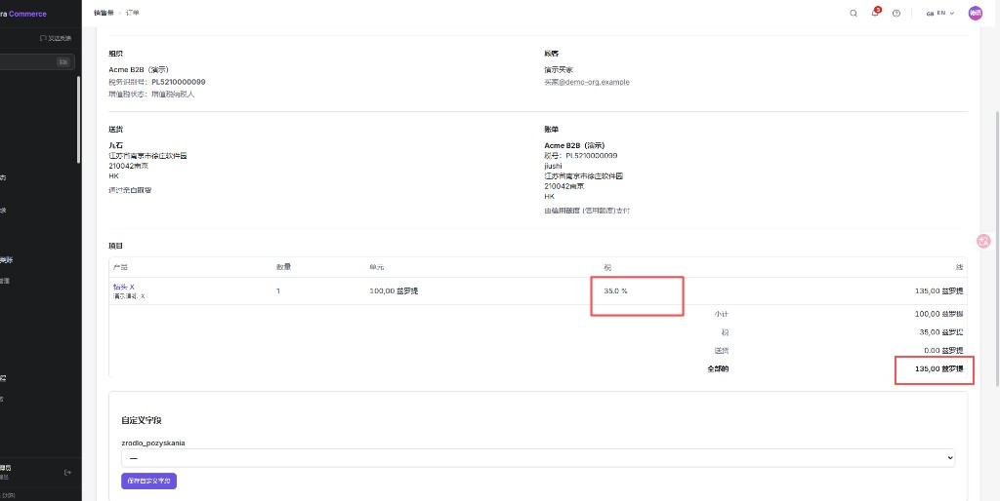

# 2026-11-17-chat1-税A+B合入pick方案 会话沟通记录

用途：确认 HK 35% 实测符合税解析分析，并确定本地按 A+B（#436+#852）cherry-pick 对齐开源 demo。
范围：最近 2 轮 ask + 对应 rep。
本文件夹同时存放提问截图：fig1～fig2。

---

## chat ask

时间：2026-11-17 00:19

OK，任务2，你的描述看起很对，
我在demo开源上有新增测试配置，我配置香港 税：35%，然后在小b 购物车上，发现：商品价格 不含税展示，但是点击结算https://demo.commerce.endora.software/en/checkout ，
在选择发货地址时，选择香港发货，如图1 所示，图中红框时发货地

- **图1** 结算页选香港发货，金额仍显示 100（未即时含税）

，已经下单金额100，而且这里显示还不是含税价格，点击下单后。
直接成功。

在大B 端看到 订单中，对应信息https://admin.demo.commerce.endora.software/orders/bec761f3-bbec-4ccb-abb9-6d7dc96564cc ，效果如图2 所示：图2中，红框提示含税价格。35%。

- **图2** 大 B 订单明细：税率 35%，总额 135


所以这个逻辑符合你上面任务2 的分析 ？

如果是：
我们是不是可以参考 demo git 代码，来优化本地代码，实现本地代码，也支持按国家区域来动态计算税，到下单中提现税价格？

如果是：我们怎么来改造本地代码，是参考 git demo开源代码来改，还是直接合并 demo git开源代码到本项目？类似参考：[2026-11-11-chat2-cherry-pick-168](../../chatlog/2026-11-11-chat2-cherry-pick-168/2026-11-11-chat2-cherry-pick-168.md) [2026-11-13-chat1-Feature167融合方案步骤](../../chatlog/2026-11-13-chat1-Feature167融合方案步骤/2026-11-13-chat1-Feature167融合方案步骤.md) 
pick168 pick 167的模式？

请先分析方案，那个更合适，待我讨论后执行

---

## chat rep

时间：2026-11-17 00:22

## 1. 你这次 HK 35% 实测，是否符合任务 2 分析？

**符合，而且把「结算页不刷税、下单才算税」钉死了。**

| 步骤 | 你看到的 | 机制 |
|------|----------|------|
| 购物车 | 不含税 / 净价感 | 购物车税多半跟**组织税档国家**走；HK 规则未匹配时不会出现 35% |
| 结算页选香港发货（图1） | 仍显示 **100**，不是 135 | **Checkout UI 不按所选地址即时重算税**（demo 也是这样） |
| 点下单成功 | — | `placeOrder` 用账单/收货国（HK）调 `taxRateFor` |
| 大 B 订单（图2） | **35%**，总额 **135** | 后端按 HK 规则入账，正确 |

所以：不是「结算选香港后小 b 当场加税」，而是 **「下单瞬间按地址国家解析税」**；结算页红框 100 与订单 135 **并存，正是开源现状**。

---

## 2. 本地要不要对齐？能对齐到哪一步？

可以，但目标要拆开，避免以为 demo 结算页已经「选地址就变 135」：

| 目标 | Demo 现状 | 本地现状 | 建议 |
|------|-----------|----------|------|
| **A. 下单入账按国家算税**（图2 那种） | 有 | 多半已有 `resolveTaxRate`；你之前卡在库存 | 先验收：HK/CN 地址能否在 Orders 出现正确税率 |
| **B. 购物车展示后端真实税率**（#436） | 有（按组织国等） | 仍常 `DEFAULT_VAT_RATE=0.23` | **应对齐上游** |
| **C. 结算页改地址后即时显示含税** | **没有**（你图1 仍是 100） | 也没有 | **不是**抄 demo 就能有；要另开需求（预览 API / 前端重算） |

若你说的「到下单中体现税价格」= **Admin 订单含税正确** → 对齐 **A**，通常不必大改前端。  
若还要 **购物车别再假 23%** → 对齐 **B**。  
若要 **结算页选香港立刻变 135** → 超出 demo，需单独设计。

---

## 3. 怎么改更合适：手改 / 整仓 merge / 像 167·168 那样 pick？

| 方式 | 评价 |
|------|------|
| 手改几处 `money.ts` / 写死国家 | **不推荐**——税率解析、cart API、组织税档、下单路径是一整条链 |
| `merge upstream/master` | **不推荐**——冲突面和 167 一样大，Mobii/竞价/zh 包易被冲掉 |
| **像 168 / 167：锁定 issue/提交再 cherry-pick** | **推荐** |

对标你们已有经验：

- [cherry-pick 168](../../chatlog/2026-11-11-chat2-cherry-pick-168/2026-11-11-chat2-cherry-pick-168.md)：按功能提交挑，不整仓合  
- [Feature 167 融合](../../chatlog/2026-11-13-chat1-Feature167融合方案步骤/2026-11-13-chat1-Feature167融合方案步骤.md)：新分支 + pick + 保留 Mobii/zh/竞价

税展示建议同样走：

1. 在 upstream 定位 **#436（cart 行税/lineGross）**、必要时 **#852（目录 vatRate）** 相关 commits（可能不止 1 个）。  
2. 新分支从当前主线拉出，`cherry-pick` 这些提交（或等价最小集）。  
3. 冲突优先保留：Mobii、竞价、`messages` 四语、已合 167/168。  
4. 验收：组织国/默认税 → 购物车；下单换 HK → Orders 税率；**不要**期望结算页即时变 135（除非另做 C）。

规模预期：比「改一个 Header」大，但通常 **小于整包 167**；会动 `carts`、contracts/port、`storefront` money/CartLine，可能还有 catalog。

---

## 拍板前请你定的范围

请选一个（或组合），确认后再按 167/168 模式出具体 commit 清单与步骤：

1. **只保证 A**：下单/Orders 按国家税正确（最小）  
2. **A + B**：再去掉购物车假 23%，接上游真实税率  
3. **A + B + C**：结算改地址即时含税（demo 没有，工作量最大）

你定范围后，我再给对应的 pick 范围与操作步骤（仍先方案、你同意再执行）。

---

## chat ask

时间：2026-11-17 00:24

定的范围：
2： A + B：再去掉购物车假 23%，接上游真实税率
是不是选择2 ，就和开源demo 目前状态一致了？
如果是，请给对应的 pick 范围与操作步骤

---

## chat rep

时间：2026-11-17 00:28

## 选 2（A+B）是否等于开源 demo 现状？

**基本是——对齐的是 demo 的「购物车真实税率 + 下单入账按国家税」；结算页仍多半显示净价，这点和你在 demo 上选香港仍显示 100、下单后订单 135 一致。**

| 能力 | Demo | 选 2 后本地预期 |
|------|------|----------------|
| 购物车含税 | 后端按**组织税档国家**解析税率，不再假 23%（[#436](https://github.com/endora-commerce/endora-commerce/issues/436) / PR [#850](https://github.com/endora-commerce/endora-commerce/pull/850)） | 同左 |
| 目录/PDP 含税 | 产品带 `vatRate`，去掉 `DEFAULT_VAT_RATE`（[#852](https://github.com/endora-commerce/endora-commerce/issues/852) / PR [#896](https://github.com/endora-commerce/endora-commerce/pull/896)） | 同左 |
| 结算页改地址即时变税 | **没有**（你图1 仍是 100） | **仍没有**（属范围 3） |
| 下单后 Admin 订单含税 | 有（HK→35%→135） | 有（A；你们多半已具备，B 不替代它） |

说明（与 demo 相同）：**购物车税用组织注册国；下单税用账单/收货国**——换香港地址只在下单后进订单，不保证购物车立刻变 35%。

本地确认：**尚未**包含这两笔（`c7da7fad5` / `d0d11e6e5` 都不是当前 `HEAD` 祖先）。

---

## Pick 范围（按 167/168 模式，不要整仓 merge）

**顺序必须：先 #436，再 #852**（#852 把税率解析抽到 contracts 的 `createProductTaxRateResolver`，依赖 #436 那套）。

### 批次 1 — Cart VAT（#436 / PR #850）

| Commit | 说明 |
|--------|------|
| `4bb4bc5af` | test: pin cart VAT = order |
| `bf1cc2d89` | fix: cart API + storefront 渲染真实 VAT |
| `59fb29225` | docs（可选，建议带上） |

规模约 **26 files / +908**。也可试 `cherry-pick -m 1 c7da7fad5`（merge），冲突时再改成上面 3 个。

### 批次 2 — Catalog/PDP VAT（#852 / PR #896）

| Commit | 说明 |
|--------|------|
| `1278970a7` | test: product gross = own VAT |
| `14fe4fb88` | fix: catalog `vatRate` + 删 `DEFAULT_VAT_RATE` |
| `b05479503` | storefront 兼容 override（建议带上） |

规模约 **43 files / +800**。可选 merge：`d0d11e6e5`。

**本范围不 pick：** `#853`（结算页 Total 文案）、结算即时税预览。

**冲突时保留：** Mobii / 竞价 / `messages` 四语 / 已合 167·168。

---

## 操作步骤（对齐 167/168）

```bash
cd ~/github/endora-commerce
git status   # 先干净：commit 或 stash（含 not-found 等未提交改动）

git fetch upstream master

git checkout -b feat/vat-436-852-from-upstream origin/master
# 或从你们当前生产线分支拉：feat/storefront-167-from-upstream

# —— 批次 1：#436 ——
git cherry-pick 4bb4bc5af
git cherry-pick bf1cc2d89
git cherry-pick 59fb29225
# 冲突：优先保留 Mobii/zh/竞价；composer:generate / manifests:generate 若触碰则按上游跑一遍再提交

pnpm run build:packages
pnpm --filter contracts exec vitest run src/carts.test.ts
pnpm --filter storefront exec vitest run test/components/CartLine.test.tsx test/components/CartTotals.test.tsx test/lib/money.test.ts

# —— 批次 2：#852 ——
git cherry-pick 1278970a7
git cherry-pick 14fe4fb88
git cherry-pick b05479503

pnpm run build:packages
pnpm --filter storefront exec vitest run test/components/product-vat-rate.test.tsx test/lib/gross-derivation.test.ts test/lib/money.test.ts
```

**验收（对齐 demo）：**

1. 大 B 配「不限国家」税 → 小 b 购物车含税跟该税率（不再死 23%）。  
2. 只留 US/HK 等国别税、组织国对不上 → 购物车接近净价/0% 含税感。  
3. 结算改香港仍可显示净价；下单后 Admin 订单税率/总额正确。  
4. 发版：至少 **backend + storefront**（contracts/carts/catalog 进 backend 镜像）。

---

你确认「按上面步骤执行 pick」后，我再开工（先保证工作区干净、拉分支、按批 cherry-pick）。
