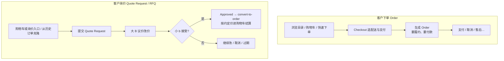
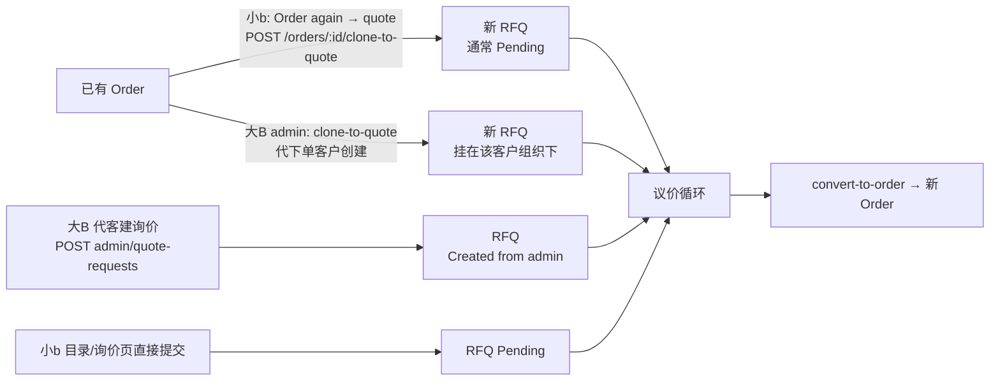

# 2026-11-20-chat2-项目下订单和询价单的流程分析

用途：2026-11-20-chat2-项目下订单和询价单的流程分析

---

## chat ask

时间：2026-11-20 00:19

上面 batch-44 测试ok。
接下来我们做其他测试流程的优化：

一：按问题分类 
1：il8n 问题
   1.1:  小b https://www.mobiib2b.com/zh-cn/orders/7972cb51-8dd1-4cdf-a24f-5402bb747507 ，订单详情中，目前是cn模式，但是order详情内部还部分英文状态。见图1 蓝框都是问题地方，可能还有我框出来的部分，请你自己check下 此页那些需要il8未处理。
   1.2： 小b https://www.mobiib2b.com/zh-cn/quote-requests/aab547d6-4f2d-489c-af0a-6ba12b11b3fa  ，询价详情页，在cn模式下，也有很多未被i18n处理的部分，见图2 蓝色方框的区域，里面很多内容还是PL语系。可能还有我框出来的部分，请你自己check下 此页那些需要il8未处理。

2：另外请帮我整理下业务流程
  2.1: 客户下单 和 客户询价单 ，这2流程各在本平台下，分别对应什么业务流程，用户分别在什么情景下发起对应的流程。
       另外：这个2个流程，有互相流程上串联的部分，如：我发现在大B admin orders中，大B管理就可以就小b发起的订单，主动发起询价单，发起后：在大B 的 https://admin.mobiib2b.com/quote-requests  就有新记录，客户小b  https://www.mobiib2b.com/zh-cn/quote-requests  也会多一条记录。
      但是这种发起询价，看起来是大B admin用户发起询价请求，不是小b发起询价请求。
  正常逻辑，不是询价时小b 向大B发起询价请求吗？而且是基于小b发起订单为基础来发起，
   另外：我也确实也发现 小b 用户可以也可以从自己发现某个order详情主动发起询价请求。
  这2种方式，有什么不同地方，大b 和 小b用户都可以发起询价，为什么这样设计？
   另外：https://www.mobiib2b.com/zh-cn/orders/3f4ab27f-7644-4ba2-9e43-0c7682611dc0   是小b 某个订单，其中：页面见图3 ，红框种按钮，再次下单-》询价，
是重新下个订单+询价，还是仅仅询价？

 请处理上面2类问题，
1：il8n，请分析后，需要做优化代码方案。
2：业务流程咨询问题，请给我分析目前项目流程问题，可以用流程图来补充描述。


---

## chat rep

时间：2026-11-17 00:22
## 第一步：需求复述（请确认）

我理解你本轮要做两件事（**确认前不改代码、不拆 do-task 编号**）：

**1. i18n（小 b storefront）**  
- **1.1** 订单详情页（如 [订单 7972…](https://www.mobiib2b.com/zh-cn/orders/7972cb51-8dd1-4cdf-a24f-5402bb747507)）在 `zh-CN` 下仍有英文/未接线文案（图1 蓝框 + 同页漏检项）。  
- **1.2** 询价详情页（如 [询价 aab5…](https://www.mobiib2b.com/zh-cn/quote-requests/aab547d6-4f2d-489c-af0a-6ba12b11b3fa)）在 `zh-CN` 下仍有大量波兰语硬编码（图2 蓝框 + 同页漏检项）。  
- 产出：**分析清单 + 按仓库统一模式（`t` + `messages.ts`，en/zh-CN/zh-TW/pl 一次补齐）的优化方案**；你确认后再实现。

**2. 业务流程说明（咨询，不改代码）**  
- 理清「客户下单」vs「客户询价」各自场景与串联。  
- 解释大 B / 小 b 都能从订单发起询价的差异与设计原因。  
- 明确图3「再次下单 → 询价」是只询价还是订单+询价。

若以上理解正确，请回复 **「正确」或「同意」**；同意后我再按 do-task 拆编号并实现 i18n。下面先交分析结论。

---

## 1. i18n 问题分析与优化方案

### 根因（两页不同）

| 页面 | 源文件 | 现状 |
|---|---|---|
| 订单详情 | `storefront/app/(account)/orders/[id]/page.tsx` | 大量 **英文硬编码**；仅取消/重试付款等少量走 `t()` |
| 询价详情 | `storefront/app/(account)/quote-requests/[id]/page.tsx` | 几乎整页 **波兰语硬编码**（含 `toLocaleString('pl-PL')`）；列表页已有 `account.rfq.*`，详情未复用 |

图3 若出现「地位」等怪译，多半是浏览器整页翻译或错误机翻；**仓库源码里该节标题仍是英文 `Status`**，应以源码为准做 `t()` 接线。

---

### 1.1 订单详情：需 i18n 清单（含未框部分）

文件：`storefront/app/(account)/orders/[id]/page.tsx`

| 区域 | 当前硬编码（例） | 建议 |
|---|---|---|
| 标题/成功条 | `Thank you — order placed` / `Order … has been received` | `t('…')` |
| 404 | `Order not found` 等 | `t('…')` |
| 银行转账说明 | `Pay by bank transfer…` | `t('…')` |
| 操作按钮 | `Order again → cart` / `Order again → quote request` / `See all orders` / `Download invoice {n}` | `t('…')`（图1 蓝框） |
| Status 区 | `Status` / `Order status` / `Payment status` / `Placed` | `t('…')`；**paymentStatus 原样 `awaiting_payment` 也要译** |
| Items 表头/合计 | `Product/Qty/Unit/Line`、`Subtotal/Tax/Discount/Delivery/Total` | `t('…')` |
| 待付款提示 | `This order is awaiting payment…` | `t('…')` |
| Comments | 标题、空态、关闭提示、placeholder、按钮 | `t('…')` |
| action 错误兜底 | `Could not reorder.` 等 | `t('…')` |
| 日期 | `toLocaleString()` 无 locale | 传入页面 `locale` |
| 订单状态值 | `resolveOrderStatusLabel` 已按 locale | 可保留；核对后台是否有 zh-CN |

**已接线（可不动）：** `order.cancel.*`、`order.payment.retry.*`、部分 return/payment notice。

---

### 1.2 询价详情：需 i18n 清单（含未框部分）

文件：`storefront/app/(account)/quote-requests/[id]/page.tsx`

| 区域 | 当前（PL） | 建议 |
|---|---|---|
| 返回/404 | `← Lista zapytań`、`Nie znaleziono…` | `t('…')`；可复用/扩展 `account.rfq.*` |
| 标题/元信息 | `Zapytanie #`、`Utworzone` / `zgłoszone` | `t('…')` + **`toLocaleString(locale)`**（勿写死 `pl-PL`） |
| 状态徽章 | `Oczekuje`、`Od opiekuna` 等 | **已有** `account.rfq.status.*`，详情应改用 `t()` |
| 表头 | `Produkt/Ilość/Cena żądana/…` | `t('…')` |
| 合计 | `Suma netto` / `VAT` / `Suma brutto` | `t('…')` |
| 备注/取消原因 | `Uwagi` / `Powód anulowania` | `t('…')` |
| 对比块 | `Co zmieniło się…` | `t('…')` |
| 历史 | `Historia zmian` + `describeEvent` 波兰词典 | `t('…')` 或按 eventType 的 key |
| server action 错误 | `Nie udało się…` | `t('…')` |
| `RfqDetailActions` | 需一并核对按钮文案 | 同模式 |

---

### 建议实现方案（确认后执行）

1. **统一模式**：页面一律 `tForLocale(locale)` → `t('key')`；词条写入 `storefront/lib/i18n/messages.ts`，**en / zh-CN / zh-TW / pl 一次补齐**（遵守 i18n-unified-pattern）。  
2. **订单页**：硬编码 → `t()`；补 `paymentStatus.*` 等枚举文案。  
3. **询价页**：去掉 PL 硬编码与 `pl-PL` 写死；状态优先接已有 `account.rfq.status.*`。  
4. **测试**：对关键 key/渲染补 storefront 测试（按仓库惯例）。  
5. **范围**：本批只动上述两页及相关 `messages` / 测试，不改业务流程。

---

## 2. 业务流程说明

### 2.1 两条主流程分别是什么



| | **下单 Order** | **询价 Quote Request** |
|---|---|---|
| 本质 | 买卖契约：价、量、履约与付款 | 议价单据：先谈妥再转订单 |
| 典型场景 | 目录价可接受、要马上买 | 量大要议价、定制/缺货谈价、销售代客报价 |
| 钱与货 | 有 `paymentStatus`、履约状态 | 谈妥前一般不进入正式履约付款 |
| 终点 | 完成/取消等 | Approved 后可 **转成订单**；或取消/过期 |

---

### 2.2 订单 ↔ 询价如何串联



- 大 B 在 [admin quote-requests](https://admin.mobiib2b.com/quote-requests) 看到新记录、小 b 在 [storefront quote-requests](https://www.mobiib2b.com/zh-cn/quote-requests) 也多一条：**同一张 RFQ，双边可见**，不是两套单。  
- 大 B「从订单发起询价」：**不是**大 B 自己当买家询价，而是 **替该订单的客户** 拉出一张 RFQ（文档/规格：admin clone 以下单客户身份创建）。

---

### 2.3 大 B 发起 vs 小 b 发起：有何不同？为何都要有？

| | **小 b 发起** | **大 B 发起** |
|---|---|---|
| 入口 | 询价页；或订单「再次下单 → 询价」 | Admin 订单 clone-to-quote；或代客 `createOnBehalf` |
| 常见状态 | `Pending`（等销售处理） | 代客创建多为 `Created from admin`（等客户接受） |
| 主动权 | 客户要谈价 | 销售主动报价/从历史单再开谈 |
| 设计原因 | 标准 B2B RFQ | 销售代表可代客起草；客户再 Accept（见模块文档 statuses） |

「正常不该只有小 b 向大 B 询价吗？」——**客户主动询价是主路径**；**销售代客报价是并列能力**，适合电话/线下谈妥后系统落单、或订单谈崩后销售重开议价。两边都能从订单 clone，是为了 **复用历史行项目**，避免手抄 SKU/数量。

---

### 2.4 图3「再次下单 → 询价」到底做什么？

**只创建询价单，不会再下一笔订单。**

代码路径：

```449:461:storefront/app/(account)/orders/[id]/page.tsx
async function reorderToQuoteAction(formData: FormData): Promise<void> {
  // ...
  await cloneOrderToQuote(session, id, ctx);
  // ...
  return await localeRedirect('/quote-requests');
}
```

- 调用：`POST /api/v1/orders/:id/clone-to-quote`（把订单行克隆成 RFQ）。  
- 成功后跳转：`/quote-requests`（询价列表）。  
- 对比：「再次下单 → 购物车」才是 `reorder` → 购物车/checkout，那才是再买一单。

文案写成「再次下单 → 询价」容易误解；i18n 时可改成更准确的中文，例如「按此单发起询价」。

---

## 请你确认

请回复 **「正确」或「同意」**（或指出要改的范围）。确认后我将：

1. 按 do-task 对新批次编号；  
2. 只实现 **1.1 + 1.2 的 storefront i18n**（`t` + `messages.ts` 四语）；  
3. **不改**下单/询价业务逻辑（本轮咨询结论已给出）。  

若你还希望顺带改按钮中文语义（避免「再次下单→询价」歧义），也可以在确认里写明。