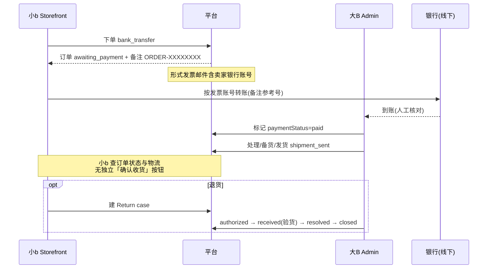
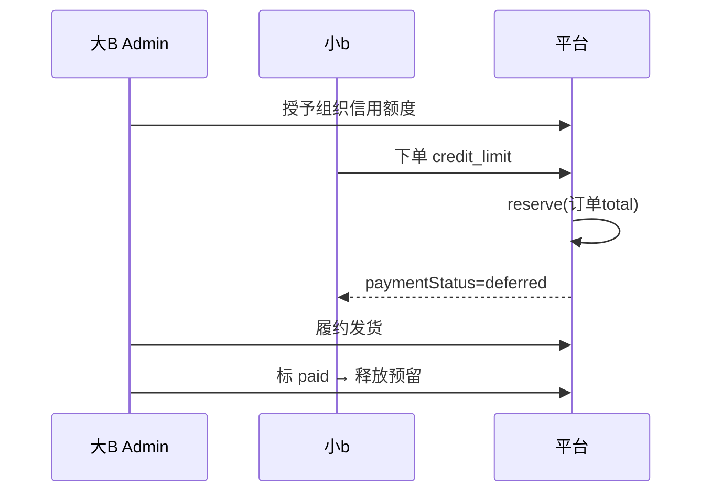
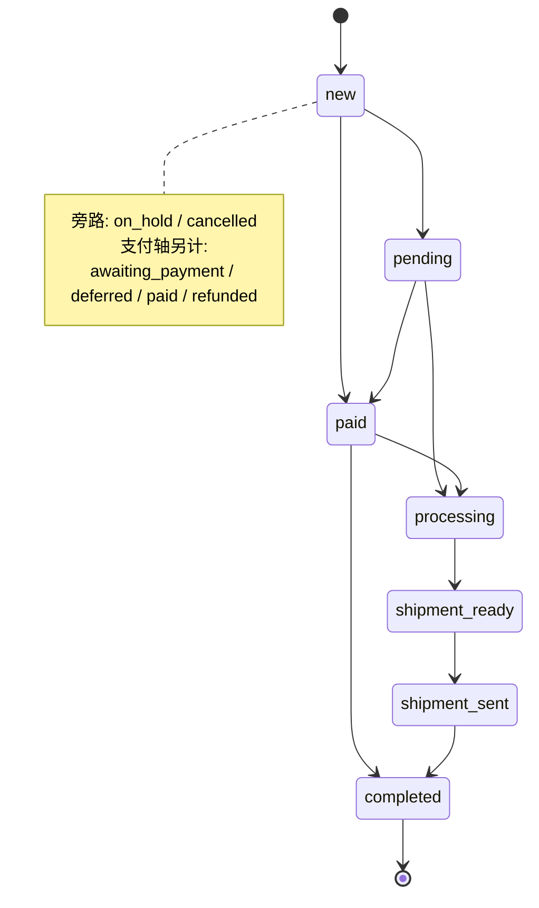
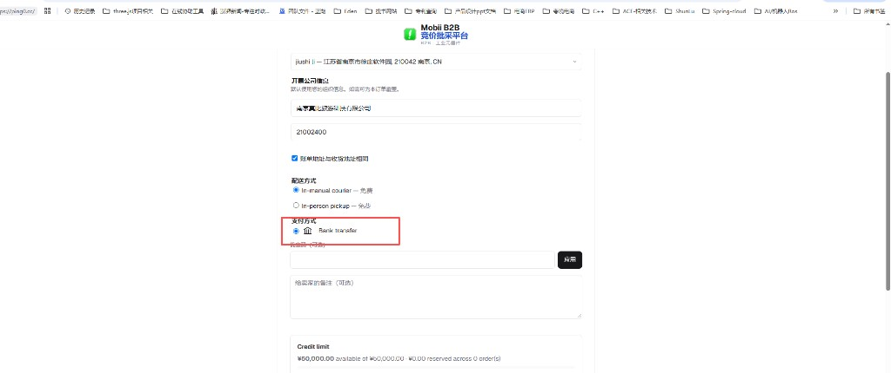
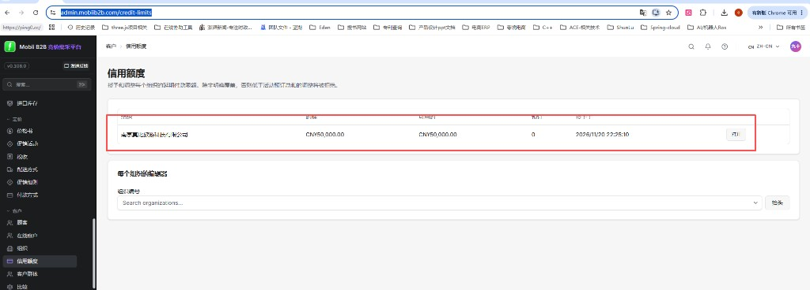
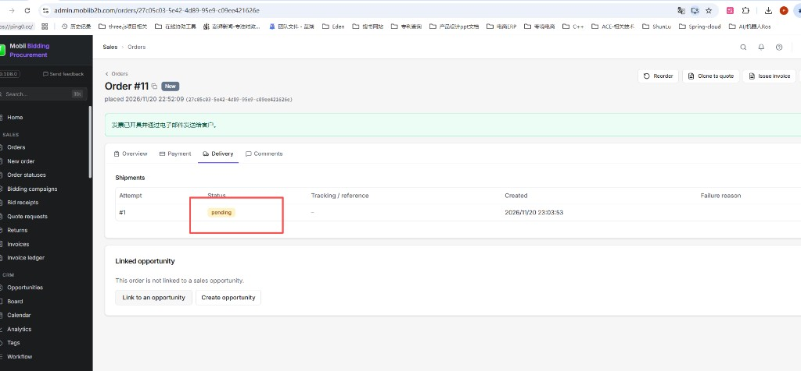
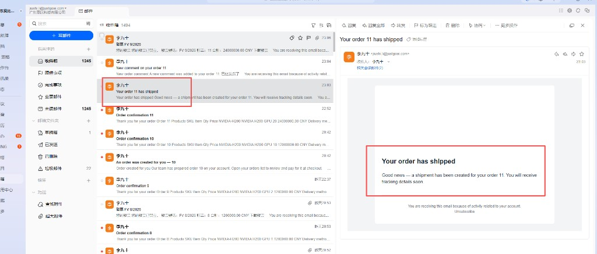
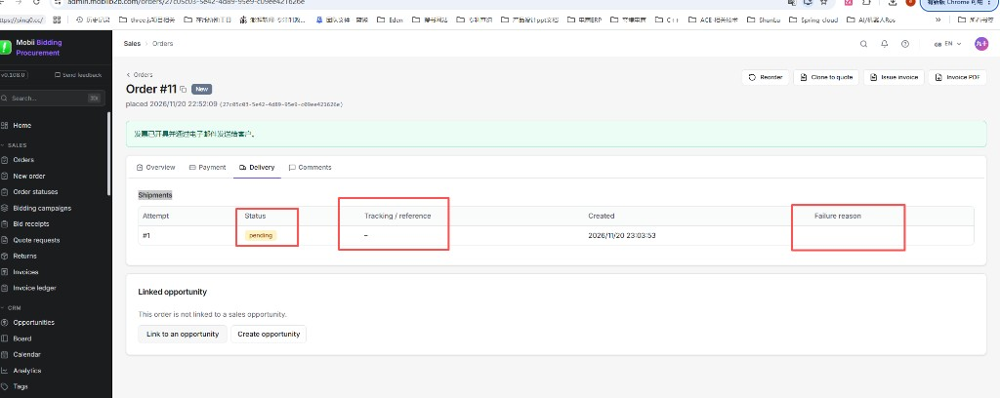
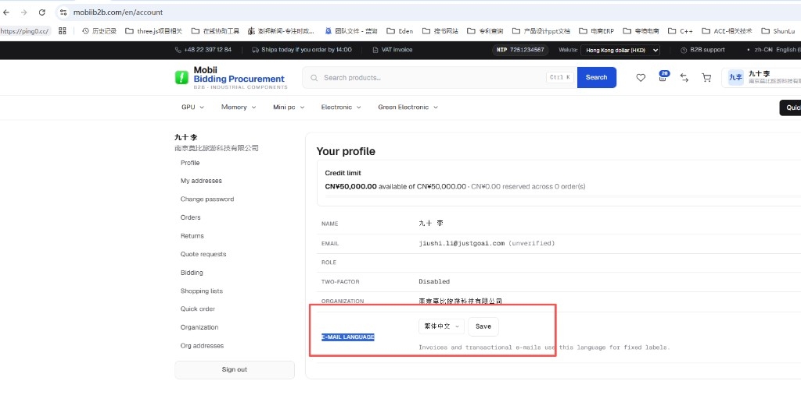
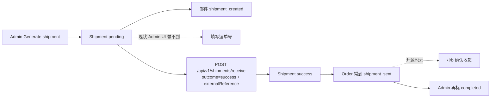

# 2026-11-20-chat5-大B和小b订单银行和额度支付发货退货流程分析 会话沟通记录

用途：2026-11-20-chat5-大B和小b订单银行和额度支付发货退货流程分析
范围：银行支付 / 信用额度 / 发货收货退货流程咨询；对照开源；后续 checkout 额度选项与发货邮件语系问题
本文件夹同时存放提问截图：fig1～fig6。

---

## chat ask

时间：2026-11-20 21:59

OK，我们接着对本项目进行优化处理，优化内容分2类：1类：代码优化，2类:项目流程咨询，但是2类咨询过程中，需要去和开源项目目前状态对比：https://github.com/endora-commerce/endora-commerce ，可能会存在代码融合情况需求。

下面是这2类问题list
1：目前项目中，小b客户下单时，支付方式有2种，一种银行支付，一种信用额度支付。问题是：
   if 银行支付，小b客户怎么 給大B的银行转账呢，因为订单中，没有大B平台 公司银行账户信息。小b怎么給大B转账？转账后，在怎么跟进订单状态和发货信息？大B 和 小b这个订单 发起 -付款- 发货-收货-验货-退货的 流程是什么，可以用图的方式描述？
   if 额度支付，哪小b的额度从哪里获取？ 额度怎么和钱对标上，换算的？

请先分析我的问题

---

## chat rep

时间：2026-11-20 22:00

## 我对你问题的理解（请先确认）

你这次要做两件事，但**当前这条问题属于第 2 类（流程咨询）**，不是立刻改代码：

| 类别 | 含义 | 本次是否启动 |
|------|------|--------------|
| **1 类：代码优化** | 对照产品缺口改本仓库实现 | 暂不启动，等流程结论 |
| **2 类：项目流程咨询** | 先弄清业务闭环；必要时对照开源仓 [endora-commerce/endora-commerce](https://github.com/endora-commerce/endora-commerce)，看本地是否要融合/补齐 | **本次先做** |

---

### 你真正在问的核心

小 b 下单有两种支付方式，你关心的不是「页面上有没有按钮」，而是**钱怎么到账、额度从哪来、订单状态怎么跟到发货/退货**：

#### A. 银行支付（Bank transfer）

1. **收款信息缺口**：订单里没有大 B 公司银行账户时，小 b 往哪转、转给谁？
2. **付款后跟进**：转账完成后，谁确认到账？订单状态怎么变？发货信息怎么通知小 b？
3. **全流程闭环**：大 B ↔ 小 b 在  
   `下单 → 付款 → 发货 → 收货 → 验货 → 退货`  
   各自做什么、系统状态怎么跳？希望用**流程图**说明。

#### B. 信用额度支付（Credit / account limit）

1. **额度来源**：小 b 的可用额度是谁授信、在哪里配置/审批出来的？
2. **额度与金额**：下单扣额度时，额度单位如何与订单金额（币种、含税/不含税）对齐、换算？

---

### 我准备怎么答（确认后才执行）

1. **先查本仓库**：银行支付、收款账户展示、到账确认、信用额度、订单状态机相关实现与文档。  
2. **再对照开源仓**：同一能力是否已有更完整流程；若有差距，标出「仅文档缺口 / 需代码融合 / 需产品决策」。  
3. **产出**：流程图 + 角色职责表 + 与开源差异清单（仍属咨询；**不自动改代码**，除非你确认进入 1 类）。

---

### 我需要你确认的两点

1. 上面复述是否准确？有无遗漏或优先级调整？  
2. 「大 B 银行账户」是否指：**平台运营方账户**，还是 **每个供应商/卖家各自账户**？（这会影响收款信息挂在哪一层。）

请回复「正确」或「同意」（或补充修正）。确认后我再按 do-task 分解并对照开源仓做流程分析。

---

## chat ask

时间：2026-11-20 22:02

正确

---

## chat rep

时间：2026-11-20 22:06

## 结论（先说清楚）

你感觉「订单里没有大 B 银行账户」**判断正确**；但开源仓也是同一设计，**不是本仓漏合代码**。

银行支付的产品假设是：账号印在**形式发票/邮件**上，不在 checkout 订单页；到账靠**大 B 人工确认**。额度支付是**同币种货币授信**，不是积分换算。

---

## 1. 银行支付：小 b 怎么转账？

| 问题 | 现状 |
|------|------|
| 账号存在哪？ | Admin → Settings → `invoices.seller.company_data`（`bankName` / `bankAccount` / `swift`）——这是**卖家（大 B 平台）公司资料** |
| 账号展示在哪？ | **发票 PDF**（`showSellerBank`），不是订单详情页 |
| checkout 给什么？ | `BankTransferAdapter` 固定返回 `iban: null` + 汇款备注 `ORDER-{订单ID前8位}` |
| 小 b 看到什么文案？ | 「请按邮件形式发票上的参考信息转账；到账后我们更新状态」 |
| 谁确认到账？ | 大 B Admin：`POST .../orders/:id/payment-status` → `paid`（无自动银行对账） |

**实操路径（当前产品意图）**

1. 大 B 先在 Settings 填好公司银行账户  
2. 小 b 选银行支付下单 → 等待形式发票邮件  
3. 小 b 按发票上的账号 + `ORDER-XXXXXXXX` 备注转账  
4. 大 B 财务核对到账后，在 Admin 把订单标为已付  
5. 之后大 B 履约发货；小 b 在订单页看状态/物流

若 Settings 里银行字段为空，连发票也印不出账号——那是**运维配置缺口**，不是适配器 bug。

开源对照：[upstream `BankTransferAdapter`](https://raw.githubusercontent.com/endora-commerce/endora-commerce/master/packages/modules/payments/src/backend/adapters/built-in-adapters.ts) 同样是 `iban: null`；官方 docs 也写 settlement out-of-band。**无需为对齐开源做融合。**

---

## 2. 信用额度：从哪来？怎么和钱对标？

| 项 | 说明 |
|----|------|
| 来源 | 大 B Admin 对**小 b 组织**授信：`POST /admin/organizations/:id/credit-limit` |
| 单位 | `grantedAmount` + ISO 币种（如 PLN/CNY）——**就是钱，不是积分** |
| 可用额 | `available = granted − Σ(活跃预留)` |
| 下单 | 预留金额 = **订单 `total`（应付总额）**，币种必须一致，否则 `CURRENCY_MISMATCH` |
| 下单后支付态 | `paymentStatus = deferred`（赊购/延期结算） |
| 释放预留 | Admin 标 `paid`（`invoice_paid`）或订单取消 → 可用额回升 |
| 退货 | 可结算为给额度加授信（`creditFromReturn`），与「释放预留」不同 |

没有汇率换算层：订单币种必须等于授信币种。

---

## 3. 全流程（含你列的验货/退货）

系统是**双轴**：订单生命周期 `Order.status` + 支付轴 `paymentStatus`。  
**没有**独立的「买家确认收货 / 验货」订单态；验货语义在退货单的 `received`。

### 3.1 银行支付主路径



### 3.2 额度支付主路径



### 3.3 订单状态（默认图，可配置）



| 你说的阶段 | 系统对应 | 谁操作 |
|------------|----------|--------|
| 下单 | `new` + `awaiting_payment` 或 `deferred` | 小 b |
| 付款 | 银行：线下转账 + Admin 标 `paid`；额度：下单即赊购，日后标 `paid` 释放额度 | 小 b + 大 B |
| 发货 | `processing` → `shipment_ready` → `shipment_sent` | 大 B（+ shipments） |
| 收货 | 承运/Admin `receive_shipment`；**非**小 b「确认收货」产品态 | 大 B / 承运 |
| 验货 | 退货 case 的 `received` | 大 B |
| 退货 | `new→authorized→received→resolved→closed` | 小 b 发起，大 B 审结 |

---

## 4. 与开源对比 / 是否要融合

| 能力 | 本仓 | 开源 | 结论 |
|------|------|------|------|
| `iban: null` | 有 | 有 | 一致，非漂移 |
| 银行账号在 seller company_data / 发票 | 有 | 有 | 一致 |
| Admin 人工标 paid | 有 | 有 | 一致 |
| 组织授信 + reserve | 有 | 有 | 一致 |
| checkout 直接展示账号 | 无 | 无 | 若要做 = **本仓产品增强**，不是 pick 开源 |

---

## 5. 若进入「1 类代码优化」，可选方向（未做）

1. **运维**：先确认生产 Settings 已填银行账户，并验证形式发票邮件真发出去  
2. **体验增强**：把 `seller.company_data.bankAccount` 注入 `awaiting_transfer`，并在 Success/订单页展示账号表（开源也没有，需自研）  
3. **流程增强**：小 b「确认收货」独立态（开源也没有，属新产品）

---

建议 commit 文案（未执行 git）：

`feat-26-11-20 22:06:54 [56.1~56.5]：银行支付/额度/履约流程咨询对照开源，无代码融合`

---

下一步你更想做哪条？  
A) 只补运维检查清单（确认卖家银行资料 + 发票邮件）  
B) 做代码：checkout/订单页展示大 B 银行账号  
C) 继续下一批「2 类流程咨询」问题

---

## chat ask

时间：2026-11-20 23:21

一：你上次回复中：
5. 若进入「1 类代码优化」，可选方向（未做）
1：运维：先确认生产 Settings 已填银行账户，并验证形式发票邮件真发出去。

  测试ok。
2：体验增强：把 seller.company_data.bankAccount 注入 awaiting_transfer，并在 Success/订单页展示账号表（开源也没有，需自研）
     咨询：在小b的订单详情中，展示大B账户意思？是：B) 做代码：checkout/订单页展示大 B 银行账号 这个？如果是暂时不需要，因为跟进发票pdf 来付款更合适。

3：流程增强：小 b「确认收货」独立态（开源也没有，属新产品）
   咨询：是不是就是目前平台发货流程 不够闭环？需要优化，我刚测试 也又发现这个情况，见后面 接下来做的list中有提到.    


二： 接下来，我们做的优化工作包含如下：
1：
请把上面最后一轮ask reps的reps 补充到本文件空缺的第二轮 rep（原先 79-83 附近）。前几轮我手工添加进入了。

2：结合你上面的描述流程，我发现额度支付，目前项目测试发现：
https://www.mobiib2b.com/zh-cn/checkout 
checkout 无法选择额度支付，但是大B 已经給此客户配置额度。见图1，只支持银行支付。无额度支付。
https://admin.mobiib2b.com/credit-limits 见图2 ,授权50000额度。

请问为什么，checkout 无法选择额度支付？

- **图1** checkout 仅 Bank transfer，底部仍显示 Credit limit ¥50,000


- **图2** Admin 已给组织授信 CNY 50,000


3： 我测试了某个订单发货 ，在：https://admin.mobiib2b.com/orders/27c05c03-5e42-4d89-95e9-c09ee421626e 
  新建发货流程，效果图3所示。
  小b客户邮箱有收到发货通知 ”Your order has shipped“。见图4 所示。
  这里问题：
   3.1：新建这个发货流程，只是插入记录，給小b客服发送邮件通知而已。邮件提示中没有发货物流信息，客户一般需要发货物流信息的。所以大B 新建发货信息，图5中红框的状态，后面怎么去迭代更新？因为有物流介入，用户收货确认来渠道这个发货流程后台状态。
  但是这里没有看到这个体现流程？
   这个流程是不是缺：也就是建议 可选反向中：3.流程增强：小 b「确认收货」独立态（开源也没有，属新产品）
   如果要新增这个流程，我们要怎么做？

- **图3** Order #11 Delivery：Shipment #1 status=pending


- **图4** 小b邮箱发货通知为英文且无运单号


- **图5** Tracking 为空、Failure reason 空、status 停在 pending


   3.2：这里在大B 新建物流，会送邮件信息給小b，但是这个邮件文字，没有对标：发票通知的模式，邮件文字，默认看起来用的EN语系，没有根据小b 自己配置的 ”E-mail language“ 配置的语言来发送。目前配置是中文，见图6.
  但是图4 是小b 邮件，你看到 ：新建发货流程” Delivery“，” Comments“ 都会給小b发送邮件，他们都是用英文发送，没有用中文。
但是：发送发票，邮件通知，是在前期我们优化过程中，要求給小b发送邮件通知，都要按小b客户 在客户端配置的语言，动态获取配置来发送。
  这里是不是要优化下。

- **图6** 小b Profile 的 E-mail language = 简体中文


---

## chat rep

时间：2026-11-20 23:30

## 一、对上轮「可选方向」的澄清

1. **运维（银行账户 + 形式发票邮件）**：你已测 OK，关闭。
2. **体验增强（checkout/订单页展示大 B 银行账号）**：**就是**上次说的 B。你选择跟进发票 PDF 付款 → **暂不做**。
3. **流程增强（小 b「确认收货」）**：**是的**，指向发货闭环不完整（创建 shipment → 物流单号 → 妥投/确认 → 订单完成）。开源也没有买家确认收货；要做属**新产品**，不是融合开源。

---

## 二.1 chatlog

已把第二轮「正确」对应的完整流程分析 rep 补进本文件；本轮 ask（含 fig1～fig6）一并归档；空壳轮次已去掉。

---

## 二.2 为什么 checkout 有额度 Widget，却选不了额度支付？

**授信 ≠ 支付方式。** 两条独立链路：

| 链路 | 接口/条件 | 你截图上的表现 |
|------|-----------|----------------|
| Credit limit Widget | `GET /api/v1/me/credit-limit` 有授信就显示 | 底部 ¥50,000 available |
| 支付方式列表 | `GET /api/v1/payment-methods` 里要有 `kind=credit_limit` 且 active，再经 storefront `selectablePaymentMethods` 过滤 | 只有 Bank transfer |

Storefront 过滤逻辑（有授信时仍要求目录里先有 `credit_limit` 方法行）：

```30:51:storefront/lib/checkout/payment-method-eligibility.ts
export function selectablePaymentMethods(
  methods: readonly PaymentMethodSummary[],
  buyer: {
    creditAvailable: number | null;
    cartTotal: number;
  },
): PaymentMethodSummary[] {
  return methods.filter((m) => {
    if (m.status !== 'active') return false;
    if (m.kind !== 'credit_limit') return true;
    if (buyer.creditAvailable === null) return false;
    return buyer.creditAvailable >= buyer.cartTotal;
  });
}
```

**最可能根因（运维）**：Admin → **Payment methods（付款方式）** 里没有启用、且对当前销售渠道可用的 `credit_limit` 方法（生产不会自动从 demo seed 带上）。额度页配了 50000，只解决授信，不自动插入支付方式。

**次要排查**：

1. 该组织 Restrictions 的 payment allow-list 是否只放了 bank_transfer  
2. 购物车金额数值是否 > 50000（过滤不比币种）  
3. Header 常是 HKD、额度是 CNY：列表层**不会因币种隐藏**；即使选项出现，下单仍可能 `CURRENCY_MISMATCH` —— 购物币种需与授信币种一致（CNY）

**建议你先在 Admin 打开 Payment methods**：是否存在 Credit limit / 额度支付、status=active、渠道绑定是否覆盖当前店面。没有就新建一条 `kind=credit_limit`。

---

## 二.3.1 发货 pending 之后怎么走？要不要「确认收货」？

你的判断对：**当前 Admin「新建发货」对 manual courier ≈ 建一条 `pending` attempt + 发「has shipped」邮件**；Tracking 空、状态不前进，是产品能力边界，不是你没点对按钮。



| 能力 | 现状 |
|------|------|
| 补运单号 | 靠承运 adapter 或 `shipments/receive` 写入 `externalReference`；**Delivery 表只读，无编辑框** |
| pending → success | **唯一入口** `POST /api/v1/shipments/receive`（Admin UI 当前未接） |
| 小 b 确认收货 | **没有** |
| 邮件时机 | **创建时**就发 “has shipped”，变量只有 `order.businessId`，**不含 tracking** |

「确认收货」是可选增强，但**不是唯一缺口**。更贴近你痛点的分档：

| 档 | 做什么 | 说明 |
|----|--------|------|
| P0 | Admin Delivery：录入运单号 + 点「标记已发出/妥投」（调 receive） | 先闭环大 B 侧 |
| P0′ | 邮件变量带 tracking；真正发出后再通知（或补发） | 对齐客户预期 |
| P1 | 小 b「确认收货」→ 推订单 `completed` | 新产品；开源无，需自研 |

若要做 P1 大致路径：订单图加边（如 `shipment_sent → completed` 可由买家触发）+ storefront 按钮 + API（鉴权买家）+ 可选邮件；与退货 `received`（验货）分开，避免语义混淆。

---

## 二.3.2 发货/评论邮件不跟 E-mail language —— 要优化

**要。** 发票已走 `CustomerAccount.preferredLanguage`；发货/评论仍用 **销售渠道 defaultLanguage**（常见 `en-US`），所以图6 配中文、图4 仍英文。

发货邮件关键行：

```115:119:packages/modules/shipments/src/backend/services/shipment-email-notifier.ts
      const outcome = await sender.send({
        code: 'shipment_created',
        salesChannelId: order.salesChannelId,
        language: channel?.defaultLanguage ?? 'en-US',
```

| 邮件 | 语系来源 | 结论 |
|------|----------|------|
| 发票 invoice | preferredLanguage → channel → en-US | 已优化 |
| 发货 shipment_created | **仅** channel.defaultLanguage | 缺口 |
| 订单评论 order_comment | channel default；legacy 路径甚至硬编码英文 | 缺口 |

另：默认模板常只有 `en-US`/`pl-PL`，即使改解析，还要补 **zh-CN/zh-TW** 模板词条。

---

## 建议的下一批评次（请确认后再改代码）

1. **运维自检**：Payment methods 是否有 active 的 `credit_limit`（可能零代码）  
2. **代码 P0-邮件**：shipment_created + order_comment 对齐发票 preferredLanguage，并补中文模板  
3. **代码 P0-发货**：Admin 可填 tracking + 调用 receive，闭环 pending  
4. **代码 P1（可选）**：小 b 确认收货  

请回复优先做哪些（例如「先 1 自检 + 2 邮件」）。确认后按 do-task 开批次改代码。
