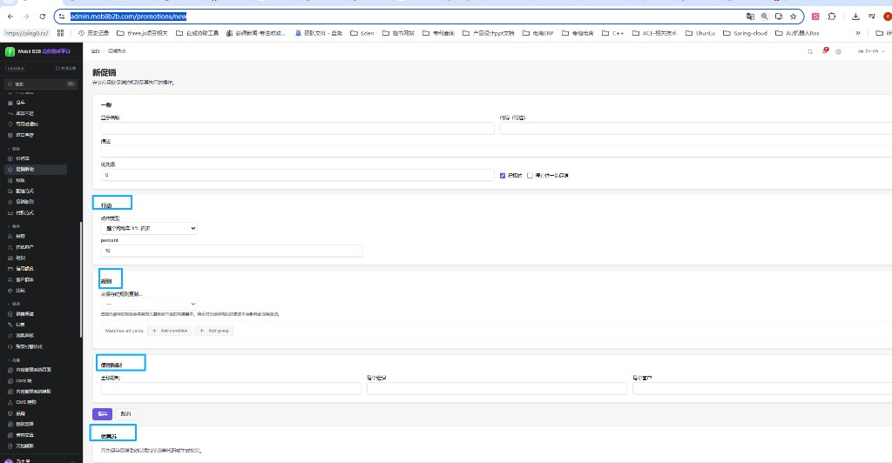
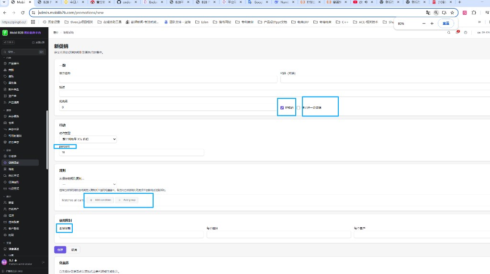
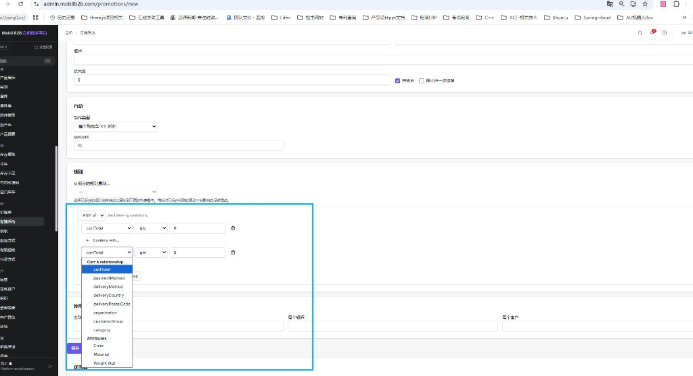
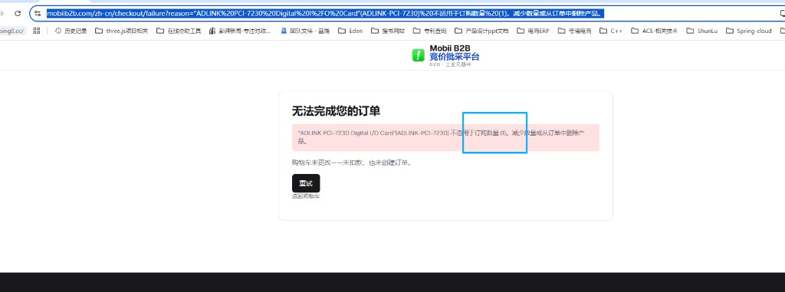
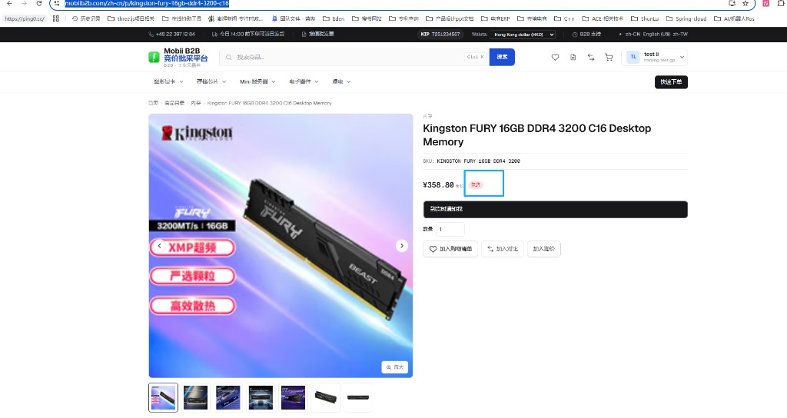

# 2026-11-26-chat1-促销优惠码与库存checkout 会话沟通记录

用途：归档促销页模块关系、优惠码「应用」流程、Admin i18n 缺口与 checkout 库存失败/缺货对照分析，作为后续 1+2+3 优化依据。
范围：本 chat 最近 2 轮 ask/rep（促销模块讲解轮 + 补充描述分析轮）。
本文件夹同时存放提问截图：fig1～fig5。

---

## chat ask

时间：2026-11-25 23:05

OK，你本次修改代码，在在部署，我们继续讨论：

你上次回复：
2. 优惠码「应用」流程（本仓并不缺）
流程已在，不在独立「优惠券模块」页面里：

Admin：promotions → 促销编辑页创建/批量优惠码
Checkout：CouponField → server action applyCouponAction → applyCartCoupon → POST /api/v1/cart/coupon → CartCouponService → promotions 校验
成功：折扣写回购物车，checkout 重渲染；失败：?couponError=
Cart 也有同类 CartCouponInput
开源同构。若点「应用」无感，多半是：后台尚未建可用优惠码，或促销模块未开；不是前端缺按钮逻辑。checkout 里部分拒绝文案仍英文硬编码，属 i18n 小债，与「流程有无」无关。

找个流程，我在大B admin端找到改页面，进行测试，发现一些疑问：
1：https://admin.mobiib2b.com/promotions/new  创建促销 项目页，如图1 所示：
图1 中，蓝框是要填写的各个模块，这些模块我不懂他们之间关系，请帮我来整理下，他们的关系，能创建那些优惠券种类，用在什么场景。
 图1 ：General ，Action，Rule，Usage limit  几个模块之间关系，
特别是：Rule ， Usage limit  名下的输入框 是怎么输入的？


其他问题，看起来需要修复bug：
1：https://www.mobiib2b.com/zh-cn/checkout/failure?reason=%E2%80%9CADLINK%20PCI-7230%20Digital%20I%2FO%20Card%E2%80%9D(ADLINK-PCI-7230)%20%E4%B8%8D%E9%80%82%E7%94%A8%E4%BA%8E%E8%AE%A2%E8%B4%AD%E6%95%B0%E9%87%8F%20(1)%E3%80%82%E5%87%8F%E5%B0%91%E6%95%B0%E9%87%8F%E6%88%96%E4%BB%8E%E8%AE%A2%E5%8D%95%E4%B8%AD%E5%88%A0%E9%99%A4%E4%BA%A7%E5%93%81%E3%80%82 ，找个是checkout ，提交结算后，出现的错误提示效果画面，为什么会提示找个产品 购买失败？

- **图1** Admin 新建促销页：General / Action / Rule / Usage limit / Coupon 蓝框



---

## chat rep

时间：2026-11-25 23:12

## 一、促销页各模块关系（If → Then → 限额 → 怎么触发）

把一条促销理解成一句话：

> **在什么条件下（Rule）**，给买家 **什么优惠（Action）**；可再限制 **用几次（Usage limit）**；再决定是 **自动生效** 还是 **要输优惠码（Coupon）**。

| 模块 | 角色 | 填什么 |
|------|------|--------|
| **General** | 元数据 + 叠优惠策略 | 显示名称、描述、优先级；「排他 / 终止其它规则」控制多条促销同时命中时谁先谁停 |
| **Action** | **优惠是什么（Then）** | 动作类型 + 参数，例如「整车 10%」 |
| **Rule** | **何时生效（If）** | 默认「匹配所有购物车」；点「添加条件」才变窄 |
| **Usage limit** | **用几次** | 三个数字框，**可全空 = 不限次数** |
| **Coupon** | **怎么触发** | **新建页先保存**，保存后才能加码；无码 = 满足 Rule 就自动打折；有码 = checkout/cart 输入才用 |

逻辑顺序：`Rule 通过` → `Action 算折扣` → `Usage limit 未超` →（若有码）`优惠码匹配`。

---

### Action：能做哪些「优惠种类」

内置约 10 类（下拉即列表）：

- 整车百分比 / 固定金额减免  
- 免运费  
- 买 X 送 Y、每满额减、第 N 件打折、指定 SKU 买满件数再减 等  

你截图里的「整个购物车 X% 折扣 + percent=10」= **满车立减 10%**（还要看 Rule / 码是否限制）。

---

### Rule：怎么输入（很多人卡在这儿）

默认文案 **「匹配所有购物车」** = 条件为空，任何购物车都过。

操作：

1. 点 **「+ 添加条件」** → 出现字段/运算符/值（如购物车合计 ≥ 500、客户组、品类、组织、支付/配送方式等）  
2. **「+ 添加组」** → AND/OR 组合多条件  
3. **「从现有规则复制」** → 复用已保存的规则模板  

**不点「添加条件」就不用填任何框**；保持「匹配所有」即可做全站通用券。

---

### Usage limit：三个空框怎么填

都是 **正整数**；**留空 = 该维度不限制**。

| 框 | 含义 | 例 |
|----|------|----|
| 总使用限制（全球） | 全站一共可用次数 | `100` = 全平台合计 100 次 |
| 每个组织 | 每个 B2B 组织上限 | `5` |
| 每个客户 | 每个买家账号上限 | `1` = 一人只能用一次 |

测试时可先全空，避免误以为「填了才生效」。

---

### Coupon：和 General 里可选「代码」的区别

- 截图底部说明：**想自动对所有车生效 → 优惠码区留空**（保存后也不加码）。  
- 要 checkout「应用」：先 **保存促销**，再在优惠码区 **添加/批量生成 code**，小 b 输入该 code。  
- 新建页提示「先保存」是正常的，不是坏掉。

**最小测试路径：**  
General 名称 → Action 整车 10% → Rule 保持「匹配所有」→ Usage 全空 → 保存 → 加码 `TEST10` → 小 b checkout 应用。

Admin 入口：[新建促销](https://admin.mobiib2b.com/promotions/new)

---

## 二、Checkout 失败：不是「优惠码坏了」，是库存不够

失败页文案来自 **库存模块** `STOCK_UNAVAILABLE`，不是起订量、也不是促销：

> 英文原意：*…is not available in the quantity ordered (1). Reduce the quantity or remove…*  
> 中文现译把 “not available in the quantity” 译成「不适用于订购数量」，容易误以为「数量规则不允许买 1」，实际是：**渠道仓对该 SKU 可售库存不足以覆盖数量 1**（常为 0 或锁定后不足）。

下单时扣减/校验库存不通过 → 订单未创建、购物车保留、无扣款 —— 与 failure 页说明一致。

**建议你先查：** Admin → Inventory / 库存概览 → `ADLINK-PCI-7230` 在当前销售渠道默认仓是否有可售数量；补库存或把行数量改为 ≤ 可售后再下单。

**算不算要修的 bug：**

| 点 | 判断 |
|----|------|
| 因库存拒单 | 预期行为，不是逻辑错 |
| 中文「不适用于订购数量」 | **文案误导**，宜改成「库存不足以满足订购数量 (1)」一类 |
| 结算页未提前挡库存、到提交才失败 | **体验债**（可选：checkout/cart 前置校验） |

若要改，建议下一批只做：**改 `inventory` 四语文案**；前置库存提示另开范围。回复「同意」并说明要 A（仅文案）还是 A+B（文案+前置提示）即可。

---

## chat ask

时间：2026-11-25 23:31

补充描述：

1： 上面 一，回复，我觉得很好，我理解了，但是：我不了解，用户在checkout时，小b用户，点击申请 按钮，他时怎么流程，他主动向大B 发起申请优惠券能力？
 请继续分析找个流程，同时可以看开源git 的目前流程，目的：看是否我们代码有延后？需要合并。
   
2：另外：根据你解释，我发现 https://admin.mobiib2b.com/promotions/new 依据有il8n的处理，但是很多翻译cn，结合你流程分析，我感觉目前翻译不切换业务环境？如图1 所示蓝框翻译，看起来都不太切换业务情景。
  另外：见图2 ，这个Rule 模块下面和 conditions: 相关控制模块，没用做到 il8n -4语系处理。需要补充。

另外：对应上面描述 二 ：Checkout 失败，我忘记补充错误提示图，见图3 ，蓝框时错误提示内容。
请重新分析这个checkout失败的原因，我感觉好像突然某个时间段，会checkout失败，提示类似这样提示，但是过一段时间有可以checkout，是后台有定时处理，在维护库存？请思路下有没用这个可能性？
  另外：分析这个产品(ADLINK-PCI-7230) 为什么checkout 报这样错误。
  但是：https://www.mobiib2b.com/zh-cn/checkout/success?id=3b7810b4-7d1c-4706-8e57-b5d5ca7b69cc   “NVIDIA H200 GPU” 是可以正常checkout。
  而且：https://www.mobiib2b.com/zh-cn/p/kingston-fury-16gb-ddr4-3200-c16  为什么报缺货：见图4 .
  所以结合这些情况，请总体分析下，sku商品--库存--下单限制条件 --- 小b-首页看到商品 是否可以购买条件，下单时出现不可以购买提示情况，总体流程分析。

- **图1** 促销页蓝框：percent / Add condition / 全球限制等翻译问题



- **图2** Rule 条件构建器英文（cartTotal / gte 等）



- **图3** Checkout failure：ADLINK STOCK 文案



- **图4** Kingston PDP 缺货 / 到货通知



---

## chat rep

时间：2026-11-25 23:40

## 1. Checkout「应用」≠ 小 b 向大 B「申请优惠券」

**结论：没有「发起申请、等大 B 审批发券」这条流程。**  
「应用」= 用**大 B 已建好的优惠码**在购物车上做校验并写折扣。开源同构，这块**不是落后缺功能**。

```
大 B Admin（事先）
  promotions → 建促销 → 保存 → 添加/批量生成 coupon code（如 SAVE10）
        ↓ 码存在库里
小 b Checkout / Cart
  输入 SAVE10 → 点「应用」
        ↓
  applyCouponAction → POST /api/v1/cart/coupon
        ↓
  CartCouponService + promotions 校验
    （码是否存在、是否启用、Rule 是否命中、渠道/客户组、Usage limit…）
        ↓
  成功：购物车带折扣，页面重渲染
  失败：?couponError=原因码（本批 70 已接四语）
        ↓
  之后「提交订单」与优惠码无关的另一次校验（库存/起订量等）
```

| 误解 | 实际 |
|------|------|
| 点应用 = 向大 B 申请一张券 | 只是**兑换已有码** |
| 大 B 会收到「申请单」 | **没有**这类工单/审批 |
| 无码也能点出折扣 | 须 Admin 先建促销并加码（或 Rule 命中的**自动促销**、优惠码区留空） |

相对开源：checkout/cart 优惠码链路一致；本仓无「申请券」能力也属正常。若产品要「买家申请 → 运营发码」，需**新需求**，不是合并就能有。

---

## 2. 促销页 i18n：有接线，但业务语境差 + Rule 未四语

### 图1：蓝框「跟语系走了，但像机翻/参数名」

| 现象 | 原因 |
|------|------|
| `percent` 英文 | `ActionConfigEditor` **写死** `label="percent"`，未走 `t()` |
| 「全球限制」 | `limits.global` 把 Global 译成「全球」，业务上应是「总使用次数」一类 |
| 「Y 关闭整个购物车」「从购物车中取出 Y」等 | `_i18n` / promotions JSON **机翻离谱**（amount off ≠ 关闭） |
| 「积极的」当 Active | 业务应是「启用」 |
| Name→「姓名」类错译 | 促销场景应是「名称 / 显示名称」（`_i18n` 里已有较好 key，模块包内仍有糟译） |

顶栏切中文后 key **会切**，但 **value 不适配促销业务**，所以感觉「不切换业务情景」。

### 图2：Rule / conditions **基本未做四语**

`RuleBuilder`（`admin-kit`）大量英文硬编码：

- `Matches all carts.` / `+ Add condition` / `+ Add group`
- 字段：`cartTotal`、`paymentMethod`…
- 运算符：`gte`、`ANY of the following…`

开源同源组件也是这套默认英文；**合并上游不会 magically 出中文**，要补：`labels` 传入 + 字段/运算符四语词条（en / zh-CN / zh-TW / pl）。

（后续探测更正：上游 RuleBuilder 已开始接 `useTranslation` / `ruleBuilder.*` 词条，本仓仍偏硬编码；做四语时应对齐合并上游组件。）

---

## 3. Checkout 失败 / 缺货 / 为何 NVIDIA 能下：统一库存模型

图3 文案对应 **`STOCK_UNAVAILABLE`（库存）**，不是优惠码、也不是起订量文案。

英文原意：*not available **in the quantity ordered** (1)* = **按数量 1 时可用库存不够**。  
中文「不适用于订购数量」易误解成「规则不允许买 1」。

### 核心公式（下单时）

```
可售 available = onHand（在库）− reserved（已被未结清订单占用）
下单要 available ≥ 行数量，否则 409 STOCK_UNAVAILABLE
```

下单成功会 **reserve**；取消订单 / 释放分配会 **减 reserved**，库存又「回来」。

### 「有时失败、过一会又能 checkout」——很可能，但不是「定时盘库」

| 可能 | 说明 |
|------|------|
| **他人/自己未付款订单占用** | ADLINK 若 `onHand` 很少（如 1），A 下单后 `reserved+=1`，B（或你再下）立刻失败；A 取消/释放后又能下 → **很像你说的间歇** |
| **并发抢最后一件** | 两单同时下，一个成功一个失败 |
| **运营改库存** | Admin 调 onHand，观感也是「过一会好了」 |
| **定时任务「自动盘库」** | **不是**常规路径；释放多跟**订单取消 / 状态机释放 reserved**有关，不是夜里重算可售 |

没有「后台定时维护导致周期性 STOCK_UNAVAILABLE」的典型设计；间歇更符合 **低库存 + reserved 占用/释放**。

### 三个 SKU 对照

| SKU | 现象 | 解释 |
|-----|------|------|
| **ADLINK-PCI-7230** | 数量 1 下单 → 图3 | 下单瞬间该渠道仓 `available < 1`（无货或已被 reserved） |
| **NVIDIA H200** | success | 当时 `available` 够 |
| **Kingston FURY**（图4） | PDP「缺货」+「到货通知我」 | `manageStock` 且累计 **onHand ≤ 0**；店面直接禁购，不必等到 checkout |

### 总流程：看见商品 → 能否买 → 何时才拒

```
目录/首页能看见
  ← 上架 + 销售渠道assortment +（内容语系等）
        ↓
PDP 能否点「加入购物车」
  ← manageStock？onHand？显示带 out_of_stock？
  ← Kingston：已在此挡掉 → 缺货/到货通知
        ↓
购物车可暂留「后来变没货」的行（曾有货时加入）
        ↓
Checkout 提交 placeOrder
  ← 起订量 / 包装倍数（另一类文案）
  ← 库存 reserve：available ≥ qty  ← ADLINK 死在这里
  ← 支付/配送等
        ↓
成功 → reserved↑；取消 → reserved↓（别人又能买）
```

**要点：** 首页「看得到」≠ 此刻「下得了」；ADLINK 若列表仍显示有货、提交才挂，常见原因是 **展示用 onHand/波段，下单用 available=onHand−reserved**，或 **车内旧行 vs 现库存不同步**。

---

## 若要继续改代码（待你确认）

建议下一批可拆：

1. **促销文案业务化**：修错译（全球限制、Action 文案、`percent` 等）+ 四语  
2. **RuleBuilder 四语**：Add condition / 字段名 / 运算符  
3. **STOCK_UNAVAILABLE 中文**改为「库存不足以满足订购数量 (n)」  
4. （可选）低库存/车内行与 PDP 一致性提示 —— 范围更大  

请回复要做的范围（例如「同意 1+2+3」）；未确认前先不动代码。运维上可先在 Admin → Inventory 查 ADLINK / Kingston 的 **onHand / reserved**，对照是否「只剩 1 件被占用」。
