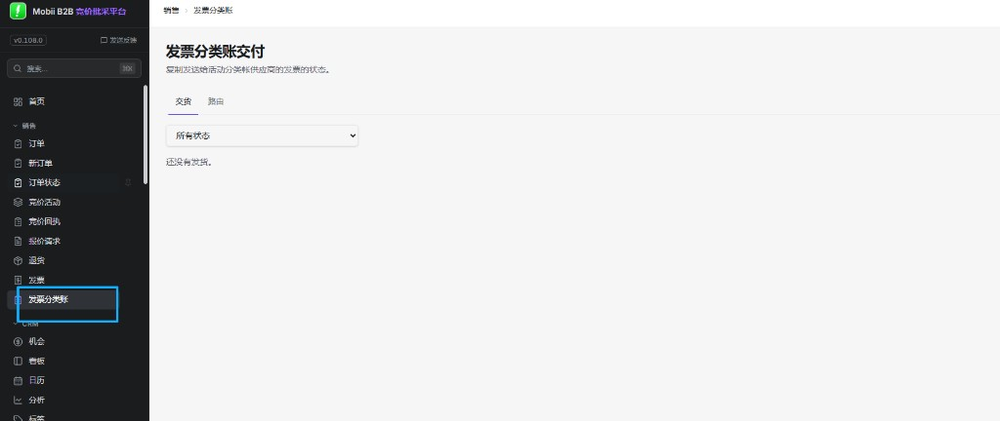
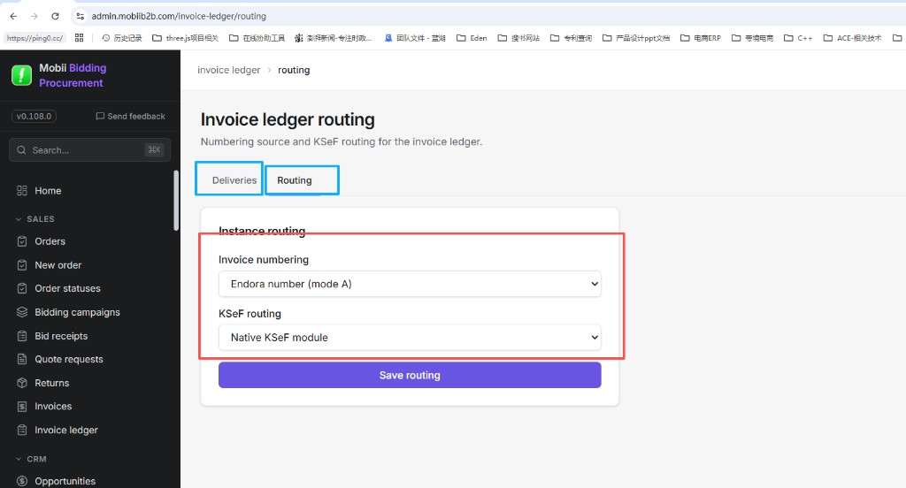
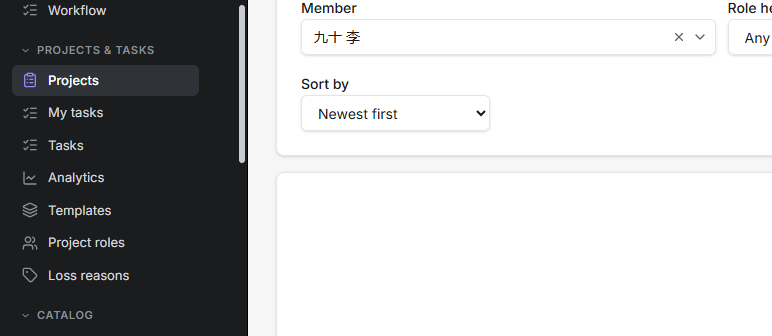

# 2026-11-26-chat2-发票台账与Projects场景 会话沟通记录

用途：归档 Invoice ledger 用途/i18n/Endora 编号说明，以及 Projects & tasks 与小 b 串联及五类业务场景，供后续沟通与手册依据。
范围：本 chat 最近 2 轮 ask/rep（① 发票台账+Projects 分析；② Projects 业务场景构建）。中间「同意」批次 72 发票台账 i18n 落地另记 §99，本档以分析与场景正文为主。
本文件夹同时存放提问截图：fig1～fig3。

---

## chat ask

时间：2026-11-26 01:01

对上面测试，发现ok，我们继续优化其他模块

一：https://admin.mobiib2b.com/invoice-ledger/deliveries  这个模块是什么用途，“Invoice ledger ” 目前被翻译为：见图1 ，看中文，不太顺畅。
请结合情景，给一个具体il8n的翻译。
  另外还有业务流程问题，这个页面中，2个tab模块，分布是什么用途，见图 2 蓝框模块，另外：Routing 子tab里面 选项目 是什么？
而且：里面还保留开源 https://github.com/endora-commerce/endora-commerce  原始下拉Endora number 字？
  所以这个模块总体疑问：
   1： 这个“Invoice ledger ” 翻译il8n 是否合理？
   2： 总体 ““Invoice ledger ” 功能是什么，和orders ，发票invoice 有什么互相支持流程？
   3： 图2 中 ，总体页面的操作流程是什么，红框区域：为什么还有 开源 endora 字在？


二：分析“Projects & tasks”，如 图2 是所有子菜单， 总体功能做什么，和小b 用户业务中，怎么互相串联。


请分析

- **图1** 发票台账 Deliveries：侧栏「发票分类账」、交货空态



- **图2** Routing：Endora number (mode A)、KSeF routing



- **图3** Projects & tasks 侧栏子菜单



---

## chat rep

时间：2026-11-26 01:05

## 一、Invoice ledger（发票台账 / 会计对接）

### 1）「Invoice ledger」中文是否合理？

**当前「发票分类账」能懂，但不顺，且页内多处机翻错位。**

英文 *ledger* 在这里不是会计科目「分类账」的日常说法，而是：**对接外部会计/电子发票厂商的「过账台账」底座**——管编号来源、KSeF 路由、向厂商推送发票的状态；**发票正文仍在 `invoices`（Invoices）模块**。

| 位置 | 现状（差） | 建议译法 |
|------|------------|----------|
| 侧栏 / 模块名 | 发票分类账 | **发票台账** 或 **会计对接台账** |
| Deliveries 标题 | 发票分类账**交付** | **过账记录** / **推送记录** |
| Deliveries 说明 | 「复制发送给活动分类帐…」 | **查看已推送到当前会计厂商的发票状态。** |
| tabs.deliveries | **交货**（被当成物流） | **过账** / **推送** |
| tabs.routing | 路由 | **编号与路由**（可保留「路由」） |
| Endora number | Endora 数 | **本平台编号（模式 A）** |
| empty | 还没有**发货** | **暂无过账记录** |

「交货 / 发货」是严重错译：英文 *Deliveries* = 推给会计厂商的 **delivery（投递）**，与订单物流无关。

---

### 2）功能是什么？和 Orders、Invoices 怎么串？

```
小 b 下单 → Orders（订单）
              ↓ 履约/开票时机
         Invoices（开具增值税发票、PDF、买家可见）
              ↓ 若启用 invoice_ledger + 会计适配器
         Invoice ledger（编号策略 + 推送状态）
              ↓ HTTP 在厂商 adapter 模块里
         外部会计 / KSeF 等
```

| 模块 | 职责 |
|------|------|
| **Orders** | 买卖交易 |
| **Invoices** | 平台内发票单据、金额、PDF |
| **Invoice ledger** | 共享「过账轨道」：厂商互斥、编号/KSeF 路由、document map、**推送 deliveries**、webhook；**自己不调厂商 HTTP** |

Mobii 若未接波兰会计厂商 / KSeF，侧栏仍会出现该模块，但 Deliveries 常空（你图里「还没有…」符合未推送）。

文档见模块说明：`packages/modules/invoice_ledger/docs/invoice-ledger.md`；开源同源：[endora-commerce](https://github.com/endora-commerce/endora-commerce)。

---

### 3）图2：两个 Tab + 红框为何还有 Endora？

**Deliveries（过账记录）**  
列出推到「当前启用的 ledger 厂商」的发票：排队 / 等厂商 / 成功 / 失败，可重试。无适配器或未推送 → 空列表。

**Routing（编号与路由）** — 红框两项：

| 下拉 | 含义 |
|------|------|
| **Invoice numbering** | 发票号谁定：`endora`（模式 A）= **平台先编号**；`vendor`（模式 B）= **等会计厂商回号** 再落号 |
| **KSeF routing** | 波兰国家电子发票（KSeF）走「原生 KSeF 模块」还是「厂商代发」 |

**为什么还有 “Endora number”？**  
代码键值是 `endora`，英文原文就是 `Endora number (mode A)`——指 **本平台（产品名 Endora Commerce）自编发票号**，不是残留未删的死链接。Mobii 品牌下应改成业务名，例如：

- EN：`Platform number (mode A)` / `Mobii number (mode A)`  
- zh-CN：**本平台编号（模式 A）**  
- 模式 B：**等待会计厂商编号（模式 B）**

内部枚举仍可为 `endora`，只改展示文案即可。

**操作流程（运营视角）**

1. Routing：选编号来源 + KSeF 路由 → 确认 → Save（已开发票号不变）。  
2. 接上会计厂商适配器（若有）并启用。  
3. 开票后在 Deliveries 看推送状态；失败可 Retry。  
4. 日常开票仍在 **Invoices**；本页是过账与路由，不是「另一套发票列表」。

---

## 二、Projects & tasks（项目与任务）

### 总体做什么？

**大 B Admin 内部的项目协作 / 销售履约看板**（feature 163），不是小 b 店面功能。

侧栏大致对应：

| 子菜单 | 用途 |
|--------|------|
| **Projects** | 项目列表：编号、阶段、组织、价值、完成/丢失 |
| **My tasks / Tasks** | 任务（跟人、跟阶段） |
| **Analytics** | 项目分析 |
| **Templates** | 建项模板（阶段、角色、门禁） |
| **Project roles** | 项目角色标签（如 Sales Rep），**不替代** Admin 权限 |
| **Loss reasons** | 丢单原因（价格、竞品、客户取消等） |

一个 Project：可挂 **0～多个 Organization**（0 = 内部项目）→ 自有 **Stages + 工作流** → 可 **关联 Orders / Quote Requests / Opportunities** → 结束为 completed 或 lost。

### 和小 b 怎么串？

```
小 b：询价 / 下单 / 组织账号
        ↓（单据进大 B）
大 B：Orders / RFQ / CRM Opportunity
        ↓（运营在 Admin「关联」）
大 B：Projects & Tasks（跟阶段、任务、丢单原因）
```

| 点 | 说明 |
|----|------|
| 小 b **有没有** Projects 菜单？ | **没有**（storefront 无 Projects 页） |
| 串联方式 | 间接：小 b 产生订单/询价 → 大 B 挂到项目上跟进 |
| 和 CRM | 可与 Opportunity 联动；Loss reasons 偏赢单/丢单治理 |
| 不串联时 | 模块可关；不挡小 b 买货 |

图中 Member「九十李」、Role、Newest first = **按管理员成员筛项目**，不是小 b 买家账号列表。

---

## 小结与可改项（未改代码）

| 问题 | 结论 |
|------|------|
| 「发票分类账」 | 可用但别扭 → 建议 **发票台账**；Deliveries≠交货 |
| 与订单/发票 | 订单→开票→台账过账；无厂商则页常空 |
| Endora number | 产品名作「平台自编号」；宜改展示为「本平台编号」 |
| Projects & tasks | 大 B 项目协作；经组织单据间接服务小 b，无店面入口 |

若要落 i18n（发票台账全套 + Endora→本平台编号，四语），回复 **同意** 后按 do-task 开批次改。

（后续用户已「同意」，落地为批次 72：invoice_ledger 四语业务化；见 `pro_doc/PRO.md` §99。）

---

## chat ask

时间：2026-11-26 01:27

请给：二、Projects & tasks（项目与任务）

构建几个业务场景，让小b下单 到 大B 对订单进行关联到 Projects & task 的流程，对应这些场景？

---

## chat rep

时间：2026-11-26 01:28

## 通用链路（所有场景共用）

```
小 b 店面：加购 → Checkout → 提交订单（Orders 产生）
                ↓
大 B Admin：销售 → 订单（看到该单）
                ↓
大 B：Projects & tasks → 新建/打开项目 →「关联记录」挂上该 Order
                ↓
大 B：按阶段推进 / 建任务；订单详情页也会出现 Project 面板
```

约束（实现里就有）：
- 只能关联**项目已挂上的 Organization** 名下的订单；
- 一条订单**同时只能挂在一个项目**上；
- 小 b **看不到** Projects 菜单，只感知订单状态/发货等。

---

## 场景 1：标准批采一单一项目（入门）

**业务：** 小 b「南京测试公司」买 10 张 ADLINK 卡，大 B 跟「南京客户首单交付」项目。

| 步 | 谁 | 做什么 |
|----|----|--------|
| 1 | 小 b | 登录 → 下单 ADLINK×10 → 提交成功 |
| 2 | 大 B | 销售 → 订单，确认组织=南京测试公司 |
| 3 | 大 B | Projects → 新建「南京-ADLINK首单」，组织选该公司，模板可选「标准交付」 |
| 4 | 大 B | 项目 → **关联记录** → 种类 Order → 搜订单号 → 关联 |
| 5 | 大 B | 阶段：确认库存 → 备货 → 发货；每阶段可有「My tasks」 |
| 6 | 大 B | 货妥、款清 → **Close as completed** |

**小 b 侧：** 只看到订单进度；不感知项目名。

---

## 场景 2：先询价再下单（RFQ + Order 同项目）

**业务：** GPU 稀缺，先 RFQ 谈价，再下正式单，一条商机跟到底。

| 步 | 谁 | 做什么 |
|----|----|--------|
| 1 | 小 b | 账户 → 询价：H200×2，备注交期 |
| 2 | 大 B | 报价请求里报价/接受 |
| 3 | 大 B | 建项目「Acme-H200供应」，组织=该买家 org；**关联 Quote request** |
| 4 | 小 b | 谈妥后正式 Checkout 下单 |
| 5 | 大 B | 同一项目再 **关联 Order** |
| 6 | 大 B | 阶段：议价完成 → 合同确认 → 履约；任务分给 Sales Rep / Project Manager |

**串联点：** 同一项目下 RFQ + Order 并排，避免询价单和订单脱节。

---

## 场景 3：CRM 商机 → 赢单下单（Opportunity + Order）

**业务：** 销售在 CRM 跟「绿电采购」机会，小 b 下单后算赢单。

| 步 | 谁 | 做什么 |
|----|----|--------|
| 1 | 大 B | CRM → Opportunity「绿电-Q1」，挂组织 |
| 2 | 大 B | 建项目并 **关联 Opportunity**（阶段对齐销售漏斗） |
| 3 | 小 b | 下绿电相关 SKU 订单 |
| 4 | 大 B | 项目再 **关联 Order**；推进到「履约」 |
| 5a | 成功 | Close as completed |
| 5b | 丢单 | 小 b 取消/不付款 → **Close as lost** + Loss reason（价格/竞品/客户取消…） |

**小 b：** 仍只下单；丢单原因只在大 B 项目里统计。

---

## 场景 4：多订单一个大项目（框架客户）

**业务：** 同组织本月多笔补货，合成「2026-Q1 框架履约」。

| 步 | 谁 | 做什么 |
|----|----|--------|
| 1～N | 小 b | 多次下单（内存、线缆、配件…） |
| 2 | 大 B | 一个项目挂该 Organization；**逐笔关联多个 Order** |
| 3 | 大 B | 阶段按「月度对账/分批发货」；Tasks 按 SKU/仓库拆 |

**价值：** 侧栏按项目看「这个客户一季度所有单」，而不是只在订单列表里翻。

---

## 场景 5：内部项目（可不挂小 b 组织）

**业务：** 「双十一备货演练」——无买家组织，或仅内部协作。

| 步 | 谁 | 做什么 |
|----|----|--------|
| 1 | 大 B | 新建 **Internal** 项目（不选 Organization） |
| 2 | — | **不能**把小 b 订单挂上来（无组织匹配） |
| 3 | 大 B | 只用 Tasks/阶段做内务；真要挂单，须先把对应 Organization 加进项目 |

---

## 场景对照（怎么选）

| 场景 | 小 b 产生 | 大 B 关联 | 项目结局常见 |
|------|-----------|-----------|--------------|
| 1 一单一项目 | Order | Order | completed |
| 2 询价转单 | RFQ → Order | quote_request + order | completed |
| 3 商机赢单 | Order（+CRM） | opportunity + order | completed / lost |
| 4 框架多单 | 多 Order | 多 order | completed |
| 5 内部 | 无 | 无订单或先加组织 | completed |

---

## 大 B 操作落点（对照界面）

1. **Projects & tasks → Projects → New**（选组织 / 模板 / 成员角色）  
2. 项目详情 → **Linked records** → Add → Order（或 RFQ / Opportunity）  
3. 或从 **订单详情** 的 Project 面板跳进已关联项目  
4. **My tasks / Tasks** 跟阶段任务；**Loss reasons** 仅丢单时用  

若要下一步做成「操作手册 md」或 Admin 空态引导文案，可以说一下要落 `pro_doc` 还是只保留本对话。
