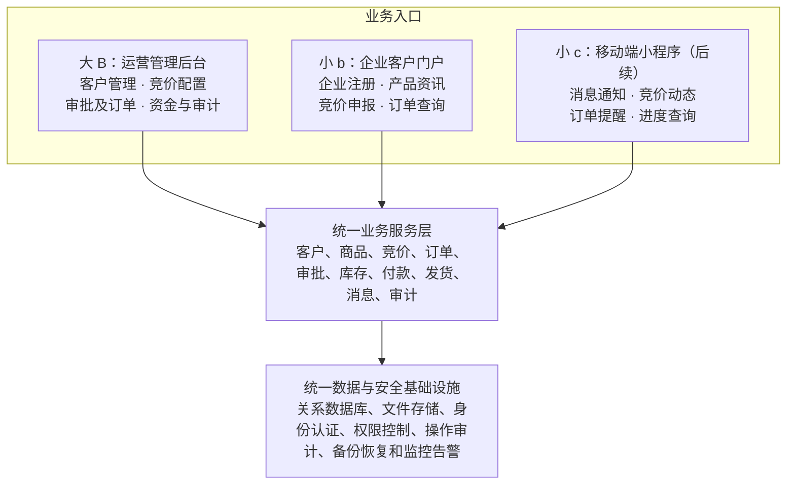
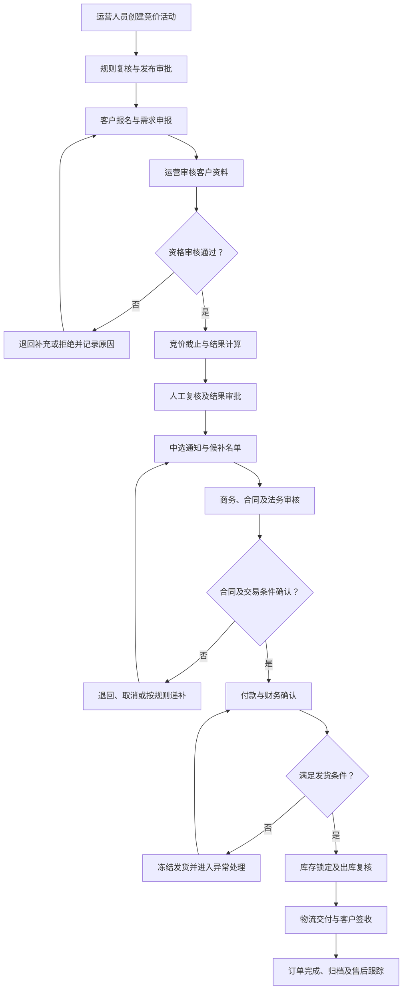
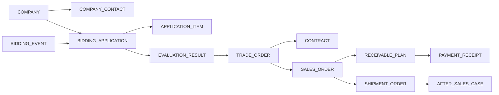
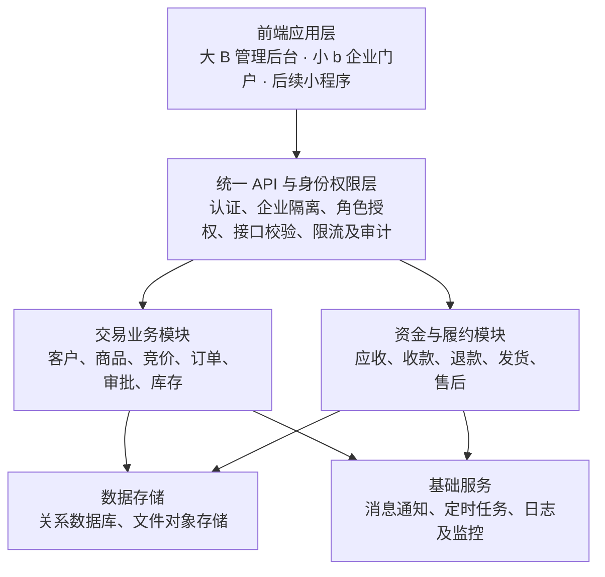

# 高端硬件设备线上竞价与大客户交易管理平台：系统建设方案

结合你的需求，我建议不要把这个项目简单定义为一个“线上竞价平台”，而是将它定位为：

**面向高端硬件设备的大客户交易、需求审核、竞价分配与订单履约管理平台。**

原因是：GPU H200 这类高价值、供货数量有限的硬件产品，交易并不是简单的“谁出价高就卖给谁”。公司还需要识别真实需求客户、评估客户资质、核实采购承诺、完成线下商务及法务审核、确认资金到账，最终确保正确的商品交付给正确的客户。

因此，你真正需要建设的是一套以竞价为入口、以大客户关系为基础、以订单和资金安全为核心、以全过程责任追溯为保障的交易业务系统。

我建议采用三个建设原则：

- **业务上：** 从单纯竞价升级为“客户准入 + 需求真实性审核 + 竞争性分配 + 订单履约”。
- **系统上：** 以大 B 端运营管理平台和小 b 端客户交易平台为 MVP，后续再增加移动端小程序。
- **管理上：** 每一笔交易都必须能够追溯到客户、商品批次、竞价规则、审核人员、审批记录、付款凭证、发货记录和最终签收结果。

---

## 一、先确定系统定位与英文名称

你的平台未来不仅会销售 GPU H200，还可能扩展其他高端硬件及高价值商品，因此系统名称不宜限定为 GPU 或 Auction。

### 推荐系统正式名称

**Enterprise High-Value Trading Platform**  
企业级高价值商品交易平台

**英文简称：EHTP**

**系统定位：** 大客户管理、稀缺商品竞争性分配、订单审核、资金确认与履约管理。

这是适合长期扩展的候选名称。正式启用前，应核查商标、域名和内部系统命名冲突。

另外，可以根据实际业务风格考虑以下名称：

| 英文名称 | 缩写 | 定位 |
|---|---|---|
| Enterprise High-Value Trading Platform | EHTP | 高价值商品综合交易平台，适合长期扩展 |
| Strategic Hardware Trading Platform | SHTP | 高端战略硬件交易平台 |
| Enterprise Bidding & Allocation Platform | EBAP | 强调竞价与稀缺商品分配 |
| High-Performance Computing Hardware Trading Platform | HPCHTP | 更突出高性能计算硬件，但名称较长 |
| Enterprise Bidding Management System | EBMS | 偏向企业内部竞价管理系统 |

**我的建议：** 如果这将成为公司的长期产品业务平台，选择 Enterprise High-Value Trading Platform (EHTP)；如果现阶段主要是内部运营人员管理竞价业务，则可以将内部管理子系统命名为 Bidding & Trading Management System。

需要区分的是，英文系统名称和竞价机制名称并不是同一件事。系统可以叫 Trading Platform，而其中一项业务采用 Bidding、另一项采用预约登记或资格审核后的配额分配。

## 二、行业对比：你的方案与成熟采购平台有什么区别？

你提出的业务与企业采购寻源、供应商资格管理、电子竞价、订单履约系统存在交集，但有一个重要区别：

- 传统采购平台通常是买方发布采购需求，多个供应商竞争供货。
- 你的平台是卖方掌握稀缺货源，由多个大客户竞争获取有限的商品库存。

因此，你的业务更接近**稀缺库存分配型交易平台**，而不只是传统招投标系统。

### 2.1 成熟平台的设计思路

例如，SAP Ariba 的供应商管理流程支持资格申请、资料审核、审批状态及补充资料等环节；Oracle Fusion Cloud Procurement 则支持供应商资格评估、谈判响应及谈判活动审计。

这些产品提供的值得借鉴的思路，是将业务拆分为独立、可管理的阶段，而不是只记录最终成交结果。

| 对比维度 | 你目前的设计 | 建议完善方向 |
|---|---|---|
| 客户管理 | 大客户注册、联系人和负责人 | 增加企业资质审核、客户分级、信用与风险记录 |
| 竞价发布 | 产品、数量、客户范围、价格规则 | 增加明确的竞价模式、截止时间、规则版本和异常处理 |
| 竞价审核 | 运营与销售人工核对 | 将资格审核、商务审核、审批权限分开 |
| 订单处理 | 线上确认，线下合同及付款 | 建立唯一交易编号，将竞价、合同、收款、订单和发货关联 |
| 资金管理 | 预付款及付款信息 | 增加应收金额、实收金额、退款、对账与财务确认 |
| 发货管理 | 审核后发货 | 必须设置资金放行条件、库存锁定、出库复核和签收回执 |
| 责任追溯 | 确定业务负责人 | 增加操作日志、审批记录、变更前后值和异常处理记录 |

以上是基于你当前需求做的设计差距分析，不代表已经对所有商业竞价产品进行了逐项功能测试。

### 2.2 你最需要补充的三个能力

**第一：客户资格与需求真实性管理**

不是所有注册客户都能参与所有竞价。需要先确认企业身份、采购用途、采购数量、履约能力及授权联系人，再根据商品的风险和价值决定是否放行。

**第二：业务状态机与审批工作流**

竞价、客户审核、合同审批、收款确认和发货必须有明确的前置条件和业务状态。不能只靠工作人员在备注中写“已确认”。

**第三：完整的交易审计链**

每次重要操作都需要记录操作人、时间、操作对象、变更前后内容、审批人及依据。成熟采购系统也将谈判活动历史用于审计和风险管理。

## 三、核心业务问题：稀缺 GPU 到底应该怎么分配？

这是整个系统设计中最关键的决策。

你希望实现的目标不是单纯提高成交价，而是尽量让货品交付给真实需求客户，同时提升订单成功率并减少无效占位、临时退单和内部操作风险。

我建议不要把所有商品都限定为一种竞价模式，而是设计一个**可配置的商品分配策略引擎**。

### 3.1 四种商品分配方式比较

| 分配模式 | 核心规则 | 优点 | 主要风险 | 适用场景 |
|---|---|---|---|---|
| 公开升价竞拍 | 客户持续提高报价，最高价优先 | 价格发现能力强 | 容易价格炒作，真实需求不一定优先 | 具有公开拍卖属性的商品 |
| 密封报价竞价 | 客户在截止时间前提交报价，结束后统一评审 | 降低跟价行为，便于控制流程 | 客户仍可能虚报需求 | 高价值、数量有限的硬件 |
| 资格审核后配额分配 | 先审客户资质，再按规则分配库存 | 更重视真实需求及客户公平性 | 需要明确、可审计的分配规则 | 战略客户、重点客户及紧缺货源 |
| 需求申报 + 竞争性分配 | 先收集需求，再结合价格、资质、采购数量、履约能力进行分配 | 最符合你描述的业务目标 | 规则设计和审核流程相对复杂 | GPU、AI 服务器等稀缺高端设备 |

### 3.2 我的推荐：采用两阶段机制

对于 GPU H200 这类高价值设备，我建议先从以下机制开始，而不是直接做传统的公开实时竞价。

**阶段一：真实需求申报**

客户提交企业资料、需求数量、报价、用途、交货要求及采购承诺。

**阶段二：资格与需求审核**

核验企业身份、采购能力、重复申报、关联客户及履约风险。

**阶段三：竞价评审与配额分配**

根据事先公布的价格、数量、客户资格和分配规则生成候选结果。

**阶段四：商务确认与履约承诺**

核实合同、付款条件、必要审批及客户的有效采购承诺。

**阶段五：正式订单与库存交付**

确认资金和库存条件后生成正式订单、出库单及签收记录。

这里有一个重要原则：**竞价结束不等于交易完成，竞价获选也不等于可以直接发货。**

竞价结果只是进入商务确认环节的依据。客户资格审核、合同审批、付款和库存交付必须分别有明确状态。

### 3.3 如何减少客户虚报需求和恶意占位？

建议设置以下控制机制。

- **客户准入：** 企业认证、授权采购联系人、企业资质及必要的信用审核。
- **有效报价：** 要求客户确认报价有效期、采购数量、交货条件和相关交易条款。
- **履约承诺：** 根据交易风险决定是否要求保证金、预付款或其他有效担保。保证金必须明确收取主体、退还条件及违约处理规则。
- **申报限额：** 根据企业资质、历史履约记录和实际供货能力限制可申报数量。
- **防重复占位：** 对同一企业、同一采购主体及关联客户的重复申报进行识别；关联关系应通过合理的规则和人工审核确认，不能仅凭相同 IP 就认定为恶意行为。
- **超时释放库存：** 中选客户必须在规定期限内完成合同、付款或其他约定动作，逾期后按已公布的规则释放库存并通知候补客户。
- **历史履约记录：** 记录中选后取消、逾期付款、拒绝签约、退单及实际履约情况，供后续资格审核参考。

注意：不能只靠收取高额保证金筛选客户，因为这也可能排除资金安排合理但信誉良好的真实客户。保证金比例、退还条件和违约责任应由公司根据合同、交易地区及适用法律确定。

### 3.4 建议增加候补分配机制

假设本次有 10 台设备，审核通过的客户申报需求总量为 30 台。

系统可以生成：

- 正式中选名单；
- 候补客户名单及排序；
- 每家客户的分配数量；
- 合同及付款截止时间；
- 逾期后自动释放的数量；
- 候补递补的触发条件和操作记录。

如果某客户中选 3 台，但最终仅完成 1 台的有效采购承诺，剩余 2 台就可以按照预先公布的规则进入递补流程，而不是由销售人员临时决定交给谁。

不过，候补递补并不意味着系统可以自动认定客户违约。涉及取消资格、扣除保证金或合同责任时，应经过相应的审核与授权。

## 四、整体系统架构：大 B + 小 b + 小 c

你的架构方向是合理的。建议将三个端理解为不同的业务入口，而不是建设三套互相独立的系统。

### 4.1 MVP 阶段

第一阶段只做大 B 和小 b，符合你的优先级。

**大 B：公司内部管理后台**

- 用户、角色及数据权限管理；
- 企业客户档案与客户负责人；
- 商品及多媒体内容管理；
- 竞价活动创建、发布与规则配置；
- 客户申报审核、竞价结果及候补管理；
- 合同、付款确认、订单、库存和发货管理；
- 审批任务、异常处理及审计报表。

**小 b：企业客户门户**

- 企业注册及认证资料提交；
- 企业联系人管理；
- 商品详情、规格、库存状态和技术资料；
- 竞价活动公告、规则及相关文件下载；
- 需求申报和报价提交；
- 申报回执、补充资料及结果查询；
- 合同、付款及发货进度查询；
- 企业账户下的多个授权用户及操作记录。

小 b 需要具备企业账号体系，而不是仅提供一个所有人共用的登录账户。企业管理员可以维护公司资料、联系人和内部用户授权。

### 4.2 后续小 c

移动端小程序可以复用统一后端，主要承担：

- 新竞价活动及重要商品资讯通知；
- 客户是否中选、补充资料、付款截止时间提醒；
- 订单状态、物流和售后进度查询；
- 客户负责人联系入口。

你提出的小程序不承担复杂竞价提交逻辑，这个取舍是合理的。MVP 阶段也应该先预留通知接口，不必一开始就开发完整小程序。

## 五、核心业务流程设计

建议把竞价业务设计为一个有明确状态、责任人和审核依据的完整流程。下面是建议的主流程。

这张流程图是目标业务流程，实际系统还应定义各状态之间允许和禁止的操作，以及每个节点的超时、退回、撤销和异常处理规则。

### 5.1 关键状态必须在系统中固定下来

建议至少为以下业务对象分别设置状态。

| 业务对象 | 主要状态 |
|---|---|
| 企业客户 | 待提交、待审核、已认证、受限、已停用 |
| 竞价活动 | 草稿、待审批、待发布、进行中、已截止、评审中、结果已确认、已结束、已取消 |
| 客户申报 | 草稿、已提交、待审核、补充资料、资格通过、资格不通过、已中选、候补、未中选、已撤回 |
| 合同 | 待拟定、待审批、待签署、已生效、已终止 |
| 付款 | 待付款、部分到账、已到账待核验、已确认、退款处理中、已退款、异常 |
| 订单 | 待确认、待付款、待发货审核、待出库、已发货、部分交付、已签收、已完成、已取消 |
| 售后 | 待受理、处理中、待客户确认、已完成、争议处理中 |

这里特别要注意：资格审核通过、中选、合同生效、款项到账、财务确认、允许发货是不同的状态，不能合并成一个“已确认”。

例如，客户提交了付款截图，只能说明客户提交了付款凭证，不代表款项已实际到账，更不代表财务已完成核验。

## 六、解决“钱货对不上、责任无法追究”的设计方案

你提出的这一点非常关键。系统的核心价值之一，就是将业务操作与财务、库存和责任记录形成可核验的对应关系。

### 6.1 建立唯一交易编号

建议每一场竞价、每一份客户申报、每一份合同、每一笔收款及每一张出库单都有独立编号，并建立关联关系。

| 对象 | 编号示例 | 关联关系 |
|---|---|---|
| 竞价活动 | BID-2026-0001 | 对应一场 GPU H200 竞价 |
| 客户申报 | APP-2026-0018 | 对应活动及具体客户 |
| 交易单 | TRD-2026-0008 | 对应中选结果及客户采购承诺 |
| 合同 | CTR-2026-0008 | 对应交易单 |
| 付款记录 | PAY-2026-0025 | 对应合同及应收款项 |
| 销售订单 | ORD-2026-0012 | 对应客户、商品、数量及价格 |
| 出库单 | SHP-2026-0009 | 对应订单及实际发货批次 |

以上只是示例编号。实际系统应使用唯一 ID，并确保跨系统同步时不会因为重复提交而生成多份交易或付款记录。

### 6.2 资金与发货的强制校验

建议设置以下发货前置条件：

- 合同状态满足发货要求；
- 订单商品、数量、成交价格与已审批结果一致；
- 应收款项及付款计划已经确定；
- 财务人员已经独立确认实际到账金额；
- 库存已锁定，且可发货数量足够；
- 需要的法务、商务及管理审批已经完成；
- 发货申请、审批及出库复核全部留有记录。

只有所有适用条件满足后，系统才允许进入“允许发货”状态。

**必须设置的异常拦截**

- **付款不足：** 不得按全额付款规则直接发货；如合同允许分批交付，则按已审批的分批条件处理。
- **商品数量不一致：** 订单、库存、出库数量不匹配时，禁止完成出库。
- **合同变更：** 涉及金额、数量或付款条件变化时，重新走相应审批。
- **重复收款或重复通知：** 采用唯一业务编号及幂等处理，避免重复创建订单或重复记账。
- **退款与取消：** 订单取消后，系统应核对已收款、应退款、库存释放和合同责任，不能只修改订单状态。

如果涉及大额款项，建议将系统中的“付款确认”与实际银行流水、财务系统或人工双人复核结合。单纯依靠销售人员上传的付款截图，不足以作为发货依据。

### 6.3 责任追溯：不只记录“谁操作了”

每个重要操作建议记录以下字段：

| 字段 | 说明 |
|---|---|
| 业务对象与业务编号 | 哪场竞价、哪笔交易或哪张订单 |
| 操作人 | 实际执行操作的员工账号 |
| 所属角色与部门 | 操作时的岗位及组织归属 |
| 操作时间 | 服务端记录的时间 |
| 操作类型 | 创建、修改、审批、驳回、确认、撤销等 |
| 变更前后内容 | 对价格、数量、状态等关键字段记录差异 |
| 审核人及审批意见 | 谁批准、依据是什么、是否附带条件 |
| 相关文件 | 合同版本、付款凭证、审批附件等 |
| 操作来源 | 后台、客户门户或经授权的接口 |

审计记录应由普通业务用户不可随意修改或删除；关键记录可以进一步采用独立日志存储、权限隔离和定期备份。

需要说明的是，系统日志可以帮助还原业务事实，但不能单凭某个账号的操作记录就认定某位员工应承担全部法律责任。账号安全、授权管理、复核制度和公司的责任制度同样重要。

### 6.4 岗位职责必须分离

建议遵循以下原则：

- 销售人员可以沟通客户和提交商务意见，但不能独立完成收款核验及最终发货放行。
- 财务人员负责核验实际到账和退款，不负责决定竞价客户是否中选。
- 仓储或售后人员依据已审批的发货指令执行出库，不能自行修改成交数量。
- 运营人员负责竞价活动及规则执行，但不能未经授权修改已经生效的竞价结果。
- 管理人员或授权审批人负责高风险例外事项。
- 高风险交易可以配置双人复核或多级审批。即使小团队需要一人兼任多个角色，也应尽量让关键的批准动作由另一名有权限的人员完成。

## 七、系统功能模块设计

建议按照业务领域拆分模块，而不是简单地把你列出的六项能力直接做成六个菜单。

### 模块 A：组织、用户与权限管理

**适用端：大 B、小 b**

- 员工账号、角色、部门和岗位管理。
- 企业客户、企业管理员及授权联系人。
- 菜单权限、数据范围、操作权限与审批权限。
- 员工离职、岗位变更、账号禁用及权限回收。

### 模块 B：大客户关系管理（CRM）

**适用端：大 B、小 b**

- 企业资料、资质、采购联系人和授权文件。
- 客户负责人、运营负责人、售后负责人。
- 客户跟进记录、意向商品、历史竞价和交易记录。
- 客户等级、履约记录、风险标记及重新审核。

### 模块 C：高端商品与库存管理

**适用端：大 B、小 b**

- 商品分类、型号、规格、批次、序列号及产品状态。
- 产品图片、性能介绍、视频、安装说明和售后规则。
- 商品上架、下架、可售数量、锁定数量和已交付数量。
- 不同商品适用的销售方式、竞价规则及交付条件。

### 模块 D：竞价活动与分配引擎

**适用端：大 B、小 b**

- 竞价活动创建、审核、发布和结束。
- 指定邀请客户、开放报名、客户资格限制。
- 起始价、最低成交价、报价规则、申报数量及截止时间。
- 竞价文件模板、客户提交、回执、补充资料。
- 评审结果、候补名单、结果确认和异常处理。

### 模块 E：合同、审批与交易订单

**适用端：大 B、小 b**

- 交易审批、合同版本、签署状态和合同附件。
- 商务确认、法务审批及客户承诺管理。
- 交易单与正式销售订单生成。
- 取消、变更、拆单、合单和异常订单处理。

### 模块 F：资金、出库与售后

**适用端：大 B、小 b**

- 应收计划、到账记录、财务确认及退款。
- 库存锁定、出库申请、出库复核和物流追踪。
- 商品序列号、实际发货数量、签收记录。
- 退换货、保修、维修及售后争议处理。

### 模块 G：工作流、审计与运营分析

**适用端：大 B；必要的信息向小 b 开放**

- 待办任务、审批超时、消息提醒。
- 全量业务操作日志、关键变更记录。
- 竞价转化率、客户履约率、成交率、库存周转。
- 异常订单、超时付款、库存差异和责任追溯报告。

### 一个重要的业务设计补充：不要把所有文件都当作附件

你的业务会使用客户意向竞价单模板、合同、付款凭证和发货文件。建议系统将文件与对应业务对象关联，并记录版本、上传人、上传时间、审核状态及文件摘要值。

如果客户上传的意向单与线上申报信息不一致，系统应进入“信息不一致、待核实”状态，而不是直接以某一个版本覆盖另一个版本。

正式签署的合同和关键法律文件还应按照公司适用的电子签署、档案管理及数据保留要求进行管理。

## 八、核心数据模型：从一开始就要设计正确

如果数据库只设计成“客户表 + 商品表 + 竞价表 + 订单表”，后续很容易出现关联混乱。

我建议至少规划以下核心实体：

| 实体 | 主要作用 |
|---|---|
| `company` | 客户企业档案 |
| `company_contact` | 企业联系人和授权信息 |
| `employee` | 公司内部员工 |
| `role_permission` | 角色、权限及数据范围 |
| `product` | 商品型号和产品资料 |
| `inventory_lot` | 商品批次及库存 |
| `bidding_event` | 一场竞价活动及规则版本 |
| `bidding_invitation` | 活动邀请的客户范围 |
| `bidding_application` | 客户的正式申报 |
| `application_item` | 申报中的商品、数量、报价等明细 |
| `evaluation_result` | 评审、中选及候补结果 |
| `approval_task` | 审批任务及审批记录 |
| `contract` | 合同及版本 |
| `trade_order` | 交易单或商务确认单 |
| `sales_order` | 正式销售订单 |
| `payment_receipt` | 实际收款记录 |
| `receivable_plan` | 应收计划和付款节点 |
| `refund_record` | 退款申请及退款结果 |
| `shipment_order` | 出库、物流及签收 |
| `after_sales_case` | 售后服务单 |
| `audit_log` | 操作审计记录 |
| `document_record` | 文件及其版本、审核信息 |

这里有两个需要特别区分的概念。

**第一，竞价结果不等于销售订单。** 一场竞价可能产生多个中选客户，每个客户也可能购买多个商品，因此应通过明确的交易关系关联起来。

**第二，应收款不等于实收款。** 应收计划描述客户应该支付多少、何时支付；实收记录描述公司实际收到了多少、何时到账。两者应独立保存，并通过财务核验形成关联。

### 推荐的核心数据关系

实际开发中，还需要加入商品批次、库存锁定、付款核验、退款、审批任务及文件版本等关联关系。上述图仅表示核心业务的主要关系，不是完整的数据库设计图。

## 九、权限体系：从“角色能做什么”升级到“谁能对什么数据做什么操作”

你目前定义了平台管理员、运营、销售和售后人员，建议再补充财务、法务、审批负责人及仓储发货等角色。

| 角色 | 核心职责 | 关键限制 |
|---|---|---|
| 平台管理员 | 账号、角色、配置和系统维护 | 默认不应拥有绕过业务审批的权力 |
| 运营人员 | 商品发布、竞价活动、规则执行 | 不可单方面修改已确认的竞价结果 |
| 销售人员 | 客户沟通、需求确认、商务跟进 | 不可独立核验收款并放行发货 |
| 财务人员 | 到账核验、应收对账、退款审核 | 不负责决定客户竞价资格或中选结果 |
| 法务人员 | 合同审核、条款风险和争议处理 | 不应直接修改竞价报价数据 |
| 仓储／售后人员 | 出库、物流、签收和售后服务 | 只能处理满足放行条件的订单 |
| 审批负责人 | 业务授权、结果确认、例外审批 | 仅能审批授权范围内的业务 |
| 客户企业管理员 | 维护企业资料、联系人及授权用户 | 只能管理本企业的数据 |
| 客户采购用户 | 报名、申报、查看本企业结果 | 不得查看其他客户的报价或商业资料 |

### 9.1 权限控制需要四个维度

- **功能权限：** 是否可以创建竞价、审核申报、确认收款或批准发货。
- **数据权限：** 可以查看哪些客户、商品、竞价和订单。
- **金额权限：** 不同金额或风险级别需要不同的审批层级。
- **状态权限：** 只有在业务状态允许时才能执行操作。

例如，销售人员即使拥有“订单管理”菜单权限，也不应因此拥有修改订单成交价、确认银行到账或批准出库的全部权限。

对于高金额交易，建议建立可配置的审批矩阵，根据金额、商品类型、客户等级及例外情况确定审批人和复核层级。

## 十、技术实现建议

对于你目前的大 B + 小 b MVP，我建议优先采用**模块化单体架构**，而不是一开始就使用大量微服务。

### 技术选型原则

具体框架应根据团队现有技术栈、部署环境及运维能力决定。没有必要为了竞价业务本身而强制引入复杂技术。

- **前端：** 大 B 使用成熟的 PC 管理后台框架；小 b 使用适配桌面浏览器的企业门户。
- **后端：** 采用模块边界清晰的应用服务，所有关键业务规则在后端校验。
- **数据库：** 使用支持事务和约束的关系型数据库，保证订单、库存及付款关联的一致性。
- **文件存储：** 产品视频、技术文档、合同和客户资料使用受控的文件存储，限制下载权限。
- **通知服务：** 邮件、短信或企业认可的消息渠道，用于竞价结果、待办、付款截止和发货状态通知。
- **接口安全：** 小 b 端的企业数据隔离必须由服务端执行，不能只靠前端隐藏按钮。

对于竞价结果生成、库存锁定、订单创建和付款回执等操作，需要特别处理并发、重复提交和事务一致性问题。

例如，两名客户同时竞争最后一台设备时，系统必须保证库存不会被重复分配；客户重复点击提交按钮，也不能生成两份有效申报或两张订单。

如果以后需要接入银行、ERP、电子签约或外部库存系统，再根据实际集成规模考虑独立服务和消息队列。

## 十一、MVP 开发计划：先打通一条完整交易链

我建议按业务闭环安排优先级，而不是先开发大量页面，再补业务逻辑。

### 01. 第一阶段：基础管理与客户准入

**目标：建立可信的客户和商品基础数据。**

- 员工、角色、权限及审批配置。
- 企业注册、客户档案和负责人分配。
- 商品、批次、库存及多媒体资料管理。
- 关键文件上传、版本和审核记录。

### 02. 第二阶段：竞价发布与结果管理

**目标：客户能够完成真实申报，运营能够审核并确定结果。**

- 创建竞价活动和规则版本。
- 小 b 报名、报价及上传申报文件。
- 资格审核、报价核验和结果计算。
- 中选、候补、结果审批及通知。

### 03. 第三阶段：订单、资金与发货闭环

**目标：从竞价结果到实际交付全过程可追溯。**

- 商务、法务和合同审批。
- 应收计划、收款核验及退款流程。
- 订单、库存锁定、出库审批和物流签收。
- 审计记录、异常订单和交易对账报表。

### 04. 第四阶段：移动端与业务扩展

**目标：提高客户触达效率，并扩展其他高端商品品类。**

- 小程序消息通知、进度查询及客户服务入口。
- 客户分层运营、产品资讯精准推送。
- 多种分配策略、商品类别和审批模板。
- 按需要接入 ERP、电子签约及财务系统。

MVP 上线前至少应完成一轮完整的端到端验收：用测试客户完成申报、审核、中选、签约、收款核验、库存锁定、发货和签收，并验证取消、退款、逾期及并发抢购等异常情形。

具体开发周期需要根据团队人数、现有技术基础、财务和签约系统的集成要求，以及审批流程复杂度评估，现阶段不建议在需求尚未冻结时给出过于精确的工期承诺。

## 十二、系统上线后应该关注哪些运营指标？

系统不能只看“竞价活动是否成功发布”，还需要评估业务结果是否真的改善。

| 指标 | 计算或观察方式 | 业务价值 |
|---|---|---|
| 有效客户率 | 通过资格审核的客户数 ÷ 申报客户数 | 判断客户准入和营销质量 |
| 有效申报率 | 符合规则的申报数 ÷ 总申报数 | 识别无效需求及流程问题 |
| 中选转订单率 | 转化为有效订单的中选数 ÷ 中选总数 | 评估客户承诺是否可靠 |
| 订单履约率 | 按约定完成履约的订单数 ÷ 应履约订单数 | 识别取消、逾期及交付问题 |
| 竞价转化率 | 成功形成有效交易的活动数 ÷ 已结束活动数 | 评估活动设计和客户匹配情况 |
| 平均交付周期 | 从中选到实际签收的平均时间 | 发现合同、付款或发货瓶颈 |
| 资金差异率 | 存在未解释资金差异的订单数 ÷ 已发生收款的订单数 | 监控资金核对风险 |
| 订单异常率 | 出现数量、价格、合同或发货异常的订单数 ÷ 总订单数 | 评估流程质量和内部控制效果 |

其中，我建议优先关注三个指标：**中选转订单率、订单履约率、资金与库存差异率**。这三个指标比单纯追求竞价参与人数或最高成交价，更贴近你的业务目标。

## 十三、目前方案中还需要提前决策的风险点

在进入详细设计前，建议明确以下问题。

- **价格机制：** 是公开竞价、密封报价，还是客户先申报需求再进行综合分配？是否设定最低成交价和最高申报数量？
- **客户准入：** 所有注册企业都可以参与，还是必须通过公司邀请、资质审核或客户等级审核？
- **中选规则：** 是否纯粹按报价排名？是否允许综合考虑采购数量、履约能力和战略客户资格？如果允许，必须事先公布客观、可审计的规则。
- **保证金与付款：** 是否收取保证金？由谁收取？中选后何时付款？客户取消时如何处理？需要由商务、财务和法务共同确认。
- **库存管理：** 商品是否有序列号？竞价期间是否锁定库存？未中选、逾期或取消后如何释放？
- **线下文件效力：** 线上申报、线下合同和系统订单不一致时，依据什么确定有效交易条件？应通过正式制度和合同条款明确，不能仅靠系统自动判定。
- **跨系统对账：** 如果公司已有 ERP、财务或仓储系统，哪些系统是商品库存、合同、收款及发货的权威数据来源？
- **法律与合规：** 根据公司所在地、商品来源及销售地区，核查高端 GPU 的进出口、最终用户、最终用途、出口管制及其他适用要求。对于受相关限制的商品，客户资格审核还需要覆盖相应合规条件。

特别是最后一点，GPU H200 等高端计算设备的跨境销售可能涉及额外监管要求。平台应支持对受限制交易进行拦截和人工合规审查，而不是默认所有通过竞价的客户都能购买。

## 十四、我的最终建议

你的项目不应该以“先开发一个竞价页面”为起点，而应先确定一套可执行的交易制度，再把制度固化到系统中。

推荐的建设顺序是：

1. **先定义交易规则：** 客户准入、竞价方式、中选规则、合同、付款、退款及库存分配。
2. **再设计业务流程：** 明确每个状态的进入条件、退出条件、责任岗位及审批权限。
3. **然后设计数据库和权限体系：** 确保客户、竞价、合同、资金、订单及发货能够一一关联。
4. **最后开发前端：** 大 B 管理后台与小 b 企业门户先形成闭环，小 c 后续复用同一套业务服务。

我建议你下一步优先产出一份正式的《高端硬件设备线上交易平台产品需求规格说明书（PRD）》，再据此开展数据库设计、系统架构设计和开发任务拆分。

在正式编写 PRD 前，有三个问题会显著影响系统设计。
